# Mobil hálózatok címlap

| verzió: V2.26.3 2026                             | http:\\web.csindra.hu  |
| --------------------------------------------------- |:----------------------:|
|  **Előadó:** Kovács János fizikova©csindra.hu |  |

|             **Szerzők:**             | Debreceni Egyetem Természettudományi és Technológiai Kar Fizikai Intézet Villamosmérnöki Tanszék |                      |
| :----------------------------------: | :-------------------------------------------------------------------------------------------------------: | :----------------------------------: |
|  Harasztosi Lajos |                              Batistig Gábor                            |   Kovács János |

# Tartalomjegyzék

### 1 . PLMN generációk
### 2 . Átviteli módok
### 3 . Antennák és hullámterjedés
### 4 . Cellás mobil hálózat
### 5 . GSM alapú mobil hálózat (3G)
### 6 . GPRS alapú hálózat (4G)
### 7 . UMTS alapú hálózat (5G)
### 8 . Közös csatornás hálózati jelzés
### 9 . MS, mobilállomás [ 12]
### 10 . Beszédfeldolgozás a mobil készülékben
### 11 . Short Message Sending (SMS)
### 12 . VoIP
### 13 . Bluetooth
### 14 . 🛰️ Űrtávközlés
### 15 . GPS
### 16 . Zárszó GPS + Starlink együtt

|          Távközléstörténet 2          |             ____________________             |       V2.26.3        |
| :-----------------------------------: | :------------------------------------------: | :------------------: |
|  |  **Távközléstörténet 2026 V2.26.3** |  |

---

# 1\. PLMN generációk

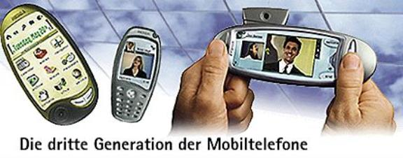
**Kép**: 3G (harmadik generációs) telefonok

## Nyilvános Földi Mobil Hálózatok
**Public Land Mobile Network = PLMN**

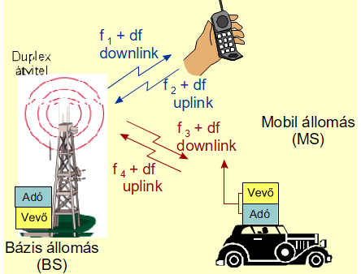
**Kép**: Földi mobil állomások

A PLMN hálózatokat generációkra osztották idő szerinti bevezetésüknek megfelelően: 1G, 2G, 3G, 4G, 5G, 6G.
Az [ITU](https://en.wikipedia.org/wiki/International_Telecommunication_Union)[^1]-R felügyeli a [3GPP](https://en.wikipedia.org/wiki/3GPP) [^7] és  az [ETSI](https://en.wikipedia.org/wiki/European_Telecommunications_Standards_Institute) [^2] kapcsolódó munkáját munkáját az [UMTS](https://en.wikipedia.org/wiki/UMTS), [LTE](https://en.wikipedia.org/wiki/LTE_(telecommunication)), [5G](https://en.wikipedia.org/wiki/5G) fejlesztések során  , amit összefoglalóan  Next Generation Mobile Networks  (NGMN)-nek neveznek .  Az IMT-2030[^6] meghatározza a jövő mobilrendszereinek teljesítménycéljait, és nyomon követi a [6G](https://en.wikipedia.org/wiki/6G) szabványosítását.

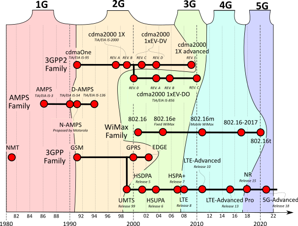
**Kép**: Mobile generációk

https://en.wikipedia.org/wiki/4G[^3]

**Kép**: 4G modem

https://en.wikipedia.org/wiki/5G[^4]

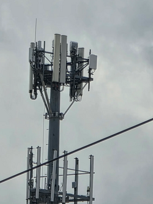
**Kép**: 5G mobil bázis állomás antenna rendszere

https://en.wikipedia.org/wiki/6G[^5]

___

## Land Mobile Network (LMN)

|                                 | DLMN                 | 1G                 | 2G                   | 2,5G                           | 3G (NGN)             | 4G                                                 | 5G                                         | 6G                                                      |
| ------------------------------- | -------------------- | ------------------ | -------------------- | ------------------------------ | -------------------- | -------------------------------------------------- | ------------------------------------------ | ------------------------------------------------------- |
| Jellemzők                    | DLMN                 | NMT                | GSM                  | GPRS                           | UMTS                 | LTE / LTE-Advanced                                 | 5G NR / IMT-2020                           | IMT-2030 / 6G                                           |
| Frekvencia sáv                  | 27MHz;150MHz; 450MHz | 450MHz             | 900MHz; 1800MHz      | 450MHz; 900MHz                 | 1,8GHz; 1,9GHz       | kb. 450 MHz–3,8 GHz                                | FR1: kb. 0,4–7,1 GHz; FR2: kb. 24–71 GHz   | sub-1 GHz-től 100 GHz fölötti tartományokig             |
| Átvitel jellege                 | Analóg               | Analóg             | Digitális/kódolt     | Digitális/kódolt               | Digitális/kódolt     | Digitális/kódolt                                   | Digitális/kódolt                           | Digitális/kódolt                                        |
|                                 | Simplex/Duplex       | Full duplex        | Full duplex          | Full duplex                    | Full duplex          | Full duplex, FDD/TDD                               | Full duplex, FDD/TDD                       | Várhatóan FDD/TDD és új duplex                          |
| Mod. Rendszer                   | AM; NB-FM            | NB-FM              | GMSK                 | CPM                            | WCDMA / DS-CDMA      | OFDMA (DL), SC-FDMA / DFT-s-OFDM (UL); QPSK–256QAM | CP-OFDM; QPSK–256QAM, UL-ban DFT-s-OFDM is | Még nincs végleges technológia; OFDM és MIMO-megoldások |
| Külső kapcsolat                 | Zárt (korlátozott)   | Nyitott (Országos) | Nyitott (Nemzetközi) | Nyitott (Nemzetközi)           | Nyitott (Nemzetközi) | Nyitott, nemzetközi                                | Nyitott, nemzetközi                        | Nemzetközi szabványosítás alatt                         |
| Hívás/hívhatóság                | Egyedi megoldások    | Telefon jellegű    | Telefon jellegű      | Adat jellegű                   | Internet jellegű     | VoLTE                                              | VoLTE, VoNR                                | Várhatóan IP-alapú, új szolgáltatások                   |
| Költségek                       | Saját fenntartás     | Szolgáltató/szla.  | Szolgáltató/szla.    | Szolgáltató/szla.              | Szolgáltató/szla.    | Szolgáltató /számlázott                            | Szolgáltató /számlázott                    | Várhatóan szolgáltatói rendszer                         |
| Titkosítás                      | Nincs                | Nincs              | Teljes               | Teljes                         | Teljes               | Igen                                               | Igen                                       | várhatóan AI- és kvantumrezisztens                      |
| Maximális elméleti adatsebesség | Nincs                | Nincs              | 9,6kbit/s            | 9,6;14,4;19,2;64 128;256kbit/s | ~2Mbit/s             | LTE: akár ~300 Mbit/s; LTE-A: akár ~1 Gbit/s       | IMT-2020: 20 Gbit/s DL, 10 Gbit/s UL       | Kutatási érték: 50–200 Gbit/s                           |

[1] https://en.wikipedia.org/wiki/LTE_frequency_bands

___

|          Távközléstörténet 2          |             ____________________             |       V2.26.3        |
| :-----------------------------------: | :------------------------------------------: | :------------------: |
|  |  **Távközléstörténet 2026 V2.26.3** |  |

---

# 2\. Átviteli módok

**Kép**: Földi mobil telefon állomások
Ahol df: sávszélesség, (pl.: 3,1 kHz)

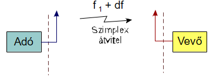
**Kép**: Szimplex átvitel elve

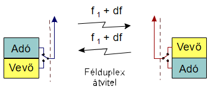
**Kép**: Félduplex átvitel elve

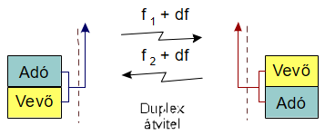
**Kép**: Duplex átvitel elve

## Elektromágneses hullámok terjedése

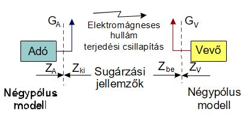
**Kép**: Sugárzási jellemzők

### Jellemzők:

- Az adó teljesítménye,
- A vevő helyén a teljesítménysűrűség, térerősség,
- Az adó és vevő közötti szakaszcsillapítás
- Polarizáció (E o  vektor iránya.)

Az optimális átvitel, a maximális vételi nyereség végfokozat-antenna és más illesztéseket igényel.

Az elektro-mágneses sugárzások csoportosítása:

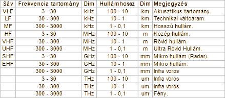

A mikrohullámú frekvenciasávok szokásos jelölése:

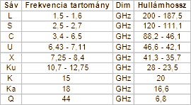

### GSM frekvenciák

#### A csatornakiosztás alapjai

- 890 MHz - 915 MHz (mobil adás)
- 935 MHz - 960 MHz  (bázis állomás adás)
- 124 csatorna, 200 kHz sávszélesség/csatorna
- Minden Rf vivőfrekvencia és időrés különböző célokra használható Fizikai-Logikai csatornák hozzárendelése

#### Fontosabb logikai csatornák:

- BCCH; Broadcast Control Channel
- Az adott hálózat és cella, illetve a szomszédos cellák adatait sugárzó csatorna 
- FCCH; Frequency Correction Channel
-  A mobil készülék frekvencia szinkronizálását segítő csatorna
- SCH; Synchronization Channel
- A mobil készülék keret szinkronizálását segítő csatorna

|          Távközléstörténet 2          |             ____________________             |       V2.26.3        |
| :-----------------------------------: | :------------------------------------------: | :------------------: |
|  |  **Távközléstörténet 2026 V2.26.3** |  |

---

# 3\. Antennák és hullámterjedés

**Kép**: Hullámterjedési jellemzők

A gyakorlatban az antennák közötti tér nem tekinthető ideálisnak, a légkör, a Föld felszíne, az éghajlati és időjárási jellemzők, a tereptárgyak, az építmények befolyásolják a hullámterjedést. Ezek a hatások a szakaszcsillapítás számításánál különböző modellekkel figyelembe vehetők
## Alapvető hullámterjedési módok és jelenségek

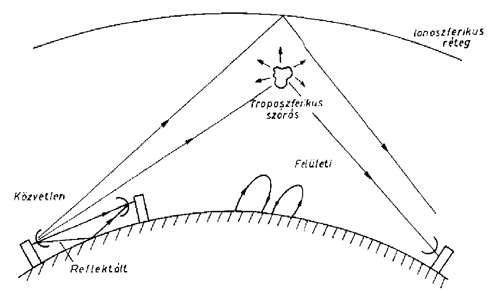
**Kép**: Hullámterjedési módok

## Antennakarakterisztikák és hullámterjedés

### Izotróp iránykarakterisztika

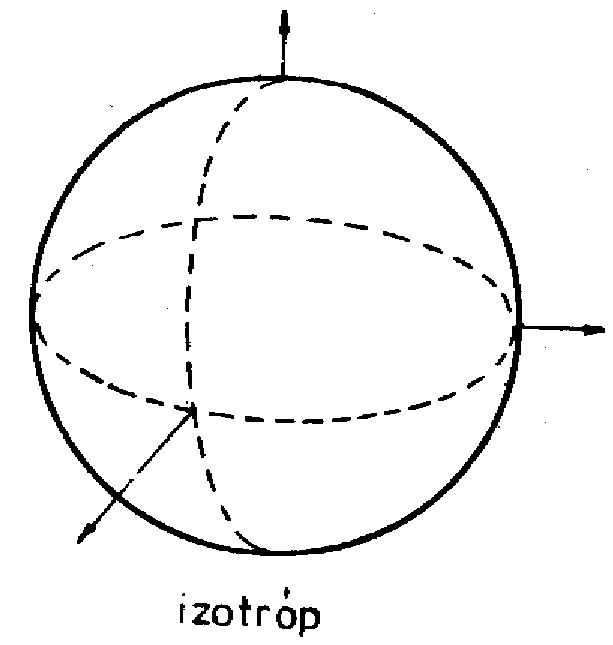
**Kép**: Izotróp (gömbszimmetrikus) antenna karakterisztika

- a tér minden irányában azonosan sugároz
- referenciaként használatos
gyakorlatban nem megvalósítható 

### Körsugárzó

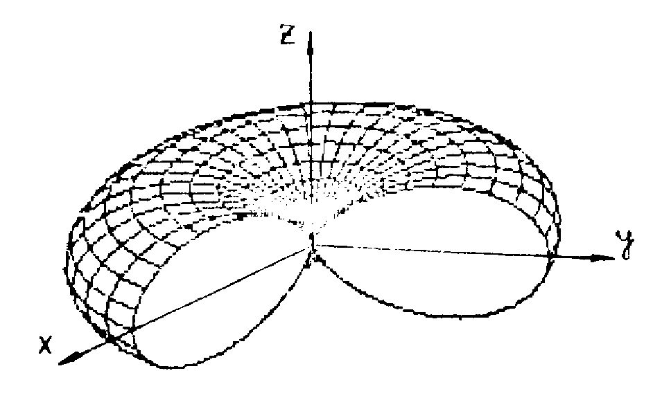
**Kép**:Körsugárzó antenna karakterisztika

- műsorszóró rendszerekben használatos
- a föld felszínen elhelyezkedő vevőket kiszolgálja, felfelé nem sugároz
### Tűnyaláb

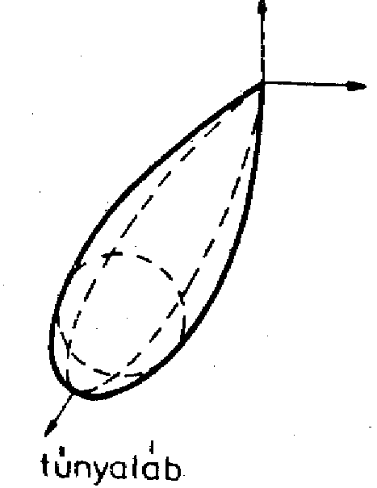
**Kép**: Tűnyaláb antenna karakterisztika

- pont-pont összeköttetésekben használatos

## Legyezőnyaláb

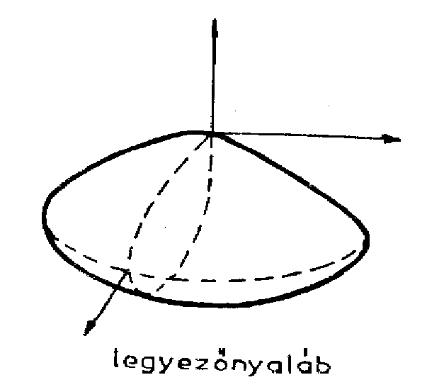
**Kép**: Legyezőnyaláb antenna karakterisztika

- egyik síkban keskeny, másikban széles nyaláb
- rádiólokátorokban használatos
- mozgatható antennával a célpont  keresésére és követésére alkalmas
- G3 Bázisállomás 120°-os antenna karakterisztika

## Forgalom méretezés 

A PSTN és a PLMN távbeszélő-hálózatokban gyakran tapasztalt felhasználói forgalmak:
Az erlangot (Erl) a CCITT 1949-ben határozta meg _a forgalom-elmélettel foglalkozó Erlang svéd matematikus_  tiszteletére.

- mobil, hordozható, kézi készülékek: 	 	 0,01-0,04 erlang
- mobil érmés, kártyás telefonállomás: 	 	 0,1-0,2 erlang
- állandóhelyű lakossági távbeszélő-állomás: 	 0,05 erlang
- állandóhelyű üzleti távbeszélő-állomás: 	 	 0,1 erlang
- állandóhelyű érmés, kártyás telefonállomás: 	 0,2-0,3 erlang
- alközponti vonal: 	 	 	 0,1-0,6 erlang.

>[!note] Irodalom
> 
>1. © dr. Dárdai Árpád, 1994. Cédrus Kiadó, 
>   2. bővített kiadás 1999. Nap Kiadó, 
>   3. bővített kiadás 2002.
>4. © Mobil Ismeret 2002. Azonosító: ISBN 963 440 996 2
>    
>5. TÁVKÖZLÉSTECHNIKAI KÉZIKÖNYV
>  FŐSZERKESZTŐ: DR. IZSÁK MIKLÓS  a műszaki tudományok kandidátusa egyetemi tanár
>  MŰSZAKI KÖNYVKIADÓ, BUDAPEST, 1979

### Alapfogalmak

**Foglaltság:**  valamely vonal igénybevétele tekintet nélkül arra,hogy a kapcsolat (beszélgetés) létrejött-e vagy sem.
**Tartási idő:**  az az időköz, ami alatt a vonal foglalt.
	 _Leggyakrabban. a beszélgetések átlagos tartási idejével (t.m ) számolunk._
A vonalnyaláb (röviden **nyaláb**):  egyidejűleg bizonyos számú, egymástól független hívás átvitelére képes, tekintet nélkül arra, hogy a nyalábon belül az összeköttetés melyik vonalon épül fel.
Egy nyaláb által tetszés szerinti időtartam alatt lebonyolított  **forgalom tömege (Q)**  egyenlő az órákban kifejezett tartásidők összegével.
$$Q=c\cdot t_m / 60 \space Erl\cdot h$$
	 	 Ahol _c_ az igénybevételek száma, $t_m$  az átlagos tartásidő percben.

Egy nyaláb által vitt  **forgalom**  nem más, mint a forgalomtömeg osztva a megfigyelés időtartamával.
$$y=c\cdot t_m / 60T \space Erl$$
	 	  Ahol _y_ a forgalom, _T_ a megfigyelési idő órában.

## Fresnel zónák

A hullámterjedés során a vétel, ill. a vevőantenna helyén több hullámösszetevő is megjelenhet, melyek különböző utakon jutnak a vevőbe.

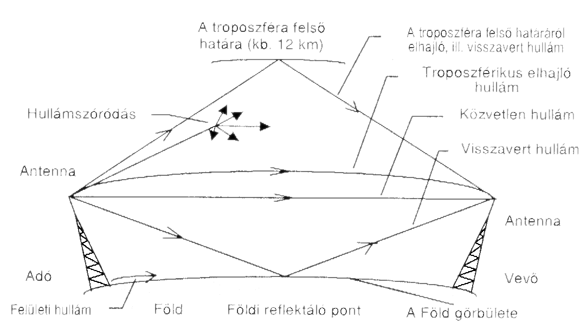
**Kép**: Hullám interferencia

A  Fresnel-zónák  azon pontok mértani helye a térben, amelyekről a visszaverődés  $\lambda / 2$ vagy többszörösei útkülönbséggel történik. A Fresnel-zónák átlátási egyenesre  (sugártengelyre) fektetett síkkal való metszetei ellipszisek.

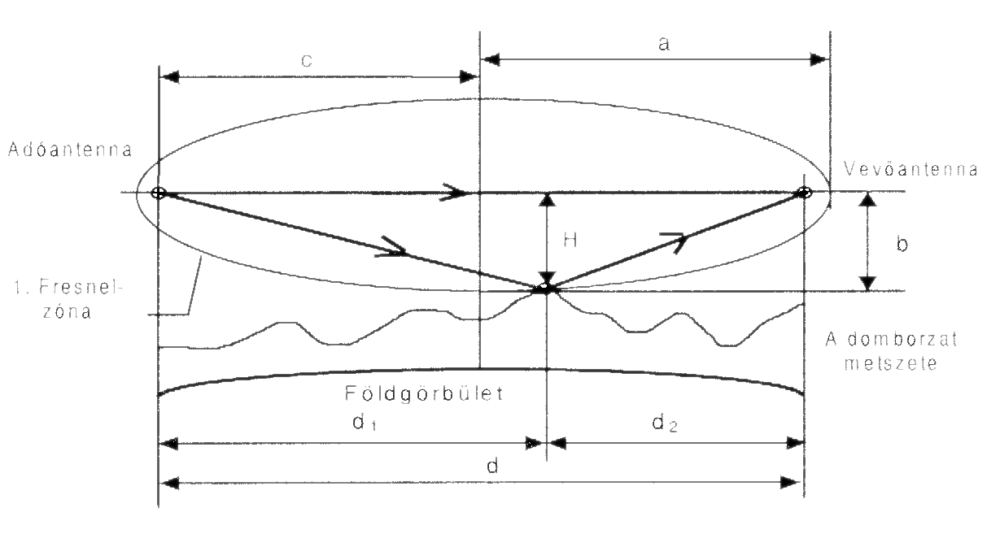
**Kép**: Fresnel ellipszis

### Megkülönböztetünk:

- akadálymentes, vagy szabad összeköttetést,
- részben takart összeköttetést,
- takart összeköttetést.

## Fading

A  fading  a térerősség értékének ingadozása a vételi helyen egy átlagérték körül.
A fading viselkedésére jellemző néhány paraméter:

- fading mélysége,
- fading gyakorisága,
- fading időtartama,
- fading gyakoriságának és időtartamának eloszlása.

Fadinget eredményezhet a légkör tulajdonságainak változása, a mozgó jármű dopler eltolódásának ingadozása, vagy a tereptárgyak mozgása is.
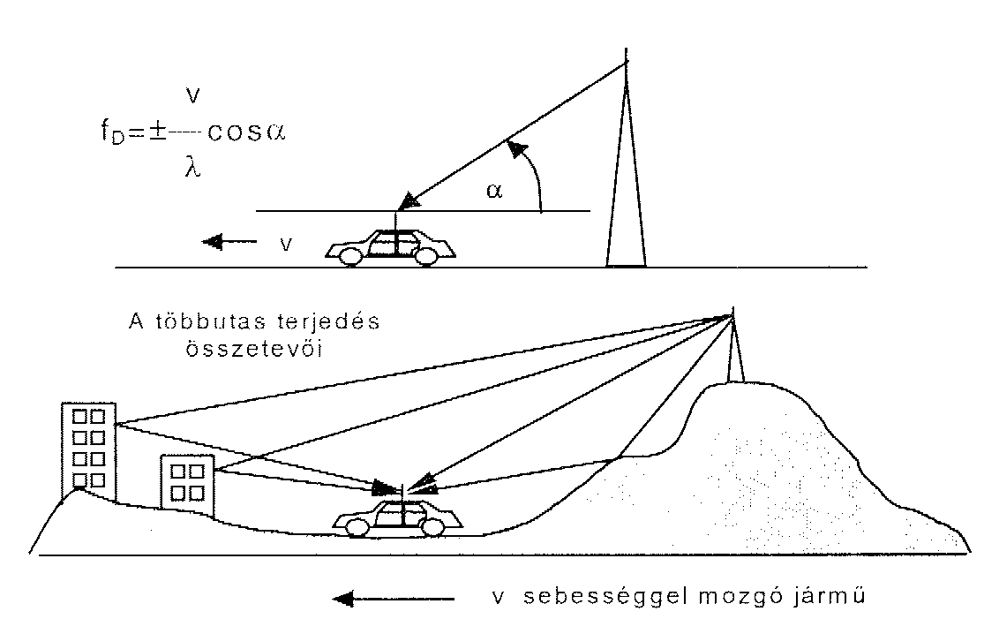
**Kép**: Fading keletkezése mozgó tárgyak hatására

„URH mobil sávokban a többutas fading összetevők átlagos késleltetése  $1 - 4\micro s$, a késleltetés szórása $0,5 - 3\micro s$, , és a Dopler-sávszélesség $50-500Hz$.

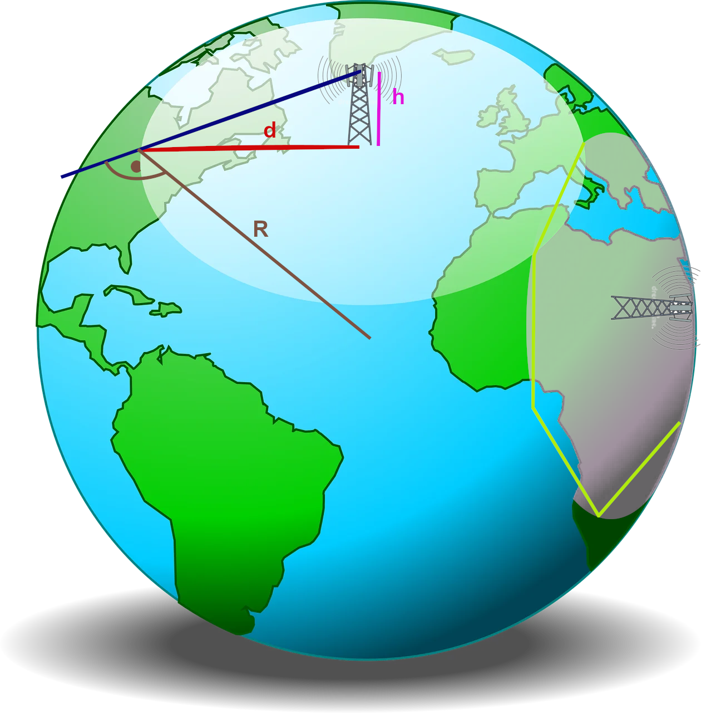
**Kép**: Rádiótorony (h:magasság, d:látóhatár, R:földsugár)

Megkülönböztetünk optikai látóhatárt ($d_0 [km]$), és rádió horizontot  ($d_r [km]$)).
Legyen $R_0$ a földsugár, és $R_e$ a  rádió egyenértékű földsugár. 
$$d_0=\sqrt{2R_0h}=3,57\sqrt h$$

Ekkor a $k=R_e /R_o$ arányszám esetén:
$$d_0=4,12\sqrt{h},\space\space ha\space \space k=4/3$$
$$d_0=3,57\sqrt{h},\space\space ha\space \space k=1$$
$$d_0=3,2\sqrt{h},\space\space ha\space \space k=4/5$$
Ahol _h_ az adótorony magassága, és méterben kell megadni.

|          Távközléstörténet 2          |             ____________________             |       V2.26.3        |
| :-----------------------------------: | :------------------------------------------: | :------------------: |
|  |  **Távközléstörténet 2026 V2.26.3** |  |

---

# 4\. Cellás mobil hálózat

A bázisállomás sík terepen kör alakú területet tud besugározni.
A kör sugarának felső határa a rádió horizont ($d_r$).

Egy adott terület több bázisállomással (BS) történő lefedésekor a körök átfedik kis mértékben egymást. Legjobb megoldás a hatszögletű cellás elv.
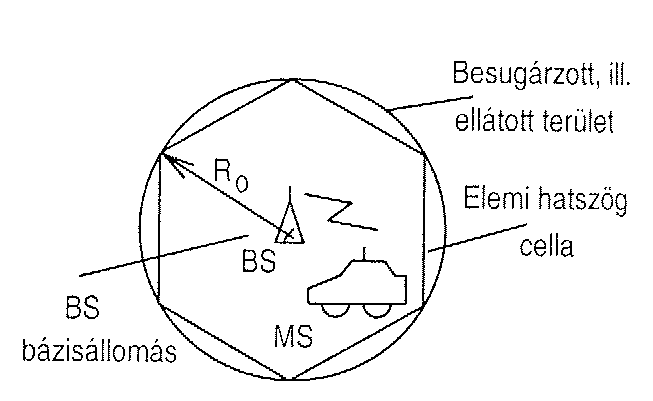
**Kép**: Mobilcella (cellaphone)

### A cellasugár sűrűn lakott területen (nagyvárosokban)

A mobil távközlést generációkra osztjuk (G1,G2,G3,G4,G5). Az egyes cellák sugara a forgalmi méretezés miatt kisebb, mint a rádióhorizont.

- 1G 	 $d_r$ =20-100km
- 2G 	 $d_r$ =1-30km
- 3G 	 $d_r$ =100m-1km
- 4G 	 ($d_r$ =10-100m) pikocella
## Handover

**Kép**: Mobilcella lefedettség 

A BS tornyokra általában 3 db irányított karakterisztikájú, 120°-os antennát szerelnek.
Ha az egész cella azonos frekvenciákat használ, akkor  omnicell.
Ha a cella 120°-onként eltérő frekvenciákat használ, akkor multicell -ről beszélünk.

Mozgás közben cellahatár átlépéskor a megszakadás nélküli összeköttetés-átadást  **handover -nek** nevezik.

## Roaming

- Az NMT rendszer működését a  mozgószolgálati kapcsolóközpont (MSC  - Mobile Services Switching Centre) vezérli.
- Az egyes MSC csomópont által ellátott terület helyzetkörzetekre van osztva. Egy helyzetkörzeten belül több cella létezhet.
- Minden cella közepén egy adótorony (BS) működik.
- Egy mobil készülék (MS) egy adott pillanatban csak egy adótoronnyal (BS) kommunikál.

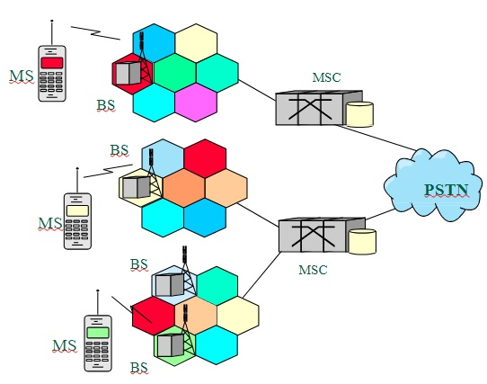
**Kép**: A cellás mobil hálózat felépítése

- A mozgóállomás (MS) mozgását egyik MSC körzetből a másikba bolyongásnak ( roaming ) nevezik.

- Minden egyes előfizető (MS) egy MSC-be van nyilvántartva. Ez a honos kapcsoló központja (MSC-H). Számára minden más MSC idegen (visited) kapcsoló központ (MSC-V).

## Hendover protokoll

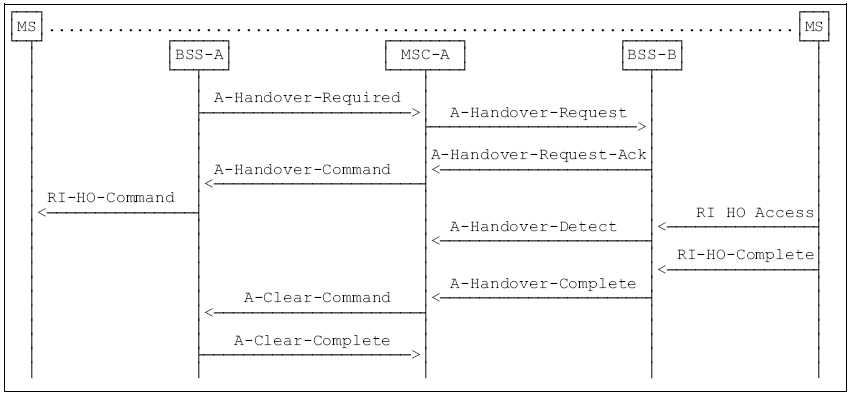
**Kép**: MS készülék átadása az A-cellából a B-cellába szolgáltatón (MSC) belül.

#  5\. GSM alapú mobil hálózat (3G)[^8]

A GSM négy alrendszerből épül fel:
- mobil állomás (MS, Mobile Station),
- bázisállomás alrendszer (BSS, Base Station Subsystem),
- hálózati és kapcsoló alrendszer (NSS, Network and Switching Subsystem),
- üzemviteli és karbantartó alrendszer (OSS, Operation and Maintenance Subsystem).

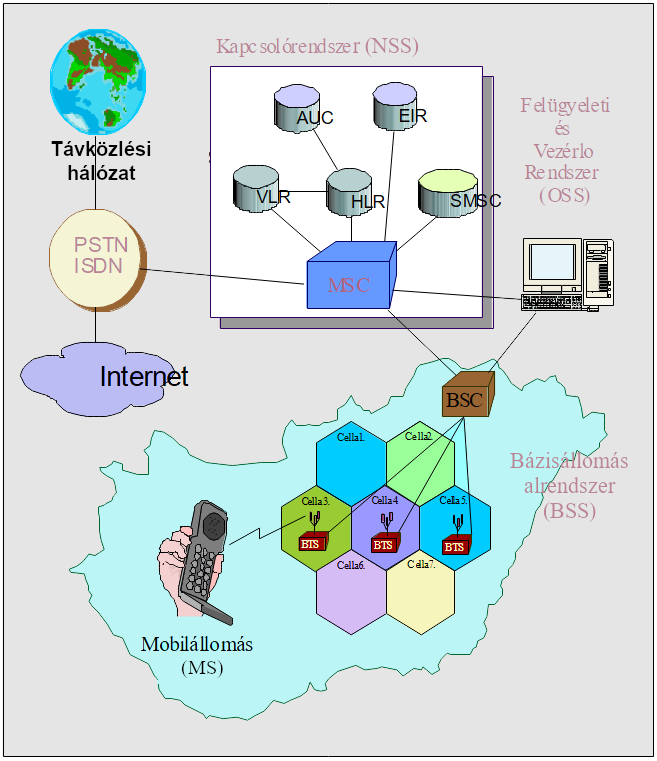
**Kép**: A 3G hálózat felépítése

- Az MSC-k SS7 jelzésrendszerrel kommunikálnak egymással, és más PSTN telefonközponttal.

## A BTS felépítése [^9]

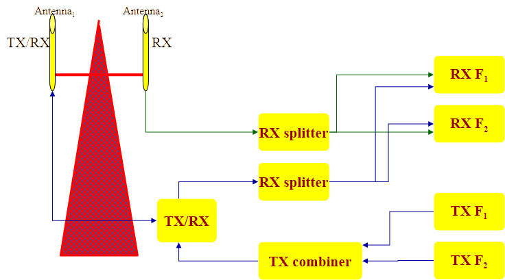
**Kép**: A BTS (Base Transceiver Station) működési ábrája

- egyetlen körsugárzó cella
- Két adás- és vételi frekvencia

## GSM protokoll rendszer (3G)

A mobil készüléktől (MS) az MSC-ig a jelzéseket és a beszédtuvábbítást is az ITU által előírt szabványok határozzák meg.

**Kép**: A 3G hálózat jelzéstovábbítási és adattovábbítási protokolljai

**Új jelölések:**
	RR: Radio Resource Management Protocoll
	MM: Mobility Management Protocoll
	CM: Connection Management
	BTSM: BTS Management
	BSSAP: BSS Aplication Part

## Handover protokolja

Intra-MSC handover

**Kép**: MS állomás átadása A-cellából B-cellába szolgáltatón (MSC) belül.

## Roaming protokolja

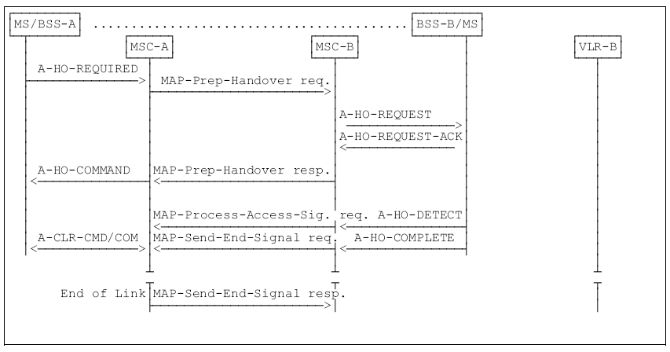
**Kép**: MS állomás átadása MSC-A -tól MSC-B -nek, és az MS bejegyzése a VLR-B-be "eszközkapcsolat" nélkül.

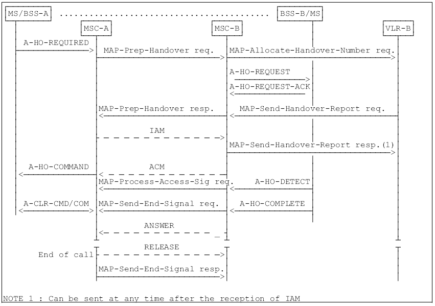
**Kép**: MS állomás átadása MSC-A -tól MSC-B -nek, és az MS bejegyzése a VLR-B-be "eszközkapcsolattal".

|          Távközléstörténet 2          |             ____________________             |       V2.26.3        |
| :-----------------------------------: | :------------------------------------------: | :------------------: |
|  |  **Távközléstörténet 2026 V2.26.3** |  |

---

# 6\. GPRS alapú hálózat (4G) [^10]

A GPRS hat alrendszerből épül fel:
- mobil állomás (MS, Mobile Station),
- bázisállomás alrendszer (BSS, Base Station Subsystem),
- hálózati és kapcsoló alrendszer (NSS, Network and Switching Subsystem),
- üzemviteli és karbantartó alrendszer (OSS, Operation and Maintenance Subsystem),
- GPRS támogató központ (SGSN, Serving GPRS Support Node),
- GPRS átjáró (GGSN, Gateway GPRS Support Node),

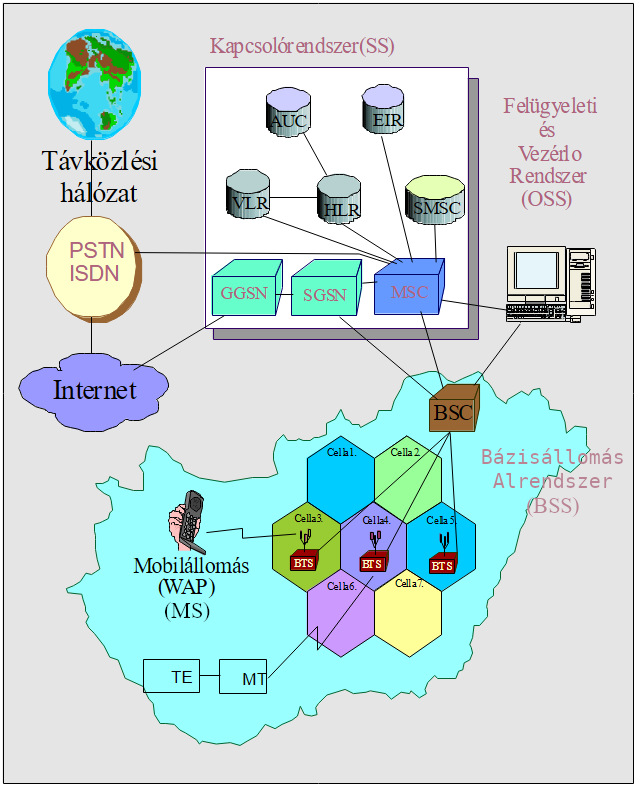
**Kép**: A 3G hálózat felépítése

- Az MSC-k SS7 jelzésrendszerrel kommunikálnak egymással, és más PSTN telefonközponttal.
- A hálózat az Internet hozzáférést GPRS Gateway-ek segítségével biztosítja a nemzetközi Internet hálózat és a felhasználói Mobile Terminal (MT) között.
## GPRS protokoll rendszer

A hálózati protokoll nem különbözik a 3G hálózat protokoljától, mert az internet csomagokat az adatátviteli csomagokban továbbítja.

## GPRS handover

A beszédátadás megegyezik a 3G-nél bemutatottal, de 4G-ben esetenként az adatkapcsolatot is át kell adni.

### Data Session

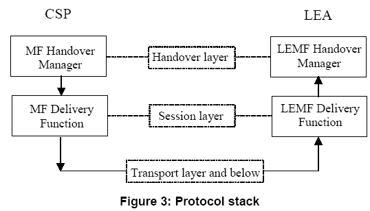
**Kép**: A 4G protokoll stack-je

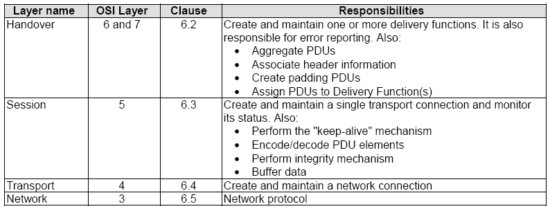
**Kép**: A 4G handover OSI előírása
### IP átadás 

Figure 6: The (note) User Control functional element and the registration/roaming information flows adapted to the TIPHON scenarios 1 and 2

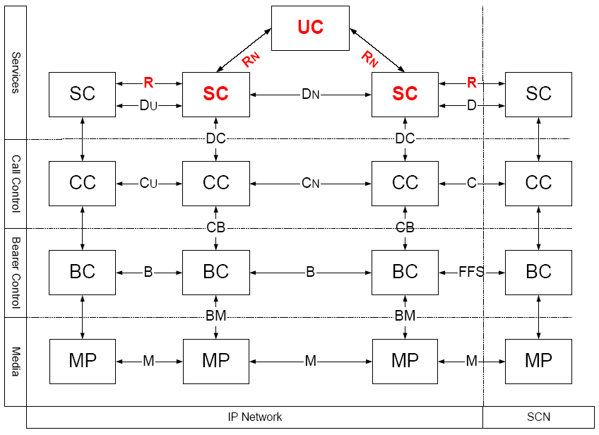
**Kép**: A 4G IP handover

## GPRS, UMTS roaming , külső átadás 

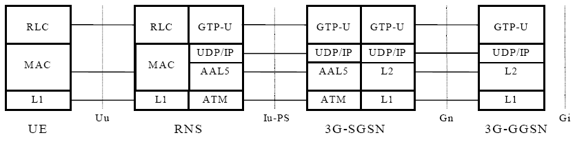
**Kép**:  GPRS Gn Interface within UMTS

|          Távközléstörténet 2          |             ____________________             |       V2.26.3        |
| :-----------------------------------: | :------------------------------------------: | :------------------: |
|  |  **Távközléstörténet 2026 V2.26.3** |  |

---

# 7\. UMTS alapú hálózat (5G) [^11]

Az UMTS alrendszerei:
- CSCF (Call State Control Function),
- E-GGSN (Enhanced Gateway GPRS Support Node),
- MGCF (Media Gateway Control Function),
- MGW (Media Gateway),
- UE (User Equipment),
- ERAN (Enhanced Radio Access Network),
- SGW (Signalling Gateway),
- E-SGSN (Enhanced Serving GPRS Support Node),
- E-HLR (Enhanced Home Location Register),
- UTRAN (UMTS Terrestrian Radio Access Network),

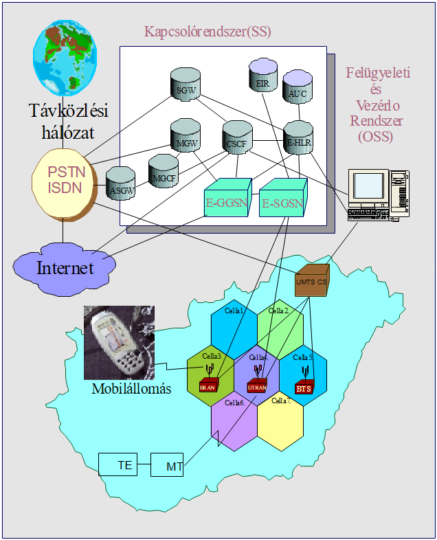

|          Távközléstörténet 2          |             ____________________             |       V2.26.3        |
| :-----------------------------------: | :------------------------------------------: | :------------------: |
|  |  **Távközléstörténet 2026 V2.26.3** |  |

---

# 8\. Közös csatornás hálózati jelzés

A közöscsatornás jelzéstechnika alapgondolata, hogy a jelzések és a híranyagok továbbításának módja és esetenként útvonala is eltér egymástól. A jelzéseket külön, nagysebességű digitális jelzés-összeköttetéseken (jelzőcsatornán) továbbítják csomagkapcsolt üzenetekben.

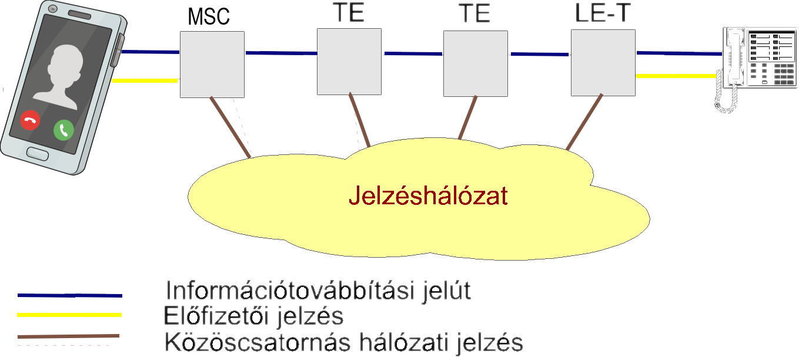
**Kép**: A központok közötti nemzetközi jelzéshálózat

A jelzéshálózatot az X.25 protokoll alapján építették fel és a 7.generáció lett szabványos (SS7), míg a híranyagok digitálisan továbbítódnak szinkron digitális hálózatban (SDH).
## SS7 mobil-jelzésrendszer kapcsolata
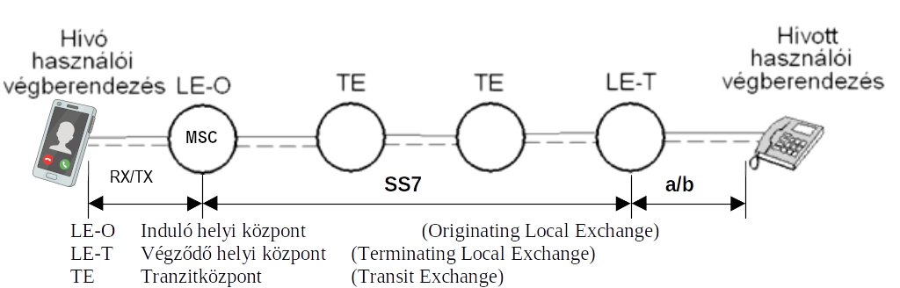
**Kép**: Az Ensz ITU által javasolt **Numero 7** (Signalling System 7) nemzetközi szabvány

**Kép**: Az SS7, hét rétegű jelzésrendszer rétegei/szintjei

- Fizikai/elektronikai megvalósítás (MTP - M Telephony Protokol)
Az analóg beszédsáv 300Hz-3400Hz frekvenciatartományban 0dB csillapítással továbbítódik, míg azon kívül a 0Hz-4kHz tartományban -40dB a csillapítás.

**Ezek a következők:**
- Jelzésösszeköttetés-vezérlés (SCCP - Signalling Connection Control Part)
- Tranzakciós képességek (TCAP - Transaction Capabilities)
- Mobil alkalmazások (MAP - Mobile Application Part)
- Üzemviteli és fenntartási egység (OMAP - Operation and Maintenance Application Part)
- IN-alkalmazási egység (INAP - Intelligent Network Application Part) 

|          Távközléstörténet 2          |             ____________________             |       V2.26.3        |
| :-----------------------------------: | :------------------------------------------: | :------------------: |
|  |  **Távközléstörténet 2026 V2.26.3** |  |

---

# 9\. MS, mobilállomás [^12]

MS;  Mobile station; A mobil készülék

Egy mobilállomás ( MS )  magában foglalja az összes felhasználói berendezést és szoftvert , amely a mobilhálózattal való kommunikációhoz szükséges .

A kifejezés a mobilhálózathoz csatlakoztatott globális rendszerre utal, azaz egy mobil szélessávú adapterrel csatlakoztatott mobiltelefonra vagy mobil számítógépre . Ez a 2G rendszerek, például a GSM terminológiája . A 3G rendszerekben a mobilállomást (MS) ma már felhasználói berendezésnek (UE) nevezik .

### GSM-ben egy mobilállomás négy fő összetevőből áll:

- **Mobil Termination (MT)** – olyan gyakori funkciókat kínál, mint: rádióátvitel és -átadás , beszédkódolás és -dekódolás , hibaészlelés és -javítás , jelzésátvitel és a SIM-kártyához való hozzáférés. Az IMEI- kód az MT-hez van csatolva. Ez egyenértékű az ISDN- hozzáférés hálózati termináljával .
- **Végberendezés (Terminal equipment=TE)** – bármely olyan eszköz, amely az MS-hez csatlakozik, és szolgáltatásokat nyújt a felhasználónak. Nem rendelkezik a GSM-re jellemző funkciókkal.
- **TerminálAdapter (TA)** – hozzáférést biztosít az MT-hez, mintha egy kibővített képességekkel rendelkező ISDN hálózati végpont lenne. A TE és az MT közötti kommunikáció a TA-n keresztül **_AT[^13] parancsok_** segítségével történik .
- **Előfizetői azonosító modul (Subscriber Identity Module=SIM)** – egy eltávolítható előfizetői azonosító token, amely az IMSI-t , a mobilhálózat-üzemeltetővel megosztott egyedi kulcsot és egyéb adatokat tárolja.

A mobil állomások fogyasztása az \"osztály\"-tól függ. Ezek a következőképpen lettek meghatározva:

1. osztály \* 	 20W 	 jármű vagy hordozható
 2. osztály 	 8W 	 jármű vagy hordozható
 3. osztály 	 5W 	 jármű vagy hordozható
 4. osztály 	 2W 	 kézi
 5. osztály \* \* 	 0, 8 W 	 kézi

\* Nincs forgalomban. 	 	

\*\* Az ilyen készülék vásárlása nem ajánlott, a hálózathoz való korlátozott hozzáférés miatt.  

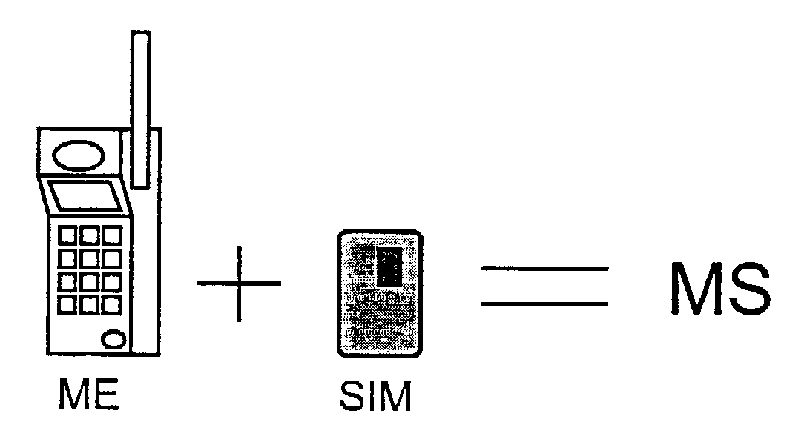
**Kép**: 1G, 2G és korai 3G (MS) mobilállomás

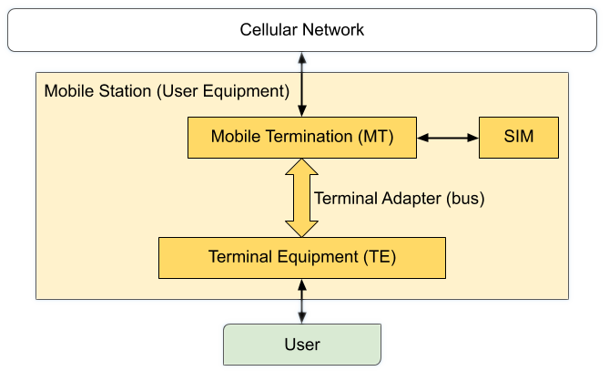
**Kép**: 3G, 4G, 5G és korai 6G (UE) mobilállomás

## Mobilállomás azonosítók

### Hívószám

SIM kártyán tárolt nemzetközi hívószám.

- MSISDN  Mobile Station ISDN Number = CC + NDC + SN

- CC = Country Code 	 	 	 (Pl.: +36)
- NDC = National Destination Code 	 (Pl.: 30 = T-Mobile)
- SN = Subscriber Number 	         (Pl.: 1234567)

### Felhasználói azonosító [^14]

SIM kártyán tárolt 15 digites előfizetői azonosító.
- IMSI  International Mobile Subscriber Identity=MCC + MNC + MSIN

- MCC = Mobile Country Code 	                         (3 digit)	 	(Pl.:216)
- MNC = Mobile Network Code                          (2-3 digit)	(Pl.: 30)
- MSIN = Mobile Station Identification Number (9-10 digit)	(Pl.: 1234567890)
### Készülék azonosító [^15]

A készülékben tárolt gyári azonosító.
- IMEI  International Mobile Equipment Identity = TAC + FAC + SNR + (SP), CD

- TAC = Type Approval Code
- FAC = Final Assembly Code
- SNR = Serial Number 	 	 	 	
- SP = Spare Digit
- CD = Check Digit

## A mobil állomás működése

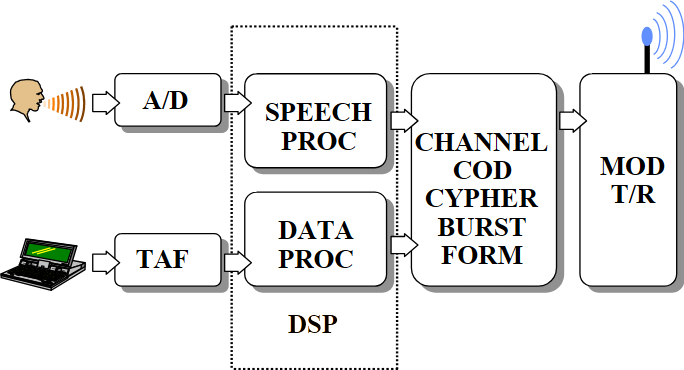
**Kép**: 3G (MS) mobilállomás működési blokkvázlata

|          Távközléstörténet 2          |             ____________________             |       V2.26.3        |
| :-----------------------------------: | :------------------------------------------: | :------------------: |
|  |  **Távközléstörténet 2026 V2.26.3** |  |

---

# 10\. Beszédfeldolgozás a mobil készülékben

## Mobil készülékek kódolói

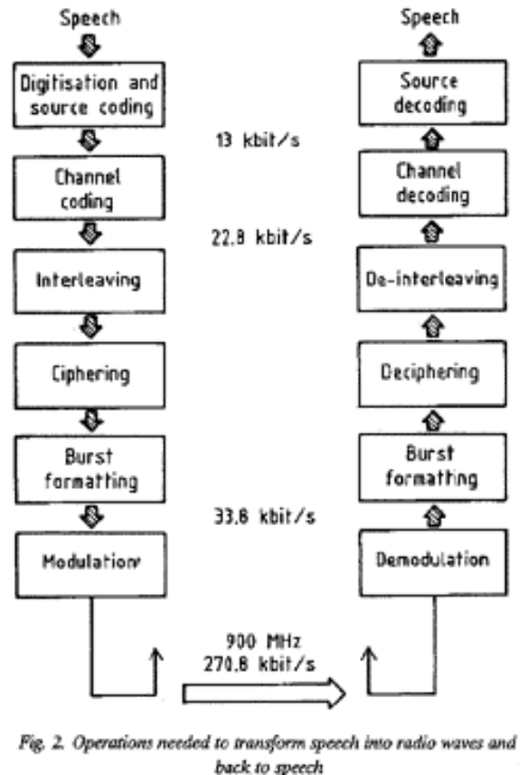
**Kép**: 3G (MS) beszédtovábbítás

## Beszédfeldolgozás MS készülékben

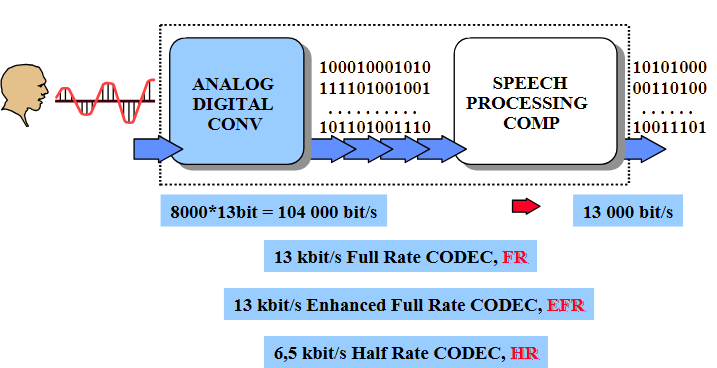
**Kép**: 3G (MS) beszédtömörítés és kódolás

|          Távközléstörténet 2          |             ____________________             |       V2.26.3        |
| :-----------------------------------: | :------------------------------------------: | :------------------: |
|  |  **Távközléstörténet 2026 V2.26.3** |  |

---

# 11\. Short Message Sending (SMS)

A Rövid Üzenetküldő Szolgáltatás ( Short Message Sending = SMS ) egy többnyire fizetős szöveges üzenetküldő szolgáltatás, amely a legtöbb telefon- , internetes és mobil eszközrendszer részét képezi.
A GSM- szabványok részeként kifejlesztett és az SS7 jelzésprotokollon alapuló SMS 1993-ban indult a digitális mobilhálózatokon , és eredetileg arra szolgált, hogy az ügyfelek értesítéseket kapjanak a szolgáltatójuktól /üzemeltetőjüktől . A szolgáltatás lehetővé teszi a felhasználók számára, hogy legfeljebb 160 karakteres szöveges üzeneteket küldjenek és fogadjanak.[^16]
## Mobil SMS küldés

 
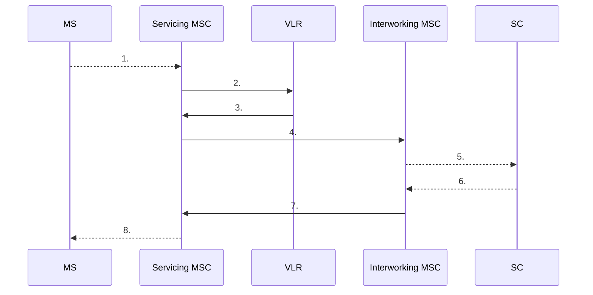
**Kép**: Mobil SMS küldés MS-ről SMSC-be.
### Magyarázat
- Indító oldalon a kiszolgáló MSC megkapja az SMS-t (1).
- Ezután az MSC a VLR-hez fordul, ahonnan lekérdezi a küldő fél jogosultságát SMS küldéshez (2).
- Ha a lekérdezés eredménye sikeres, az MSC elküldi az SMS-t a mobil SMS központba (SMSC) közvetlenül ha lehet, ha így nem megy, interworking MSC-n keresztül (4, 5). 
- Az SMSC nyugtázza a vételt az MSC-nek közvetlenül vagy az interworking MSC-n keresztül (6, 7).
- Az MSC nyugtázza az SMS küldést az előfizető felé (8).

## Mobil SMS vétel

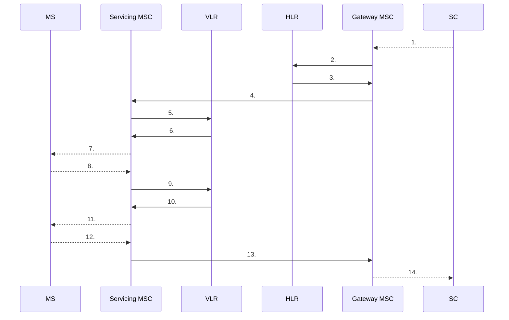
**Kép**: Mobil SMS küldés SMSC-ből MS-re.
### Magyarázat
- A mobil végződő oldalon az SMSC-tol a gateway MSC megkapja az SMS-t (1).
- Ez az MSC lekérdezi a HLR-t, hogy hol található az SMS címzettje (2).
- A kapott információ (3) alapján az SMS-t továbbítja a megfelelő MSC-nek (4).
- Az megkérdezi a VLR-t, hogy a címzett tényleg ott van-e, tud-e SMS-t fogadni (5).
- Ha minden rendben, elindul az előfizető keresési folyamat (6, 7,8, 9).
- Ha a végállomást sikerül megtalálni (10), az MSC kiküldi neki az SMS-t (11).
- Az SMS vételéről az SMSC nyugtát kap (12, 13, 14). 

## Fix-SMS elve

ISDN/PSTN (analóg) hívószám kijelzés megléte kötelező.

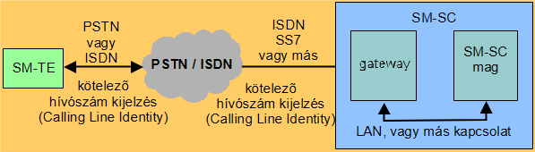
**Kép**: SMS küldés ISDN készülékre, vagy karakteres kijelzésre képes PSTN készülékre.

Ha PSTN oldalon nincsüzenet kijelzésre alkalmas készülék, akkor egy hang-gateway (Text-to-Speach gateway) segítségével telefonhívásként felolvassa a gép a küldött szöveget a címzettnek. Ebben az esetben az előfizető nem tud SMS-t küldeni, csak venni.
## MMS

A multimédiás üzenetküldő szolgáltatás (**Multimedia Messaging Service** = MMS ) egy szabványos módja multimédiás üzenetek küldésének mobiltelefonról mobiltelefonra mobilhálózaton keresztül. Az MMS szabvány kibővíti az SMS (rövid üzenetszolgáltatás) alapvető képességét, lehetővé téve a 160 karakternél hosszabb szöveges üzenetek cseréjét.[^17]

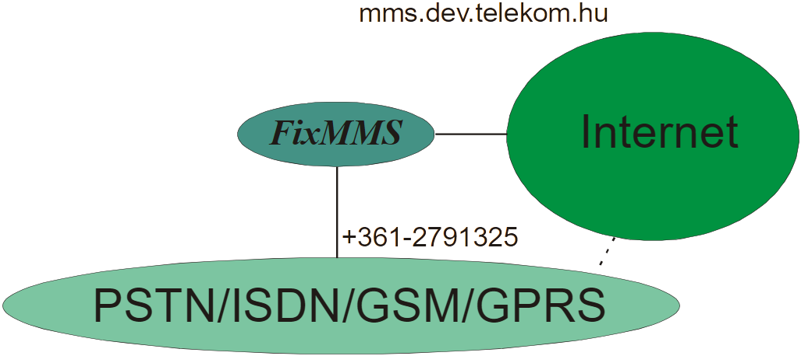
**Kép**: SMS fejléc segítségével multimédia fájlok küldhetők MMS üzenetben. 

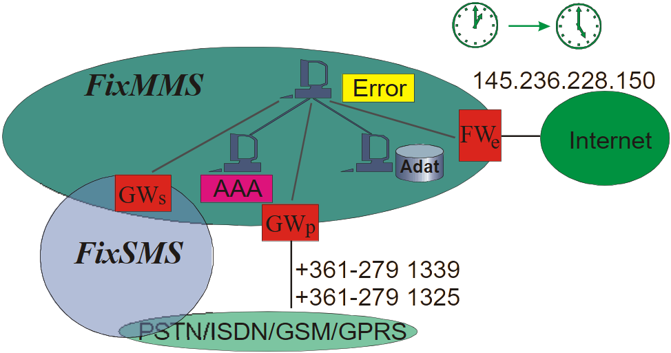
**Kép:** Magyarországon lehetővé vált ISDN/PSTN vonalról is küldeni MMS-t a Fix SMS szerver segítségével. 

|          Távközléstörténet 2          |             ____________________             |       V2.26.3        |
| :-----------------------------------: | :------------------------------------------: | :------------------: |
|  |  **Távközléstörténet 2026 V2.26.3** |  |

---

# 12\. VoIP

A beszédtovábbítás lehetőségének tárgyalása előtt Internet hálózaton célszerű felfrissíteni a tudásunkat az Internetről.

Az **Internet** összekapcsolt számítógépes hálózatok globális rendszere , amely az internetprotokoll-csomagot (**TCP/IP**) használja a hálózatok és eszközök közötti kommunikációhoz. Ez egy olyan hálózat, amely helyi és globális hatókörű magán- , állami, akadémiai , üzleti és kormányzati hálózatokat foglal magában , amelyeket elektronikus , vezeték nélküli és optikai hálózati technológiák kötnek össze.[^18]
## Az ARPANET célkitűzése

Az '50-es és '60-as évek hidegháborús helyzete miatt az Amerikai Egyesült Államok katonaságának egy olyan hálózat létrehozása volt a célja, amelyikben ha bármelyik csomópontot kiiktatják, attól a hálózat többi eleme még működőképes legyen!

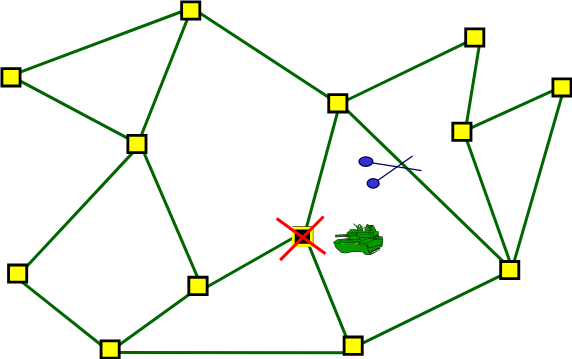

**Kép:** ARPANET követelmény

Minden csomópontnak legalább 2 összeköttetése legyen, így bármelyik összeköttetés megszakad, kerülőutakon elérhetők még a berendezések.

Mai hatások  (Best effort jelleg):

- Torlódás esetén kerülő utat keresnek az útválasztók.
- A csomagok sorrendje nem garantált.
- A késleltetési idő változik.
- Különböző kapcsolatok más-más úton épülhetnek fel (pl. oda-vissza irány eltér).

## Számítógépes hálózatok általános felépítése

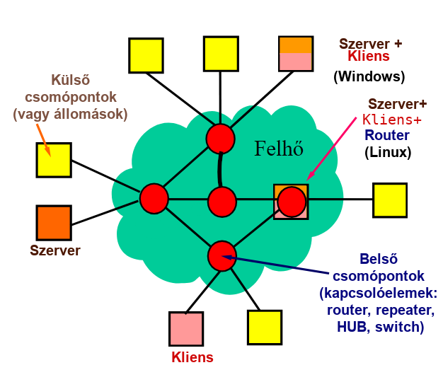
**Kép:** Internethálózat elemei

## IPV4 hálózatok címformátuma 

### RFC 791 cím:

32 bites = 4 bájtos
**Formátuma:**
Pontokkal elválasztott decimális számok,
	Pl.: 10.38.2.240

A címeket osztályokba sorolták.

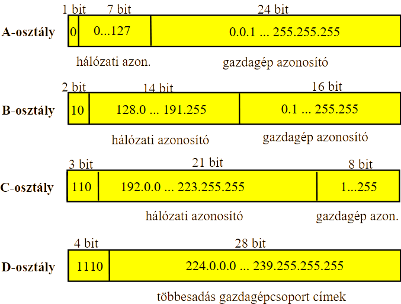
**Kép:** IP-V4 címosztályok

## IP-V4 Route és NAT

A router a címosztálynak megfelelő maszkolással dönti el, hogy a csomagot hova kell továbbítania, WAN felé, vagy LAN felé [^19].

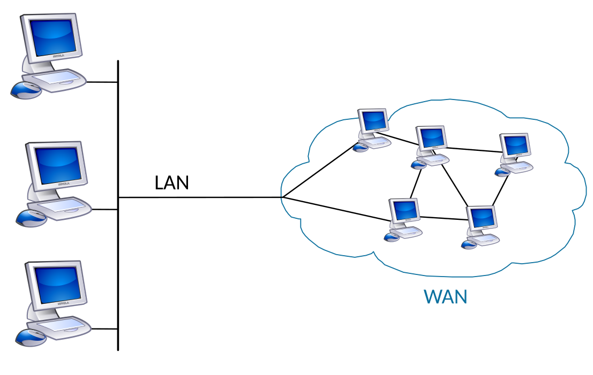
**Kép:** Internet WAN és LAN [^19]

**Kép:** IP-V4 rout-olás maszk alapján

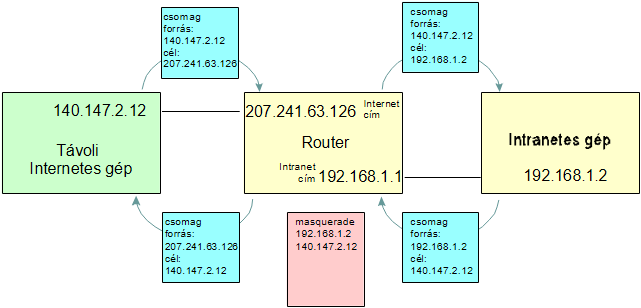
**Kép:** IP-V4 NAT-olás (címfordítás) maszk alapján

## Internet hálózati összeköttetés eszközei

- Átjáró (Gateway) (GW),
- Helyettesítő kiszolgáló (pl. Proxy),
- Útválasztó vagy Átjáró (Router vagy Gateway)
- Híd vagy Kapcsoló (Bridge vagy Switch)
- Ismétlő vagy Elosztó (Repeater vagy HUB)

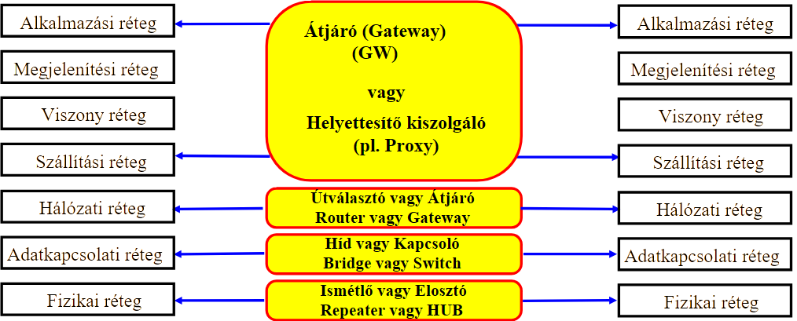

**Kép:** Internet az  Open Systems Interconnection -  OSI  koncepció  szerint

## SS7 & Voice over Internet Protocols (VoIP)

RFC 0760 DoD standard Internet Protocol. J. Postel. Jan-01-1980. 
RFC 0791 Internet Protocol. J. Postel. Sep-01-1981. 

**Kép:** SS7 és IP protokollok összehasonlítása
## VoIP Elméleti alapok

Az analóg jeleket csomagkapcsolt hálózaton csak úgy lehet továbbítani, ha a vételi oldalon pufferbe tároljuk le a vett csomagokat, és azt időkésleltetéssel folyamatosan játszok le (alakítjuk analóg jellé). A csomagok mérete, a puffer mérete erősen befolyásolja a késleltetést, és az átvitel minőségét.

**Kép:** Folyamatos beszéd átvitele csomagkapcsolt hálózaton

Az ITU-T szabványok közül emeljünk ki hármat:
- ITU-T G.711 [^20]
- ITU-T G.723 [^21]
- ITU-T G.720 [^22]
Ezeket hasonlítsuk össze, ha IP csomagonként 10-,20-,30-,60 msec analóg jelet továbbítunk!

**Kép:** Táblázat átviteli sebesség, hatásfok és késleltetés számításokhoz

## G.711 Half duplex protokoll

Half duplex átvitel 10Mbit/sec sebességű coax Internet kábelen azt jelenti, hogy egyszer az adó ad, másszor a vevő, de egyszerre csak egyik.
G.711 kódolás esetén 30ms hanganyag 240 bájt/oktet információt jelent (hasznos teher). A fej-, és lábrészekkel kiegészítve az IP csomag mérete 314 báj/oktet. 10Mbit/s hálózaton ez átvihető 0,26 ms alatt.

Ez azt jelenti, hogy 64kbit/sec fulduplex átvitelhez min. 172 kbit/sec sávszélességet kell biztosítani! A késleltetés 2-10 ms alatt tartható (a puffermérettől függően).

A hatásfok: $$\eta = \frac{240/2}{314+8}=37,27\% $$
## SIP: Session Initiation Protocol 

A **Session Initiation Protocol** ( **SIP** ) egy jelzőprotokoll amelyet multimédiás elemeket, például hangot, videót és üzenetküldést tartalmazó Internetes kommunikációs munkamenetek kezdeményezésére, fenntartására, módosítására és leállítására használnak .[^23]

**RFC 3261 SIP**: Session Initiation Protocol. J. Rosenberg, H. Schulzrinne, G. Camarillo, A. Johnston, J. Peterson, R. Sparks, M. Handley, E. Schooler. June 2002. (Obsoletes RFC2543) (Updated by RFC3265)

**Kép:** SIP session setup example with SIP trapezoid

## VoIP

**A Voice over Internet Protocoll** ( **VoIP** ),  más néven **IP-telefónia , elsősorban** az internetprotokoll (IP) hálózatokon, például az interneten keresztüli hangkommunikációs munkamenetekhez használt technológiák összessége .[^24]
**Az internetes telefonálás** , a szélessávú telefonszolgáltatás tágabb értelemben vett változata a hang- és egyéb kommunikációs szolgáltatások, például fax , SMS és hangüzenetek interneten keresztüli nyújtására utalnak , szemben a hagyományos nyilvános kapcsolt telefonhálózattal (PSTN).
A VoIP technológiát adaptálták a mobilhálózatokba , ami fejlett rendszerek kifejlesztéséhez vezetett. Ezek közé tartozik a 4G hálózatok részeként bevezetett **Voice over LTE**[^25] VoLTE ( [VoLTE](https://en.wikipedia.org/wiki/VoLTE "VoLTE") ), és a Voice over 5G ( [Vo5G](https://en.wikipedia.org/wiki/Vo5G "Vo5G") ).

|          Távközléstörténet 2          |             ____________________             |       V2.26.3        |
| :-----------------------------------: | :------------------------------------------: | :------------------: |
|  |  **Távközléstörténet 2026 V2.26.3** |  |

---

# 13\. Bluetooth

**A Bluetooth** egy rövid hatótávolságú vezeték nélküli technológiai szabvány, amelyet vezetékes és mobil eszközök közötti rövid távolságú adatcserére, valamint személyi hálózatok (PAN) kiépítésére használnak. A legszélesebb körben használt módban az átviteli teljesítmény 2,5 milliwattra korlátozódik, ami nagyon rövid, akár 10 méteres (33 láb) hatótávolságot biztosít .[^26]

**Kép:** Bluetooth pikohálózat

A Bluetooth szabványt a Bluetooth Special Interest Group (Bluetooth SIG) kezeli.

**Kép:** Frequincy Shift Keying (FSK) elve

**Kép:** Frequincy Shift Keying (FSK) nulla átmenet hibája

A Bluetooth GFSK - modulációt alkalmaz[^27] (Gaussian Frequency Shift Keying), BT = 0,5-es paraméterrel. A modulációs index 0,28 és 0,35 között lehet. A GSFK lényege, hogy a bináris 1-et pozitív, míg a bináris 0-át negatív frekvencia eltérés jelenti.
A Bluetooth UHF rádióhullámokat használ az [ISM sávokban](https://en.wikipedia.org/wiki/ISM_band "ISM band") , 2,402 GHz -től 2,48 GHz-ig.

## Bluetooth protokollok

**Kép:** A Bluetooth rendszer rétegszerkezete

A Bluetooth protokollok négy rétegbe sorolhatóak be, a rendszer működésében betöltött szerepük és a Specifikáció "eredetisége"-től függően.

**Kép:** A Bluetooth rétegek protokolja
## Bluetooth pikohálózat

**Kép**: Időrések a Bluetooth rendszerben

|          Távközléstörténet 2          |             ____________________             |       V2.26.3        |
| :-----------------------------------: | :------------------------------------------: | :------------------: |
|  |  **Távközléstörténet 2026 V2.26.3** |  |

---

# 14\. 🛰️ Űrtávközlés

A **műhold** vagy **satellite** egy objektum, jellemzően űrhajó , amelyet egy égitest körüli pályára állítanak . Számos felhasználási területe van, beleértve a kommunikációs közvetítést, az időjárás-előrejelzést , a navigációt ( GPS ), a műsorszórást , a tudományos kutatást és a Föld megfigyelését. További katonai felhasználási területei a felderítés, a korai figyelmeztetés , a jelfelderítés és potenciálisan a fegyverek szállítása.[^28]
## Műholdpályák

A műholdpályák (orbit)[^29] két test tömegének vonzása hatására alakuénak ki. A tömegközéppontok mozgását a Kepler törvények írják le. Amikor két test gravitációs kölcsönhatásba lép, pályáik [kúpszeletet](https://en.wikipedia.org/wiki/Conic_section "Kúpszelet") követnek .

**Kép**: Kúpszeletek különböző pályatípusokhoz

Stabilan (hosszú időn át) a Föld körül egy műhold csak kör-, vagy ellipszis pályán marad meg. A továbbiakban csak ezekkel foglalkozunk.

**Kép**: Ellipszis alakú műholdpálya

Az ábrán 
- $R_f= 6378 Km$ a Föld sugara,
- a és b az ellipszis fél tengelyei,
- a pálya földközeli pontja a Perigeum, Földtől legtávolabbi pontja az Apogeum.
- A pálya excentritása $e=c/a$, (speciális esetben a pálya kör alakú, ekkor , e=0)
- a pillanatnyi pályasugár r, (pálya magassága)
- a keringési sebesség v,
- a keringési idő T.

Az excentricitás (e) az ellipszis középpontja és gyújtópontja közötti távolságnak (c) és a fél nagytengely hosszának (a) hányadosa:

**Kép**: excenricitás 

Kommunikációs célra a műholdakat körpályára célszerű állítani. Ekkor fontos paraméter a pálya sugara és a az egyenlítői síkhoz képest a pálya dőlésszöge.[^31]

**Kép**: Műhold körpályák
## Pályák listája

### A gyakori Föld-pályák rövidítéseinek listája [^30]

| Orbit                                                                               | Név                        |
| ----------------------------------------------------------------------------------- | -------------------------- |
| [GEO](https://en.wikipedia.org/wiki/Geostationary_orbit "Geostacionárius pálya")    | Geostacionárius pálya      |
| [LEO](https://en.wikipedia.org/wiki/Low_Earth_orbit "Alacsony Föld körüli pálya")   | Alacsony Föld körüli pálya |
| [MEO](https://en.wikipedia.org/wiki/Medium_Earth_orbit "Közepes Föld körüli pálya") | Közepes Föld körüli pálya  |
| [SSO](https://en.wikipedia.org/wiki/Sun-synchronous_orbit "Napszinkron pálya")      | Napszinkron pálya          |

**Kép**: Gyakori műholdpályák
### Más pályák rövidítéseinek listája

| Orbit                                                                                              | Név                               |
| -------------------------------------------------------------------------------------------------- | --------------------------------- |
| [GSO](https://en.wikipedia.org/wiki/Geosynchronous_orbit "Geoszinkron pálya")                      | Geoszinkron pálya                 |
| [GTO](https://en.wikipedia.org/wiki/Geostationary_transfer_orbit "Geostacionárius transzferpálya") | Geostacionárius transzferpálya    |
| [HCO](https://en.wikipedia.org/wiki/Heliocentric_orbit "Heliocentrikus pálya")                     | Heliocentrikus pálya              |
| [HEO](https://en.wikipedia.org/wiki/Highly_elliptical_orbit "Erősen elliptikus pálya")             | Erősen elliptikus pálya           |
| [NRHO](https://en.wikipedia.org/wiki/Near-rectilinear_halo_orbit "Közel egyenes vonalú halópálya") | Közel egyenes vonalú halópálya    |
| [VLEO](https://en.wikipedia.org/wiki/Very_low_Earth_orbit "Nagyon alacsony Föld körüli pálya")     | Nagyon alacsony Föld körüli pálya |
## Lefedési terület

Egy műholdas rendszer pályájának kialakítása során figyelembe kell venni, hogy a Föld felszínének mely területéről lesz látható a műhold alkalmas  $\alpha$  emelkedési (elevációs) szögben.

**Kép**: Műhold láthatósági szög.

|          Távközléstörténet 2          |             ____________________             |       V2.26.3        |
| :-----------------------------------: | :------------------------------------------: | :------------------: |
|  |  **Távközléstörténet 2026 V2.26.3** |  |

---

# 15\. GPS

A GPS (Global Positioning System) Globális Helymeghatározó Rendszer, az Amerikai Egyesült Államok Védelmi Minisztériuma (Department of Defense) által (elsődlegesen katonai célokra) kifejlesztett és üzemeltetett – a Föld bármely pontján, a nap 24 órájában működő – műholdas helymeghatározó 
rendszer.

**Kép**: GPS műholdas rendszer  

 A **Globális Helymeghatározó Rendszer ( GPS )** egy műholdalapú hiperbolikus navigációs rendszer, amely az Egyesült Államok Űrhaderejének tulajdonában van , és a Mission Delta 31 üzemelteti .[^32]

A GPS egy fejlett helymeghatározó rendszer, amellyel 3 dimenziós helyzetmeghatározást, időmérést és sebességmérést végezhetünk földön, vízen vagy levegőben. Pontossága jellemzően méteres nagyságrendű, de differenciális mérési módszerekkel akár mm-es pontosságot is el lehet érni, valós időben is. A GPS, mint számos más technológia esetében is, először katonai célokra lett kifejlesztve, de ma már széleskörű a felhasználása a civil lakosság minden rétegében. Nagy előnye, hogy adatait felhasználva szolgáltatások sorát élvezhetjük a kis méretű eszköz által és növelhetjük kényelmünket, biztonságunkat.

**Kép:** GPS használata
## A GPS rövid története

|         1973          |                1978                 |              1995               |                     2000                      |          2018          |
|:---------------------:|:-----------------------------------:|:-------------------------------:|:---------------------------------------------:|:----------------------:|
| NAVSTAR program indul | Az első Block I műhold felbocsátása | Teljes üzemképesség (24 műhold) | A szándékos pontosságrontás (SA) kikapcsolása | Az első GPS III műhold |
**Katonai fejlesztésből lett a világ legelterjedtebb polgári helymeghatározó rendszere.**
A GPS egy konkrét rendszer; a GNSS a több műholdrendszer együttese.

**Kép**: GNSS műholdrendszerek

## A GPS működési lánca

A helymeghatározás alapja a jelterjedési idő pontos mérése.

**Kép**: GPS működési elve
## Trilateráció: hogyan lesz a jelekből pozíció?

Síkban két egymást metsző kör két pontban metszi egymást.

**Kép**: GPS műholdaktól való távolság ismeretében meghatározhatjuk a metszéspontokat.

Térben egy műhold helyzetének (koordinátáinak) pontos ismeretében a tőle adott távolságra lévő pontok halmaza egy gömbfelszínen van. Két műhold esetén az egymást metsző gömbfelszínek egy kört adnak meg, tehát kell egy harmadik műholdtól való távolság is, hogy a körön két pontot ki todjunk jelölni. Végül a két pont közül a helyeset egy negyedik gömbön, a Földfelszínen való helyzet fogja eldönteni.

**Kép**: GPS pozíció meghatározás

1. Hosszúság
2. Szélesség
3. Magasság
4. Időmérési hiba

**Legalább négy műhold jele szükséges a 3D pozíció és a vevő órahibájának meghatározásához.**
### Fontos terminológia
Pontosabban pszeudotávolságokról beszélünk, mert az óra- és terjedési hibák is benne vannak.
### Miért 4 műhold?

**Kép**: GPS helymeghatározás 4 műholddal

x, y, z és a vevő óraeltérése egyszerre ismeretlen.

# 15\. :ra_satellite: A Starlink felépítése 🌐 

 

| ==🔵Terminál==                                                                              | ==🔵Műholdak==                                                              | ==🔵Átjárók==                                                                 |
| ------------------------------------------------------------------------------------------- | --------------------------------------------------------------------------- | ----------------------------------------------------------------------------- |
| Elektronikusan irányított fázisvezérelt antenna követi a gyorsan mozgó műholdakat (Ku-sáv). | Több ezer LEO műhold; a műholdak lézerrel egymással is kapcsolatban vannak. | A Ka-sávú földi állomások kötik be a forgalmat az internetes gerinchálózatba. |

Letöltés tipikusan több tíz--száz Mbit/s. A kapacitás a cellán belüli felhasználók között oszlik meg. A számok gyorsan változnak.

# 16\. Zárszó: GPS + Starlink együtt

A helyzetadat és az adatkapcsolat együtt már intelligens, távoli alkalmazásokat tesz lehetővé.

## Példák

távfelügyelet • mezőgazdasági gépek • hajózás • katasztrófavédelem • logisztika • távoli IoT • expedíciók

A megfelelő technológia az alkalmazás követelményeitől függ.

## Zárszó

Köszönöm a figyelmet!

© fizikova@csindra.hu

|          Távközléstörténet 2          |             ____________________             |       V2.26.3        |
| :-----------------------------------: | :------------------------------------------: | :------------------: |
|  |  **Távközléstörténet 2026 V2.26.3** |  |

---

# Irodalom

[^1]: https://en.wikipedia.org/wiki/International_Telecommunication_Union
[^2]: https://en.wikipedia.org/wiki/European_Telecommunications_Standards_Institute
[^3]: https://en.wikipedia.org/wiki/4G
[^4]: https://en.wikipedia.org/wiki/5G
[^5]: https://en.wikipedia.org/wiki/6G
[^6]: „ITU-R M.2160-0 ajánlás" . ITU -- Nemzetközi Távközlési Unió . 2023. november . Letöltve: 2024. április 3 .
[^7]:  „Bevezetés a 3GPP 19-es kiadásába és a 6G tervezésébe" . 3GPP . 2024. Letöltve: 2024. április 3
[^8]: https://en.wikipedia.org/wiki/3G
[^9]: https://en.wikipedia.org/wiki/Base_transceiver_station
[^10]: https://en.wikipedia.org/wiki/4G
[^11]: https://en.wikipedia.org/wiki/5G
[^12]: https://en.wikipedia.org/wiki/Mobile_station
[^13]: https://en.wikipedia.org/wiki/Hayes_AT_command_set
[^14]: https://en.wikipedia.org/wiki/International_mobile_subscriber_identity
[^15]: https://en.wikipedia.org/wiki/International_Mobile_Equipment_Identity
[^16]: https://en.wikipedia.org/wiki/SMS
[^17]: https://en.wikipedia.org/wiki/Multimedia_Messaging_Service
[^18]: https://en.wikipedia.org/wiki/Internet
[^19]: https://en.wikipedia.org/wiki/Wide_area_network
[^20]: https://en.wikipedia.org/wiki/G.711
[^21]: https://en.wikipedia.org/wiki/G.723
[^22]: https://en.wikipedia.org/wiki/G.729
[^23]: https://en.wikipedia.org/wiki/Session_Initiation_Protocol
[^24]: https://en.wikipedia.org/wiki/Voice_over_IP
[^25]: https://en.wikipedia.org/wiki/LTE_(telecommunication)
[^26]: https://en.wikipedia.org/wiki/Bluetooth
[^27]: https://en.wikipedia.org/wiki/Frequency-shift_keying?utm_source=chatgpt.com#Gaussian_frequency-shift_keying
[^28]: https://en.wikipedia.org/wiki/Satellite
[^29]: https://en.wikipedia.org/wiki/Orbit
[^30]: https://en.wikipedia.org/wiki/List_of_orbits
[^31]: https://en.wikipedia.org/wiki/Orbit#Specification
[^32]: https://en.wikipedia.org/wiki/Global_Positioning_System
