# Mobile Networks

| version: V2.26.4 2026                             | http:\\web.csindra.hu  |
| --------------------------------------------------- |:----------------------:|
|  **Lecturer:** Kovács János fizikova©csindra.hu | 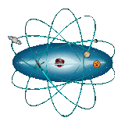   Csindra Fundation|

|             **Writers:**             |University of Debrecen Faculty of Science and Technology Institute of Physics Department of Electrical Engineering |             University of Debrecen |
| :----------------------------------: | :-------------------------------------------------------------------------------------------------------: | :----------------------------------: |
|   Lajos Harasztosi|  Batistig Gábor  |   János Kovács |

# Table of Contents 

### 1. PLMN Generations
### 2. Transmission Modes
### 3. Antennas and Wave Propagation
### 4 . Cellular Mobile Network
### 5 . GSM-based mobile network (3G)
### 6 . GPRS-based network (4G)
### 7 . UMTS-based network (5G)
### 8 . Common-Channel Signaling
### 9 . MS, Mobile station
### 10 . Speech Processing in Mobile Devices
### 11 . Short Message Sending (SMS)
### 12 . VoIP
### 13 . 🦷Bluetooth
### 14 . 🛰️ Space Telecommunications
### 15 . GPS
### 16. Closing Remarks GPS + Starlink Combined

| History of Telecommunication 2 |           ____________________            |             V2.26.4             |
| :--------------------------: | :---------------------------------------: | :-----------------------------: |
|  |  **Mobile History 2026 V2.26.4** |  |

---

# 1. PLMN Generations

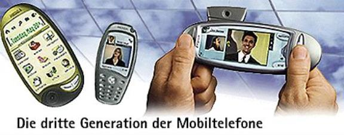
**Image**: 3G (third-generation) phones

## Public Land Mobile Networks
**Public Land Mobile Network = PLMN**

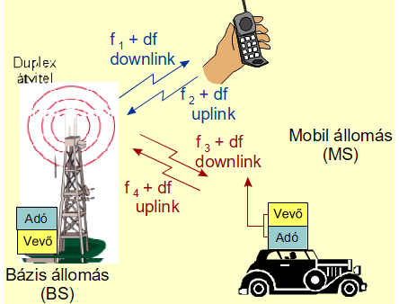
**Image**: Terrestrial mobile stations

PLMN networks are categorized into generations based on the timing of their introduction: 1G, 2G, 3G, 4G, 5G, and 6G.
The [ITU](https://en.wikipedia.org/wiki/International_Telecommunication_Union)[^1]-R oversees the relevant work of the [3GPP](https://en.wikipedia.org/wiki/3GPP)[^7] and the [ETSI](https://en.wikipedia.org/wiki/European_Telecommunications_Standards_Institute)[^2] regarding the development of [UMTS](https://en.wikipedia.org/wiki/UMTS), [LTE](https://en.wikipedia.org/wiki/LTE_(telecommunication)), and [5G](https://en.wikipedia.org/wiki/5G)—collectively referred to as Next Generation Mobile Networks (NGMN). IMT-2030[^6] defines the performance targets for future mobile systems and tracks the standardization of [6G](https://en.wikipedia.org/wiki/6G). 
**Image**: Mobile generations

https://en.wikipedia.org/wiki/4G[^3]

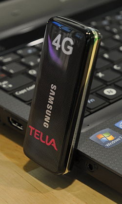
**Image**: 4G modem

https://en.wikipedia.org/wiki/5G[^4]

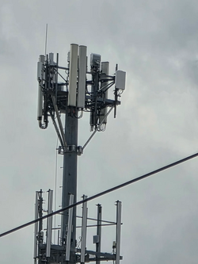
**Image**: Antenna system of a 5G mobile base station

https://en.wikipedia.org/wiki/6G[^5]

___

## Land Mobile Network (LMN)

|                                 | DLMN                 | 1G                 | 2G                   | 2.5G                           | 3G (NGN)             | 4G                                                 | 5G                                         | 6G                                                      |
| ------------------------------- | -------------------- | ------------------ | -------------------- | ------------------------------ | -------------------- | -------------------------------------------------- | ------------------------------------------ | ------------------------------------------------------- |
| Characteristics              | DLMN                 | NMT                | GSM                  | GPRS                           | UMTS                 | LTE / LTE-Advanced                                 | 5G NR / IMT-2020                           | IMT-2030 / 6G                                           |
| Frequency band                  | 27 MHz; 150 MHz; 450 MHz | 450 MHz            | 900 MHz; 1800 MHz    | 450 MHz; 900 MHz               | 1.8 GHz; 1.9 GHz     | approx. 450 MHz–3.8 GHz                            | FR1: approx. 0.4–7.1 GHz; FR2: approx. 24–71 GHz   | From sub-1 GHz up to ranges above 100 GHz               |
| Transmission type               | Analog               | Analog             | Digital/encoded      | Digital/encoded                | Digital/encoded      | Digital/encoded                                    | Digital/encoded                            | Digital/encoded                                         |
|                                 | Simplex/Duplex       | Full duplex        | Full duplex          | Full duplex                    | Full duplex          | Full duplex, FDD/TDD                               | Full duplex, FDD/TDD                       | Expected to include FDD/TDD and new duplex schemes      |
| Modulation system               | AM; NB-FM            | NB-FM              | GMSK                 | CPM                            | WCDMA / DS-CDMA      | OFDMA (DL), SC-FDMA / DFT-s-OFDM (UL); QPSK–256QAM | CP-OFDM; QPSK–256QAM, also DFT-s-OFDM in UL | No final technology yet; OFDM and MIMO solutions |
| External connectivity           | Closed (restricted)  | Open (National)    | Open (International) | Open (International)           | Open (International) | Open, international                                | Open, international                        | Under international standardization                     |
| Calling/Reachability            | Proprietary solutions | Telephone-like     | Telephone-like       | Data-oriented                  | Internet-oriented    | VoLTE                                              | VoLTE, VoNR                                | Expected to be IP-based, with new services               |
| Costs                           | Self-maintained      | Provider/billed    | Provider/billed      | Provider/billed                | Provider/billed      | Provider / billed                                  | Provider / billed                          | Expected to be a provider-based system                   |
| Encryption                      | None                 | None               | Full                 | Full                           | Full                 | Yes                                                | Yes                                        | Expected to be AI- and quantum-resistant                 |
| Maximum theoretical data rate   | None                 | None               | 9.6 kbit/s           | 9.6; 14.4; 19.2; 64, 128; 256 kbit/s | ~2 Mbit/s            | LTE: up to ~300 Mbit/s; LTE-A: up to ~1 Gbit/s       | IMT-2020: 20 Gbit/s DL, 10 Gbit/s UL       | Research target: 50–200 Gbit/s                           |

[1] https://en.wikipedia.org/wiki/LTE_frequency_bands

| History of Telecommunication 2 |           ___ 1 ____            |             V2.26.4             |
| :--------------------------: | :---------------------------------------: | :-----------------------------: |
|  |  **Mobile History 2026 V2.26.4** |  |
___

# 2. Transmission Modes

**Image**: Terrestrial mobile telephone stations
Where df: bandwidth (e.g., 3.1 kHz)

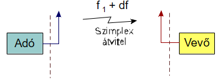
**Image**: Principle of simplex transmission

**Image**: Principle of half-duplex transmission

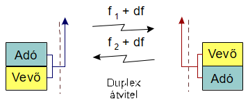
**Image**: Principle of duplex transmission

## Propagation of Electromagnetic Waves

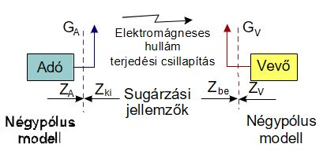
**Image**: Radiation characteristics

### Characteristics:

- Transmitter power,
- Power density and field strength at the receiver location,
- Path loss (attenuation) between the transmitter and receiver,
- Polarization (direction of the E-field vector).

Optimal transmission and maximum reception gain require proper impedance matching—such as between the final power stage and the antenna.

Classification of electromagnetic radiation:

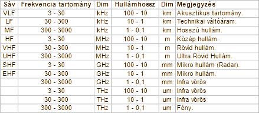

Standard designations for microwave frequency bands:

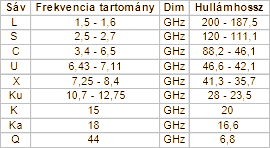

### GSM Frequencies

#### Fundamentals of Channel Allocation

- 890 MHz – 915 MHz (mobile transmission)
- 935 MHz – 960 MHz (base station transmission)
- 124 channels, 200 kHz bandwidth per channel
- Each RF carrier frequency and time slot can be assigned to specific physical/logical channels for various purposes

#### Key Logical Channels:

- BCCH (Broadcast Control Channel)
- A channel that broadcasts data regarding the specific network and cell, as well as neighboring cells
- FCCH (Frequency Correction Channel)
- A channel that assists the mobile device with frequency synchronization
- SCH (Synchronization Channel)
- A channel that assists the mobile device with frame synchronization
Visszajelzés küldése

| History of Telecommunication 2 |           ___ 2 ___            |             V2.26.4             |
| :--------------------------: | :---------------------------------------: | :-----------------------------: |
|  |  **Mobile History 2026 V2.26.4** |  |
---

# 3. Antennas and Wave Propagation

**Image**: Wave Propagation Characteristics

In practice, the space between antennas cannot be considered ideal; wave propagation is influenced by the atmosphere, the Earth's surface, climatic and weather conditions, terrain features, and man-made structures. These effects can be accounted for when calculating path loss by using various models.
## Basic Wave Propagation Modes and Phenomena

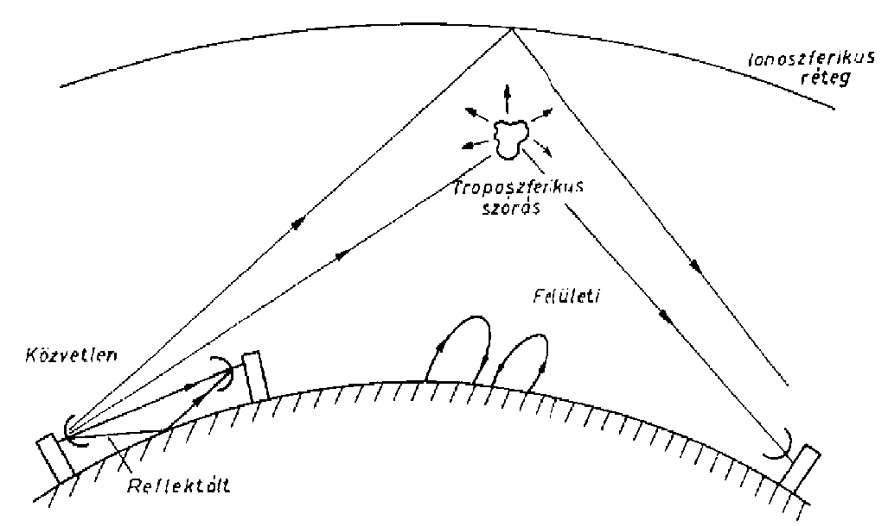

**Image**: Wave propagation modes

## Antenna Characteristics and Wave Propagation

### Isotropic Radiation Pattern

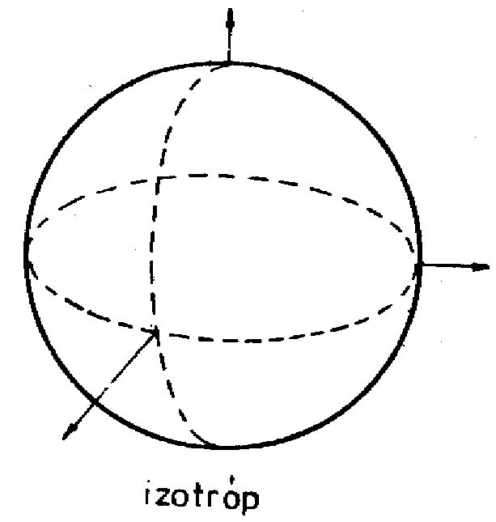

**Image**: Isotropic (spherically symmetric) antenna pattern

- radiates identically in all directions in space
- used as a reference
- cannot be realized in practice

### Omnidirectional Antenna

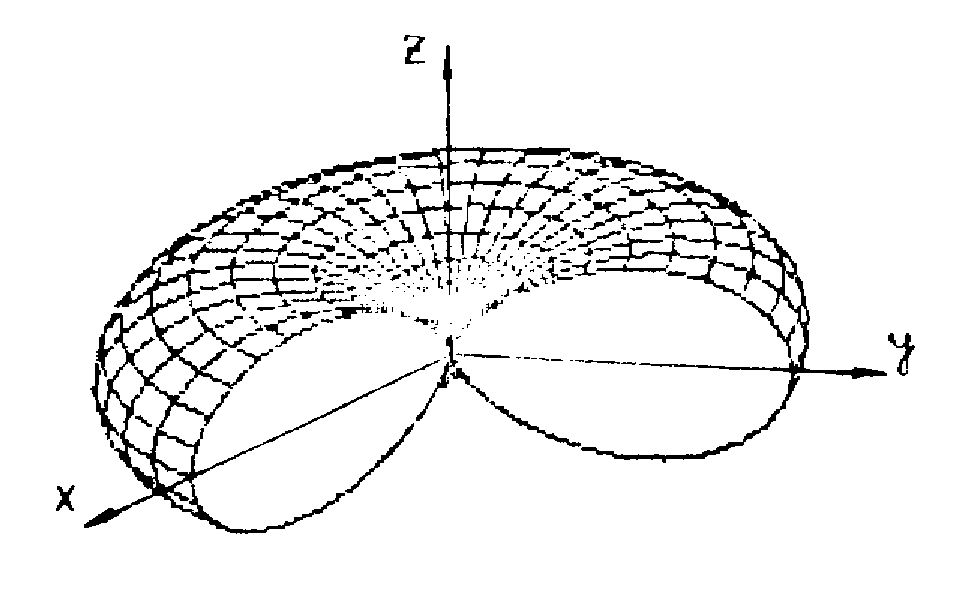

**Image**: Omnidirectional antenna pattern

- used in broadcasting systems
- serves receivers located on the ground; does not radiate upwards
### Pencil beam

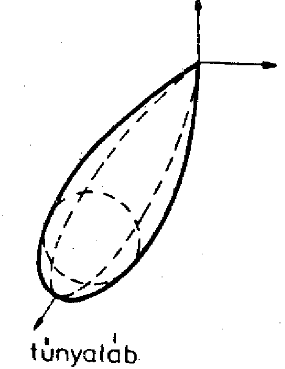

**Image**: Pencil beam antenna pattern

- used in point-to-point links

## Fan beam

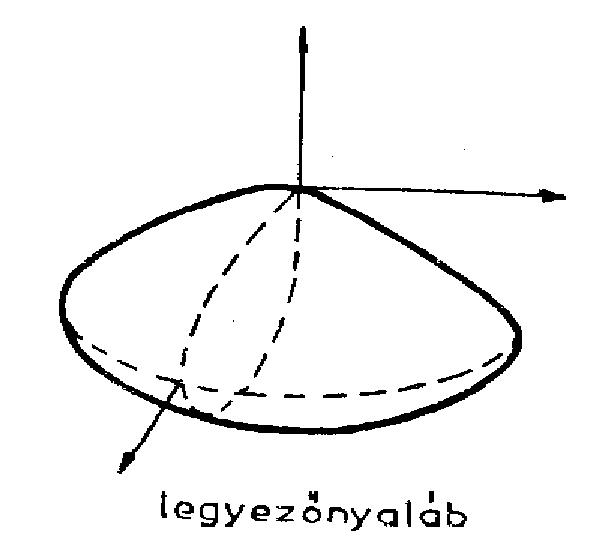

**Image**: Fan beam antenna pattern

- a beam that is narrow in one plane and wide in the other
- used in radar systems
- suitable for searching for and tracking targets when used with a movable antenna
- 120° antenna pattern for a G3 base station

## Traffic dimensioning

User traffic patterns frequently encountered in PSTN and PLMN telephone networks:
The Erlang (Erl) was defined by the CCITT in 1949 in honor of the Swedish mathematician Erlang, who specialized in traffic theory. - mobile, portable, handheld devices: 	 	 0.01–0.04 Erlangs
- mobile coin- or card-operated telephone station: 	 0.1–0.2 Erlangs
- fixed residential telephone station: 	 0.05 Erlangs
- fixed business telephone station: 	 	 0.1 Erlangs
- fixed coin- or card-operated telephone station: 	 0.2–0.3 Erlangs
- private branch exchange (PBX) line: 	 	 0.1–0.6 Erlangs.

>[!note] References
> 
>1. © dr. Dárdai Árpád, 1994. Cédrus Kiadó, 
>   2. bővített kiadás 1999. Nap Kiadó, 
>   3. bővített kiadás 2002.
>4. © Mobil Ismeret 2002. Azonosító: ISBN 963 440 996 2
>    
>5. TÁVKÖZLÉSTECHNIKAI KÉZIKÖNYV
>  FŐSZERKESZTŐ: DR. IZSÁK MIKLÓS  a műszaki tudományok kandidátusa egyetemi tanár
>  MŰSZAKI KÖNYVKIADÓ, BUDAPEST, 1979

### Basic Concepts

**Occupancy:** The utilization of a line, regardless of whether a connection (conversation) has been established or not.
**Holding time:** The duration for which a line is occupied. 
_Most commonly, we use the average holding time ($t_m$) of conversations for calculations._
**Line bundle** (or simply **bundle**): A group of lines capable of carrying a certain number of independent calls simultaneously, regardless of which specific line within the bundle is used to establish the connection.
The **volume of traffic ($Q$)** handled by a bundle over a given period is equal to the sum of the holding times, expressed in hours.
$$Q=c\cdot t_m / 60 \space Erl\cdot h$$
Where _c_ is the number of requests (occupancies), and $t_m$ is the average holding time in minutes.

The **traffic** carried by a bundle is defined as the volume of traffic divided by the duration of the observation period.
$$y=c\cdot t_m / 60T \space Erl$$
Where _y_ is the traffic, and _T_ is the observation period in hours.

## Fresnel Zones

During wave propagation, multiple wave components may arrive at the reception point—or the location of the receiving antenna—having traveled along different paths.

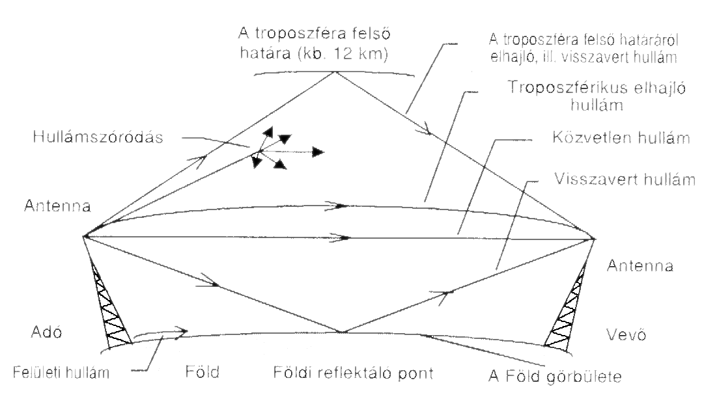

**Image**: Wave interference

Fresnel zones are the locus of points in space from which reflection occurs with a path difference of $\lambda/2$ or its multiples. The intersections of Fresnel zones with a plane passing through the line of sight (the ray axis) are ellipses.

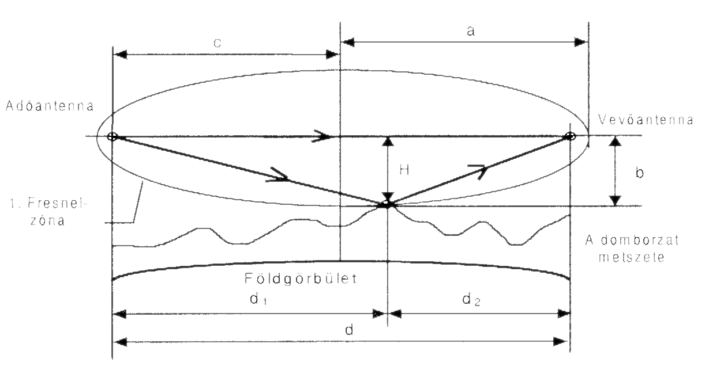

**Image**: Fresnel ellipse

### We distinguish between:

- unobstructed (or clear) paths,
- partially obstructed paths,
- obstructed paths.

## Fading

Fading refers to the fluctuation of field strength at the reception point around an average value.
Key parameters characterizing fading behavior include:

- fading depth,
- fading frequency,
- fading duration,
- the distribution of fading frequency and duration.

Fading can be caused by changes in atmospheric properties, fluctuations in the Doppler shift (e.g., for a moving vehicle), or the movement of objects in the terrain. 
**Mobile History 2026 V2.26.4** |  |
---

# 4\. Cellular Mobile Network

A base station can provide coverage over a circular area on flat terrain.
The upper limit of the circle's radius is the radio horizon ($d_r$).

When covering a given area with multiple base stations (BS), the circles overlap slightly. The optimal solution is the hexagonal cellular model.
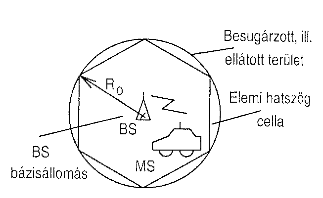
**Image**: Mobile cell

### Cell Radius in Densely Populated Areas (Large Cities)

Mobile telecommunications are categorized into generations (1G, 2G, 3G, 4G, 5G). Due to traffic capacity requirements, the radius of individual cells is smaller than the radio horizon.

- 1G: $d_r$ = 20–100 km
- 2G: $d_r$ = 1–30 km
- 3G: $d_r$ = 100 m–1 km
- 4G: ($d_r$ = 10–100 m) picocell
## Handover
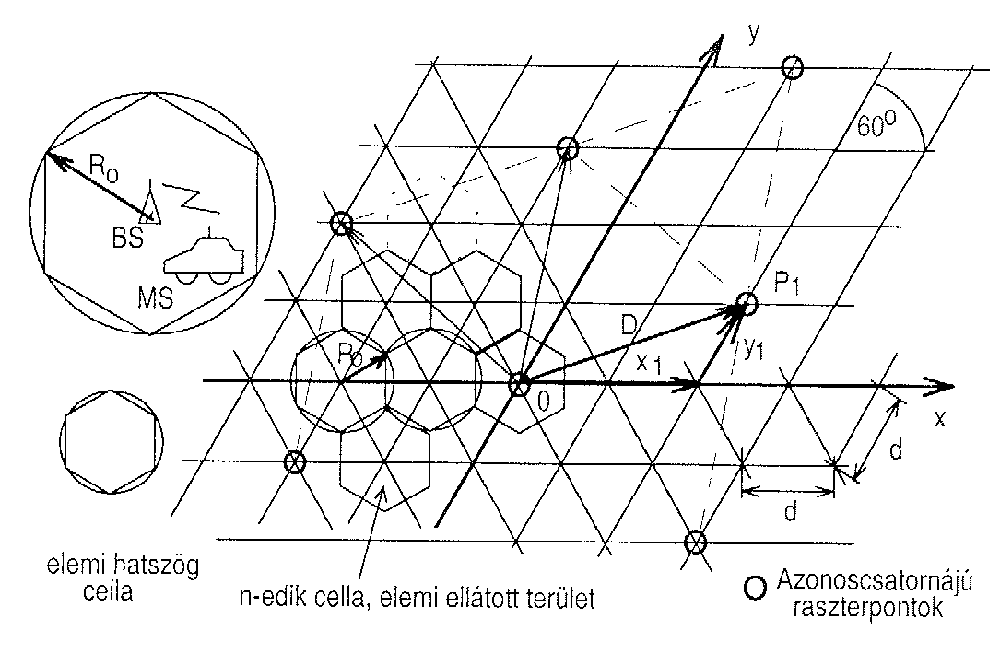
**Image**: Mobile cell coverage

Base station towers are typically equipped with three directional antennas, each covering a 120° sector.
If the entire cell uses the same set of frequencies, it is referred to as an "omnicell."
If the cell uses different frequencies for each 120° sector, it is referred to as a "multicell" configuration.

The process of transferring a connection without interruption when crossing a cell boundary while in motion is called a **handover**. ## Roaming

- The operation of the NMT system is controlled by a Mobile Services Switching Centre (MSC).
- The area served by a given MSC is divided into location areas. A single location area may contain multiple cells.
- A base station (BS) operates at the center of each cell.
- At any given moment, a mobile station (MS) communicates with only one base station (BS).

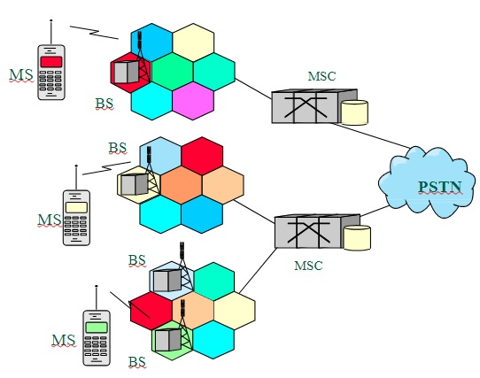
**Image**: Structure of a cellular mobile network

- The movement of a mobile station (MS) from the area of ​​one MSC to another is called roaming.

- Each subscriber (MS) is registered with a specific MSC. This is known as the home MSC (MSC-H). Any other MSC is considered a visited MSC (MSC-V) for that subscriber.
## Hendover protokoll

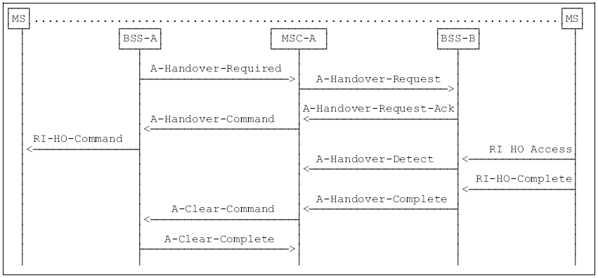
**Image**: Handover of an MS from cell A to cell B within a service provider (MSC).

| History of Telecommunication 2 |           ____ 4 ____            |             V2.26.4             |
| :--------------------------: | :---------------------------------------: | :-----------------------------: |
|  |  **Mobile History 2026 V2.26.4** |  |

---

#  5\. GSM-based mobile network (3G)[^8]

GSM is composed of four subsystems:
- mobile station (MS),
- base station subsystem (BSS),
- network and switching subsystem (NSS),
- operation and maintenance subsystem (OSS).

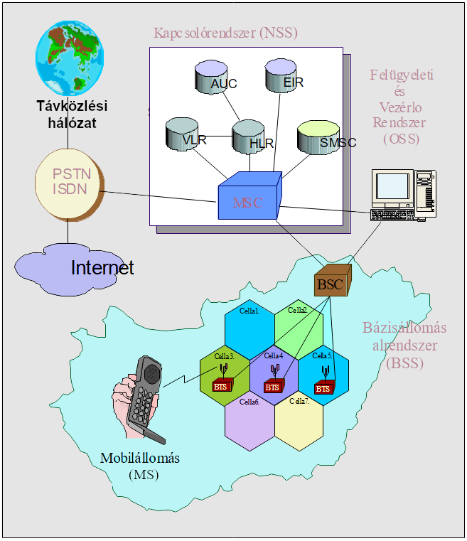
**Image**: Architecture of a 3G network

- MSCs communicate with each other—and with other PSTN exchanges—using the SS7 signaling system.

## Architecture of the BTS [^9]

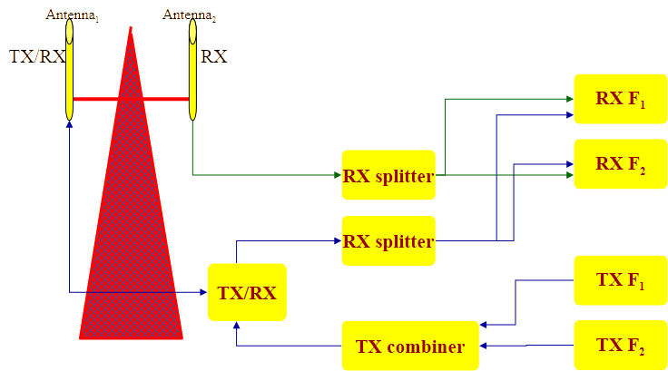
**Image**: Operational diagram of a BTS (Base Transceiver Station)

- A single omnidirectional cell
- Two transmit and receive frequencies

## GSM protocol system (3G)

From the mobile station (MS) to the MSC, both signaling and voice transmission are governed by standards established by the ITU.

**Image**: Signaling and Data Transmission Protocols in the 3G Network

**New Acronyms:**
RR: Radio Resource Management Protocol
MM: Mobility Management Protocol
CM: Connection Management
BTSM: BTS Management
BSSAP: BSS Application Part

## Handover Protocol

Intra-MSC Handover

**Image**: Handover of an MS (Mobile Station) from Cell A to Cell B within the same MSC (Mobile Switching Center).

## Roaming Protocol

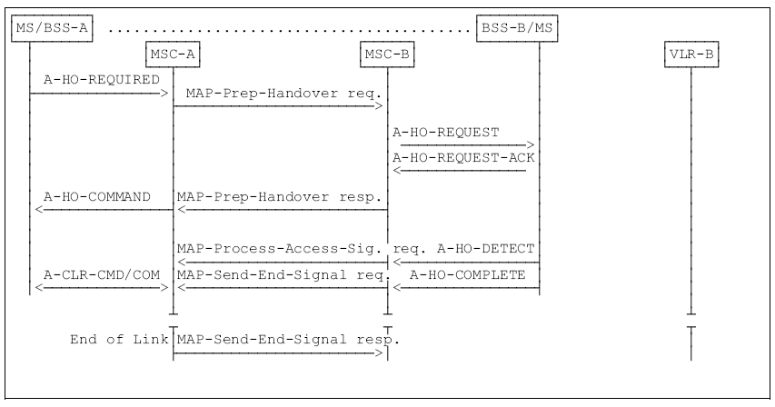
**Image**: Handover of an MS from MSC-A to MSC-B, and the registration of the MS in VLR-B without an "inter-MSC connection" (trunk/circuit connection).

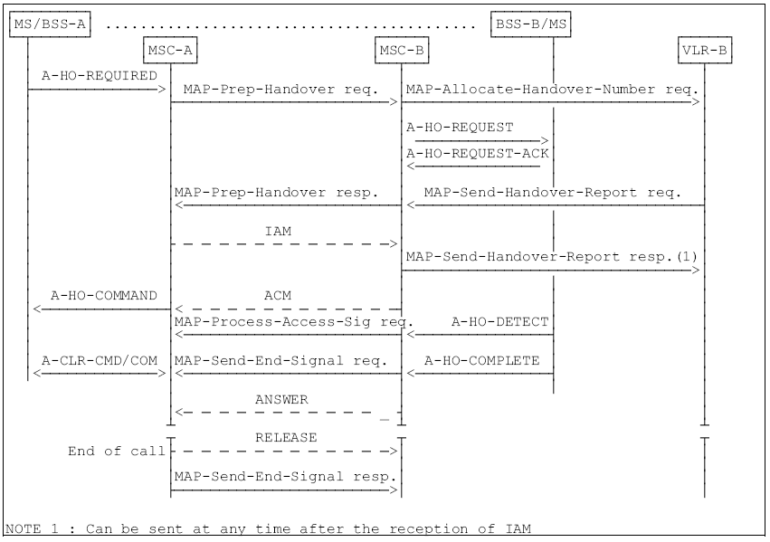
**Image**: Handover of an MS from MSC-A to MSC-B, and the registration of the MS in VLR-B with an "inter-MSC connection" (trunk/circuit connection).

| History of Telecommunication 2 |           ____ 5 _____            |             V2.26.4             |
| :--------------------------: | :---------------------------------------: | :-----------------------------: |
|  |  **Mobile History 2026 V2.26.4** |  |

---

# 6\. GPRS-based network (4G) [^10]

GPRS is composed of six subsystems:
- Mobile Station (MS),
- Base Station Subsystem (BSS),
- Network and Switching Subsystem (NSS),
- Operation and Maintenance Subsystem (OSS),
- Serving GPRS Support Node (SGSN),
- Gateway GPRS Support Node (GGSN).

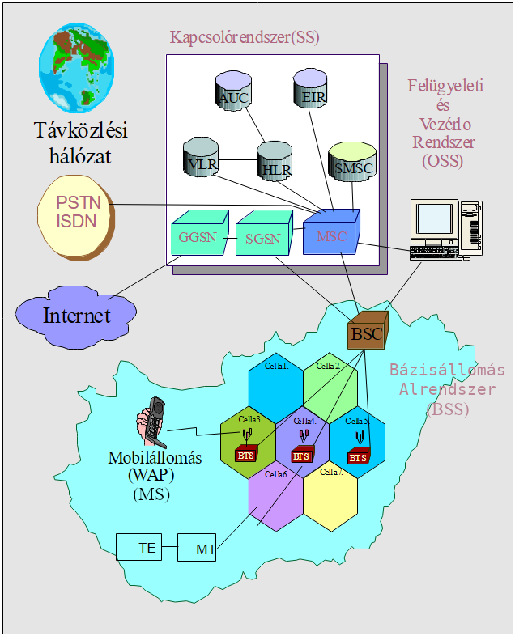
**Image**: Architecture of a 3G network

- MSCs communicate with each other—and with other PSTN exchanges—using the SS7 signaling system.
- The network provides Internet access via GPRS Gateways, connecting the international Internet to the user's Mobile Terminal (MT).

## GPRS protocol system

The network protocol is identical to that of a 3G network, as it encapsulates Internet packets within data transmission packets.

## GPRS handover

The handover process for voice calls is the same as that described for 3G; however, in 4G, the data connection may also need to be handed over. 

### Data Session

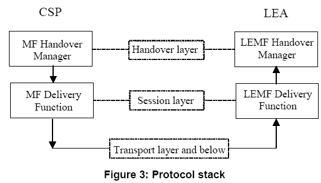
**Image**: 4G protocol stack

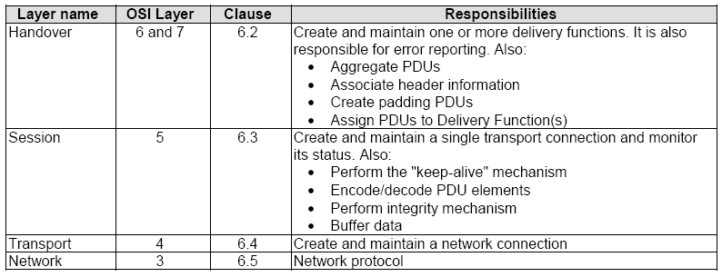
**Image**: OSI specification for 4G handover

### IP transfer

Figure 6: The (note) User Control functional element and the registration/roaming information flows adapted to the TIPHON scenarios 1 and 2

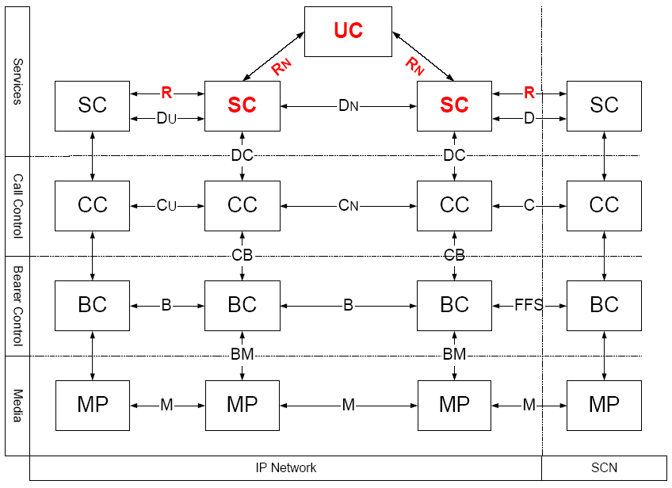
**Image**: The 4G IP handover

## GPRS, UMTS roaming, external transfer

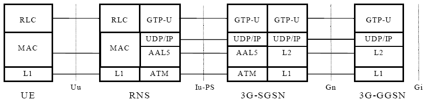
**Image**:  GPRS Gn Interface within UMTS

| History of Telecommunication 2 |           ___ 6 ____            |             V2.26.4             |
| :--------------------------: | :---------------------------------------: | :-----------------------------: |
|  |  **Mobile History 2026 V2.26.4** |  |

---

# 7\. UMTS-based network (5G) [^11]

Subsystems of UMTS:
- CSCF (Call State Control Function),
- E-GGSN (Enhanced Gateway GPRS Support Node),
- MGCF (Media Gateway Control Function),
- MGW (Media Gateway),
- UE (User Equipment),
- ERAN (Enhanced Radio Access Network),
- SGW (Signalling Gateway),
- E-SGSN (Enhanced Serving GPRS Support Node),
- E-HLR (Enhanced Home Location Register),
- UTRAN (UMTS Terrestrial Radio Access Network),

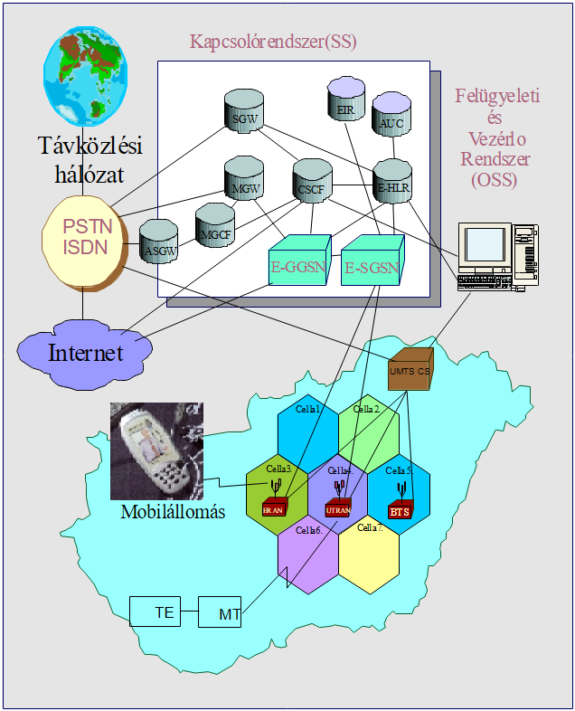

| History of Telecommunication 2 |           ___ 7 _____            |             V2.26.4             |
| :--------------------------: | :---------------------------------------: | :-----------------------------: |
|  |  **Mobile History 2026 V2.26.4** |  |

---

# 8\. Common-Channel Signaling

The fundamental concept behind common-channel signaling is that the methods—and, in some cases, the paths—used for transmitting signaling information differ from those used for transmitting user traffic (payload). Signaling information is transmitted separately via high-speed digital signaling links (signaling channels) in the form of packet-switched messages.

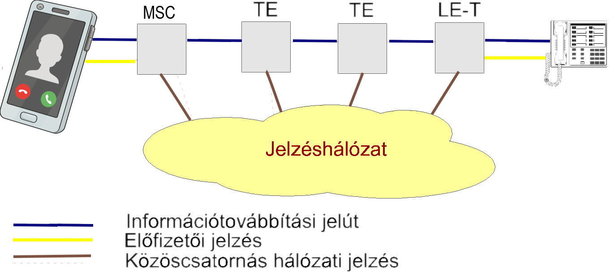
**Image**: International signaling network between exchanges

The signaling network is built upon the X.25 protocol, with the 7th generation (SS7) becoming the standard, while user traffic is transmitted digitally via a Synchronous Digital Hierarchy (SDH) network.
## SS7 Mobile Signaling System Connectivity

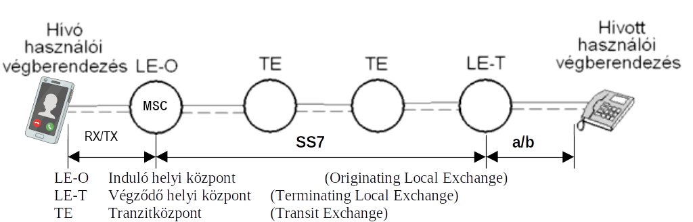
**Image**: The **Signalling System 7 (SS7)** international standard, proposed by the UN’s ITU

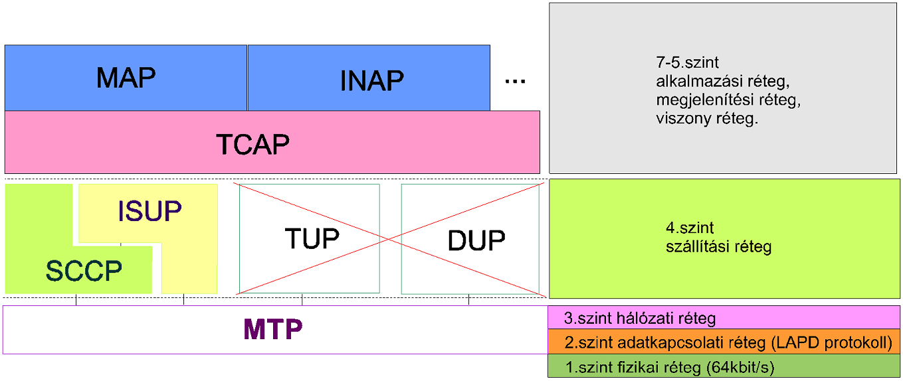
**Image**: The layers/levels of the seven-layer SS7 signalling system

- Physical/electronic implementation (MTP – Message Transfer Part)
The analog voice band is transmitted within the 300 Hz–3400 Hz frequency range with 0 dB attenuation, while outside this range—within the 0 Hz–4 kHz span—the attenuation is -40 dB.

**These include the following:**
- Signalling Connection Control Part (SCCP)
- Transaction Capabilities (TCAP)
- Mobile Application Part (MAP)
- Operation and Maintenance Application Part (OMAP)
- IN (Intelligent Network) Application Part (INAP - Intelligent Network Application Part) 

| History of Telecommunication 2 |           ___ 8 ____            |             V2.26.4             |
| :--------------------------: | :---------------------------------------: | :-----------------------------: |
|  |  **Mobile History 2026 V2.26.4** |  |

---

# 9\. MS, Mobile station [^12]

A Mobile Station (MS) encompasses all user equipment and software required for communication with a mobile network.

The term refers to the complete system connected to the mobile network—for instance, a mobile phone or a computer connected via a mobile broadband adapter. This terminology is used in 2G systems, such as GSM. In 3G systems, the Mobile Station (MS) is referred to as User Equipment (UE).

### In GSM, a Mobile Station consists of four main components:

- **Mobile Termination (MT)** – provides core functions such as radio transmission and handover, speech encoding and decoding, error detection and correction, signaling, and access to the SIM card. The IMEI code is associated with the MT. It is equivalent to the Network Termination (NT) in an ISDN access.
- **Terminal Equipment (TE)** – any device connected to the MS that provides services to the user. It does not contain functions specific to GSM.
- **Terminal Adapter (TA)** – provides access to the MT, functioning like an ISDN network termination point with extended capabilities. Communication between the TE and the MT takes place via the TA using **_AT commands_**[^13]. - **Subscriber Identity Module (SIM)** – a removable subscriber identification token that stores the IMSI, a unique key shared with the mobile network operator, and other data.

The power consumption of mobile stations depends on their "class." These are defined as follows:

Class 1 * 	 20W 	 vehicle-mounted or portable
Class 2 	 8W 	 vehicle-mounted or portable
Class 3 	 5W 	 vehicle-mounted or portable
Class 4 	 2W 	 handheld
Class 5 ** 	 0.8W 	 handheld

* Not in circulation.

** Purchasing such a device is not recommended due to limited network access.

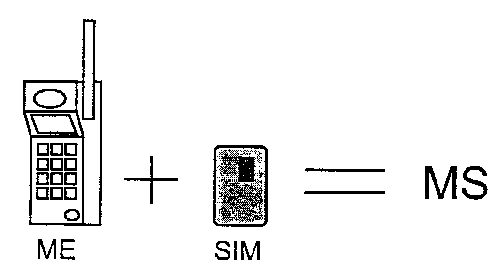
**Image**: 1G, 2G, and early 3G mobile station (MS)

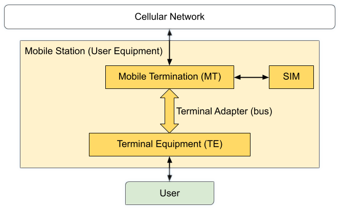
**Image**: 3G, 4G, 5G, and early 6G mobile station (UE)

## Mobile Station Identifiers

### Phone Number

An international phone number stored on the SIM card.

- MSISDN (Mobile Station ISDN Number) = CC + NDC + SN

- CC = Country Code 	 	 	 (e.g., +36)
- NDC = National Destination Code 	 (e.g., 30 = T-Mobile)
- SN = Subscriber Number 	         (e.g., 1234567)

### User Identifier [^14]

A 15-digit subscriber identifier stored on the SIM card.
- IMSI (International Mobile Subscriber Identity) = MCC + MNC + MSIN

- MCC = Mobile Country Code 	                         (3 digits)	 	(e.g., 216)
- MNC = Mobile Network Code                          (2–3 digits)	(e.g., 30)
- MSIN = Mobile Station Identification Number (9–10 digits)	(e.g., 1234567890)
### Device Identifier [^15]

A factory-assigned identifier stored within the device.
- IMEI (International Mobile Equipment Identity) = TAC + FAC + SNR + (SP), CD

- TAC = Type Approval Code
- FAC = Final Assembly Code
- SNR = Serial Number 	 	 	 	
- SP = Spare Digit
- CD = Check Digit

## Operation of the mobile station

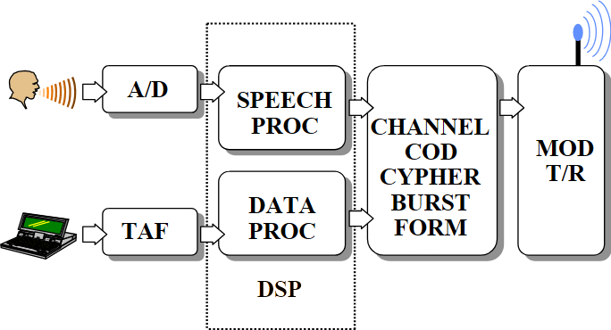
**Image**: 3G (MS) functional block diagram of a mobile station

| History of Telecommunication 2 |           ____ 9 __            |             V2.26.4             |
| :--------------------------: | :---------------------------------------: | :-----------------------------: |
|  |  **Mobile History 2026 V2.26.4** |  |

---

# 10\. Speech Processing in Mobile Devices

## Encoders for Mobile Devices

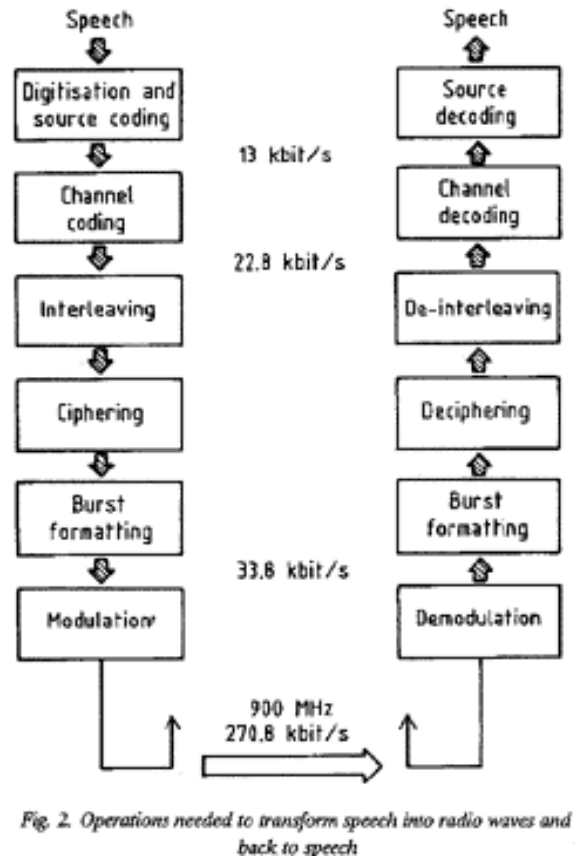
**Image**: 3G (MS) speech transmission

## Speech Processing in an MS Device

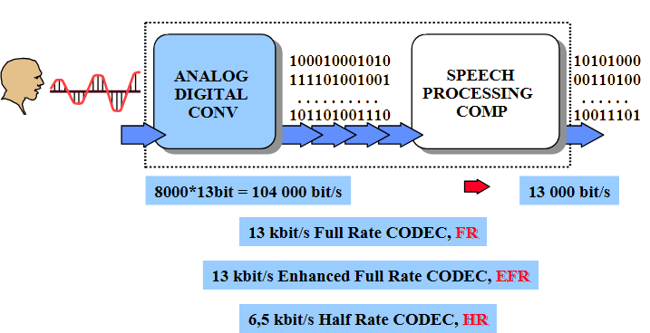
**Image**: 3G (MS) speech compression and encoding

| History of Telecommunication 2 |           _____ 11 ____            |             V2.26.4             |
| :--------------------------: | :---------------------------------------: | :-----------------------------: |
|  |  **Mobile History 2026 V2.26.4** |  |

---

# 11\. Short Message Sending (SMS)

The Short Message Service (SMS) is a text messaging service—typically a paid one—that is integrated into most telephone, internet, and mobile device systems.
Developed as part of the GSM standards and based on the SS7 signaling protocol, SMS was launched on digital mobile networks in 1993; it was originally intended for customers to receive notifications from their service provider or operator. The service allows users to send and receive text messages of up to 160 characters.[^16]
## Sending SMS via Mobile

 
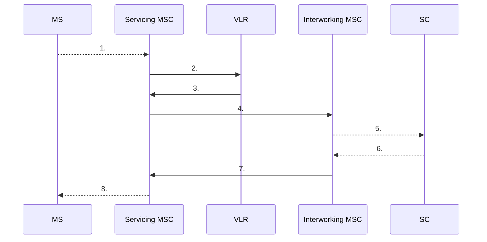
**Image**: Sending an SMS from a mobile station (MS) to an SMS center (SMSC).
### Explanation
- On the originating side, the serving MSC receives the SMS (1).
- The MSC then queries the VLR to verify the sender's authorization to send an SMS (2).
- If the query is successful, the MSC forwards the SMS to the mobile SMS center (SMSC)—directly, if possible, or otherwise via an interworking MSC (4, 5).
- The SMSC acknowledges receipt to the MSC, either directly or via the interworking MSC (6, 7).
- The MSC confirms the successful transmission of the SMS to the subscriber (8).

## Mobile SMS reception

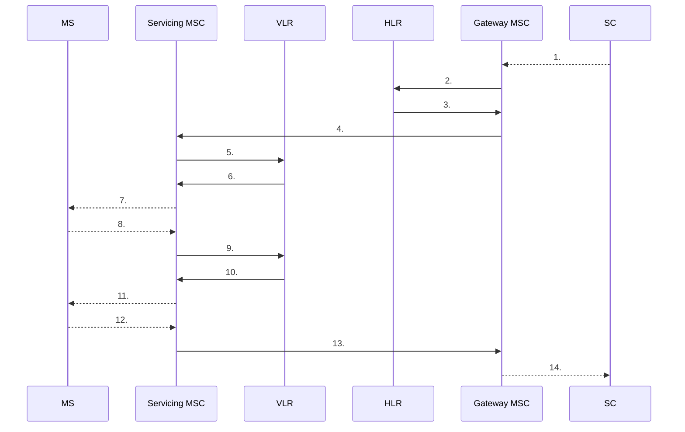
**Image**: Sending an SMS from an SMSC to an MS (Mobile Station).
### Explanation
- On the mobile terminating side, the gateway MSC receives the SMS from the SMSC (1).
- This MSC queries the HLR to determine the location of the SMS recipient (2).
- Based on the information received (3), the SMS is forwarded to the appropriate MSC (4).
- This MSC queries the VLR to verify that the recipient is indeed present and capable of receiving SMS (5).
- If everything is in order, the subscriber search process begins (6, 7, 8, 9).
- Once the terminal station is located (10), the MSC delivers the SMS to it (11).
- The SMSC receives an acknowledgment confirming the delivery of the SMS (12, 13, 14).

## Fixed-Line SMS Principle

Caller ID (calling number identification) support is mandatory for ISDN/PSTN (analog) lines.

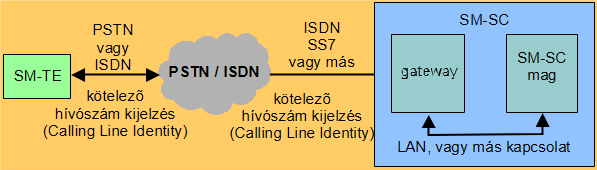
**Image**: Sending an SMS to an ISDN device or a PSTN device capable of displaying text.

If the PSTN subscriber does not have a device capable of displaying text messages, a voice gateway (Text-to-Speech gateway) is used to read the sent text aloud to the recipient via a telephone call. In this scenario, the subscriber can only receive SMS messages, not send them.
## MMS

The Multimedia Messaging Service (MMS) is a standardized method for sending multimedia messages from one mobile phone to another over a mobile network. The MMS standard extends the basic capabilities of SMS (Short Message Service), allowing for the exchange of text messages longer than 160 characters.[^17]

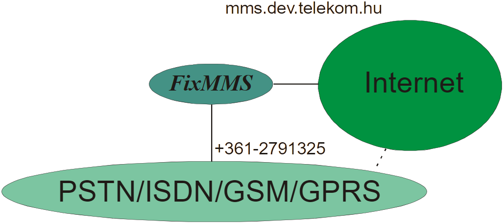
**Image**: Multimedia files can be sent within an MMS message using the SMS header.

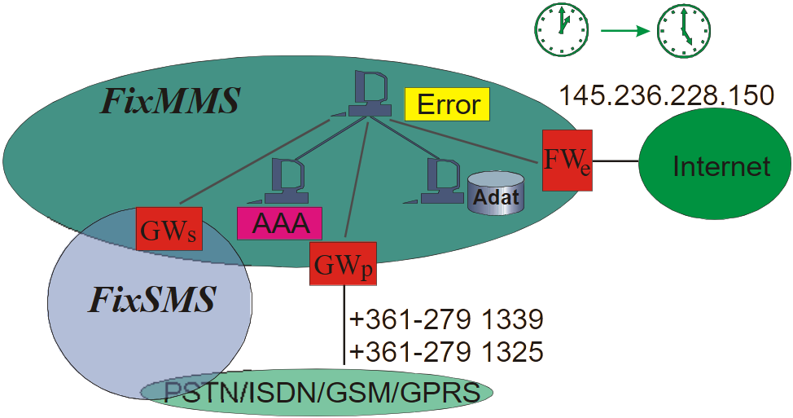
**Image:** In Hungary, it has become possible to send MMS messages from ISDN/PSTN lines as well, using the Fix SMS server.

| History of Telecommunication 2 |           ___ 12 __            |             V2.26.4             |
| :--------------------------: | :---------------------------------------: | :-----------------------------: |
|  |  **Mobile History 2026 V2.26.4** |  |

---

# 12\. VoIP

Before discussing the possibility of transmitting voice over the Internet, it is useful to refresh our knowledge about the Internet itself.

The **Internet** is a global system of interconnected computer networks that uses the Internet Protocol suite (**TCP/IP**) for communication between networks and devices. It is a network encompassing private, public, academic, business, and government networks—ranging from local to global in scope—which are linked together by electronic, wireless, and optical networking technologies.[^18]
## The Objective of ARPANET

Due to the Cold War situation in the 1950s and 1960s, the United States military aimed to create a network where, if any single node were taken out of action, the remaining elements of the network would still remain operational.

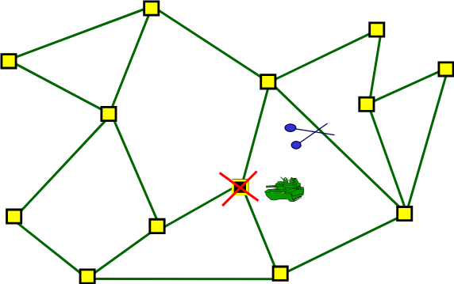

**Image:** ARPANET requirement

Every node must have at least two connections, ensuring that if any one connection is severed, the equipment remains accessible via alternative paths.

Modern implications ("Best effort" nature):

- In the event of congestion, routers seek alternative paths.
- The order of packets is not guaranteed.
- Latency (delay) varies.
- Different connections may be established via different routes (e.g., the forward and return paths may differ).

## General Structure of Computer Networks

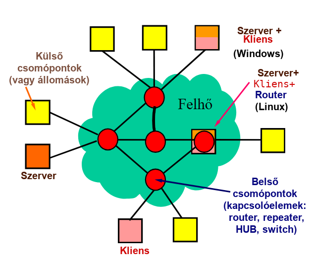
**Image:** Elements of an Internet Network

## Address Format for IPv4 Networks

### RFC 791 Address:

32 bits = 4 bytes
**Format:**
Decimal numbers separated by dots,
E.g.: 10.38.2.240

Addresses are categorized into classes.

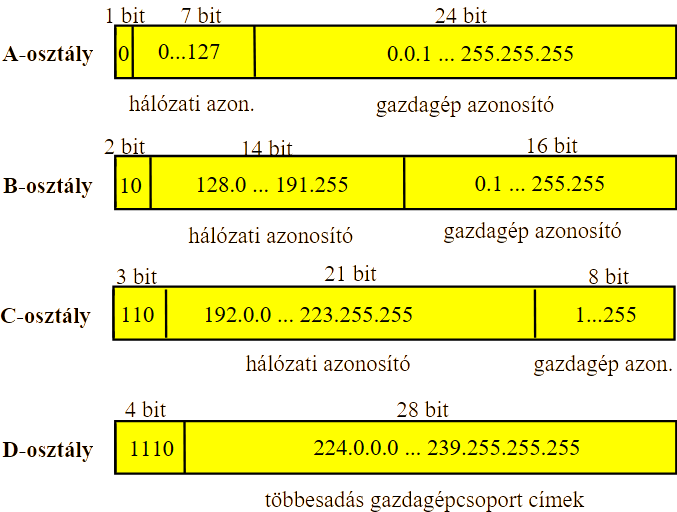
**Image:** IPv4 address classes

## IPv4 Routing and NAT

Using a mask corresponding to the address class, the router determines where to forward a packet—either toward the WAN or toward the LAN [^19].

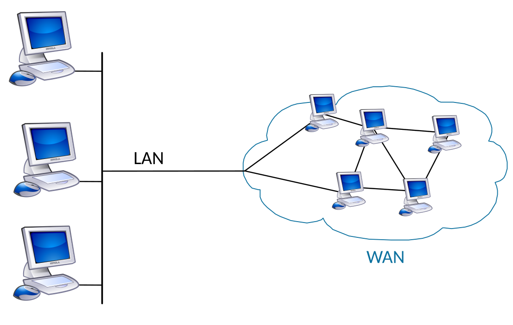
**Image:** Internet WAN and LAN [^19]

**Image:** IPv4 routing based on a mask

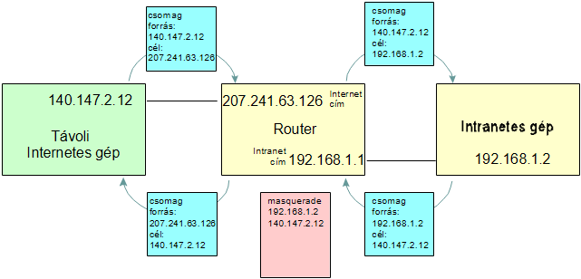
**Image:** IPv4 NAT (address translation) based on a mask

## Internet Network Connectivity Devices

- Gateway (GW),
- Proxy server (e.g., Proxy),
- Router or Gateway,
- Bridge or Switch,
- Repeater or Hub

**Image:** The Internet according to the Open Systems Interconnection (OSI) model

## SS7 & Voice over Internet Protocols (VoIP)

RFC 0760 DoD standard Internet Protocol. J. Postel. Jan-01-1980. 
RFC 0791 Internet Protocol. J. Postel. Sep-01-1981. 

**Image:** Comparison of SS7 and IP Protocols
## Theoretical Foundations of VoIP

Analog signals can only be transmitted over a packet-switched network if the received packets are stored in a buffer at the receiving end and then played back continuously (converted back into an analog signal) with a time delay. The size of the packets and the size of the buffer significantly influence both latency and transmission quality.

**Image:** Transmission of continuous speech over a packet-switched network

Let us highlight three standards from the ITU-T recommendations:
- ITU-T G.711 [^20]
- ITU-T G.723 [^21]
- ITU-T G.720 [^22]
Let us compare these, assuming the transmission of 10, 20, 30, or 60 ms of analog signal per IP packet.

**Image:** Table for calculating transmission speed, efficiency, and latency

## G.711 Half-Duplex Protocol

Half-duplex transmission over a 10 Mbit/s coaxial Internet cable means that the transmitter and receiver take turns sending and receiving; only one can transmit at any given time.
With G.711 encoding, 30 ms of audio content corresponds to 240 bytes/octets of information (payload). Including the header and trailer, the total size of the IP packet is 314 bytes/octets. On a 10 Mbit/s network, this can be transmitted in 0.26 ms. 

This means that a bandwidth of at least 172 kbit/sec must be provided for 64 kbit/sec full-duplex transmission! The latency can be kept between 2 and 10 ms (depending on the buffer size).

Efficiency: $$\eta = \frac{240/2}{314+8}=37.27\% $$

## SIP: Session Initiation Protocol 

A **Session Initiation Protocol** ( **SIP** ) a signaling protocol used for initiating, maintaining, modifying, and terminating Internet communication sessions that include multimedia elements such as audio, video, and messaging.[^23]

**RFC 3261 SIP**: Session Initiation Protocol. J. Rosenberg, H. Schulzrinne, G. Camarillo, A. Johnston, J. Peterson, R. Sparks, M. Handley, E. Schooler. June 2002. (Obsoletes RFC2543) (Updated by RFC3265)

**Image:** SIP session setup example with SIP trapezoid

## VoIP

**Voice over Internet Protocol** (**VoIP**), also known as **IP telephony**, is a set of technologies primarily used for voice communication sessions over Internet Protocol (IP) networks, such as the Internet.[^24]
**Internet telephony**—a broader term for broadband telephone service—refers to the provision of voice and other communication services (such as fax, SMS, and voicemail) over the Internet, as opposed to the traditional Public Switched Telephone Network (PSTN).
VoIP technology has been adapted for mobile networks, leading to the development of advanced systems. These include **Voice over LTE** (VoLTE)[^25]—introduced as part of 4G networks—and Voice over 5G (Vo5G).

| History of Telecommunication 2 |           ___ 12 __            |             V2.26.4             |
| :--------------------------: | :---------------------------------------: | :-----------------------------: |
|  |  **Mobile History 2026 V2.26.4** |  |

---

# 13\. 🦷Bluetooth

**A Bluetooth** A short-range wireless technology standard used for short-distance data exchange between fixed and mobile devices, as well as for establishing Personal Area Networks (PANs). In its most widely used mode, transmission power is limited to 2.5 milliwatts, providing a very short range of up to 10 meters (33 feet).[^26]

**Image:** Bluetooth piconet

The Bluetooth standard is managed by the Bluetooth Special Interest Group (Bluetooth SIG).

**Image:** Principle of Frequency Shift Keying (FSK)

**Image:** Zero-crossing error in Frequency Shift Keying (FSK)

Bluetooth employs GFSK (Gaussian Frequency Shift Keying) modulation[^27] with a BT parameter of 0.5. The modulation index can range between 0.28 and 0.35. The essence of GFSK is that a binary 1 is represented by a positive frequency deviation, while a binary 0 is represented by a negative frequency deviation.
Bluetooth uses UHF radio waves within the [ISM bands](https://en.wikipedia.org/wiki/ISM_band "ISM band"), ranging from 2.402 GHz to 2.48 GHz.

## Bluetooth Protocols

**Image:** Layered structure of the Bluetooth system

Bluetooth protocols can be categorized into four layers, based on their role in the system's operation and their "origin" within the Specification. 
**Image:** Bluetooth protocol layers
## Bluetooth piconet

**Image:** Time slots in the Bluetooth system

| History of Telecommunication 2 |           __ 13 ___            |             V2.26.4             |
| :--------------------------: | :---------------------------------------: | :-----------------------------: |
|  |  **Mobile History 2026 V2.26.4** |  |

---

# 14\. 🛰️ Space Telecommunications

A **satellite** is an object—typically a spacecraft—placed into an orbit around a celestial body. It serves numerous purposes, including communication relay, weather forecasting, navigation (GPS), broadcasting, scientific research, and Earth observation. Additional military applications include reconnaissance, early warning, signals intelligence, and potentially the delivery of weaponry.[^28]
## Satellite Orbits

Satellite orbits[^29] are formed by the gravitational attraction between two bodies. The motion of their centers of mass is described by Kepler's laws. When two bodies interact gravitationally, their paths follow a [conic section](https://en.wikipedia.org/wiki/Conic_section).

**Image**: Conic Sections for Various Types of Orbits

A satellite can remain in a stable orbit around the Earth (over a long period) only if it follows a circular or elliptical path. In what follows, we shall consider only these.

**Image**:Elliptical Satellite Orbit

In the diagram:
- $R_f = 6378 \text{ km}$ is the radius of the Earth;
- $a$ and $b$ are the semi-axes of the ellipse;
- the point in the orbit closest to the Earth is the perigee, while the point farthest from the Earth is the apogee;
- the eccentricity of the orbit is $e = c/a$ (in the special case where the orbit is circular, $e = 0$);
- $r$ is the instantaneous orbital radius (orbital altitude);
- $v$ is the orbital velocity;
- $T$ is the orbital period.

Eccentricity ($e$) is the ratio of the distance between the center of the ellipse and its focus ($c$) to the length of the semi-major axis ($a$):

**Image**: eccentricity 

For communication purposes, it is advisable to place satellites into circular orbits. In this case, important parameters include the orbital radius and the inclination of the orbit relative to the equatorial plane.[^31]

**Image**: Satellite Orbits
## List of Orbits

### List of abbreviations for common Earth orbits [^30]
| Orbit                                                                               | Name                       |
| ----------------------------------------------------------------------------------- | -------------------------- |
| [GEO](https://en.wikipedia.org/wiki/Geostationary_orbit "Geostationary orbit")      | Geostationary orbit        |
| [LEO](https://en.wikipedia.org/wiki/Low_Earth_orbit "Low Earth orbit")              | Low Earth orbit            |
| [MEO](https://en.wikipedia.org/wiki/Medium_Earth_orbit "Medium Earth orbit")        | Medium Earth orbit         |
| [SSO](https://en.wikipedia.org/wiki/Sun-synchronous_orbit "Sun-synchronous orbit")  | Sun-synchronous orbit      |

**Image**: Common Satellite Orbits

### List of Abbreviations for Other Orbits

| Orbit                                                                                              | Name                              |
| -------------------------------------------------------------------------------------------------- | --------------------------------- |
| [GSO](https://en.wikipedia.org/wiki/Geosynchronous_orbit "Geosynchronous orbit")                   | Geosynchronous orbit              |
| [GTO](https://en.wikipedia.org/wiki/Geostationary_transfer_orbit "Geostationary transfer orbit")   | Geostationary transfer orbit      |
| [HCO](https://en.wikipedia.org/wiki/Heliocentric_orbit "Heliocentric orbit")                       | Heliocentric orbit                |
| [HEO](https://en.wikipedia.org/wiki/Highly_elliptical_orbit "Highly elliptical orbit")             | Highly elliptical orbit           |
| [NRHO](https://en.wikipedia.org/wiki/Near-rectilinear_halo_orbit "Near-rectilinear halo orbit")   | Near-rectilinear halo orbit       |
| [VLEO](https://en.wikipedia.org/wiki/Very_low_Earth_orbit "Very low Earth orbit")                   | Very low Earth orbit              |

## Coverage Area

When designing the orbit for a satellite system, one must consider which areas of the Earth's surface will have a view of the satellite at an appropriate elevation angle, denoted as $\alpha$.

**Image**: Satellite visibility angle.

| History of Telecommunication 2 |           ___ 14 ___            |             V2.26.4             |
| :--------------------------: | :---------------------------------------: | :-----------------------------: |
|  |  **Mobile History 2026 V2.26.4** |  |

---

# 15\. GPS

The GPS (Global Positioning System) is a satellite-based positioning system developed and operated by the United States Department of Defense (primarily for military purposes). It functions 24 hours a day and is accessible from any point on Earth.

**Image**: GPS satellite system  

The **Global Positioning System (GPS)** is a satellite-based hyperbolic navigation system owned by the United States Space Force and operated by Mission Delta 31.[^32]

GPS is an advanced positioning system that enables 3D location tracking, timekeeping, and velocity measurement on land, at sea, or in the air. Its accuracy is typically on the order of meters; however, through differential measurement techniques, precision down to the millimeter level can be achieved—even in real time. Like many other technologies, GPS was originally developed for military purposes, but it is now widely used across all sectors of civilian life. A major advantage is that, by utilizing its data, we can access a range of services through compact devices, thereby enhancing both our convenience and our safety.

**Image:** Using GPS
## A brief history of GPS

|         1973          |                1978                 |              1995               |                     2000                      |          2018          |
|:---------------------:|:-----------------------------------:|:-------------------------------:|:---------------------------------------------:|:----------------------:|
| NAVSTAR program begins | Launch of the first Block I satellite | Full Operational Capability (24 satellites) | Disabling of Selective Availability (SA) | The first GPS III satellite |

**What began as a military development has become the world’s most widely used civilian positioning system.**
GPS is a specific system; GNSS refers to the collection of multiple satellite systems.

**Image**: GNSS satellite systems

## The operational chain of GPS

The foundation of positioning is the precise measurement of signal propagation time.

**Image**: The operating principle of GPS
## Trilateration: how are signals converted into a position?

On a plane, two intersecting circles meet at two points.

**Image**: Knowing the distances from GPS satellites allows us to determine the points of intersection.

In three-dimensional space, if the position (coordinates) of a satellite is known precisely, the set of all points at a specific distance from it forms the surface of a sphere. With two satellites, the intersection of their spherical surfaces forms a circle; therefore, the distance to a third satellite is required to narrow this down to two specific points on that circle. Finally, a fourth sphere—defined by the Earth's surface—is used to determine which of those two points is the correct one.

**Image**: GPS position determination

1. Longitude
2. Latitude
3. Altitude
4. Time measurement error

**Signals from at least four satellites are required to determine the 3D position and the receiver's clock error.**
### Important terminology
More precisely, we speak of *pseudoranges*, because they also incorporate clock errors and propagation errors.
### Why 4 satellites?

**Image**: GPS positioning with 4 satellites

x, y, z, and the receiver's clock offset are all unknown simultaneously.

| History of Telecommunication 2 |           ____ 14 ____            |             V2.26.4             |
| :--------------------------: | :---------------------------------------: | :-----------------------------: |
|  |  **Mobile History 2026 V2.26.4** |  |

# 15. :ra_satellite: The Architecture of Starlink 🌐

| ==🔵Terminal==                                                                              | ==🔵Satellites==                                                            | ==🔵Gateways==                                                                |
| ------------------------------------------------------------------------------------------- | --------------------------------------------------------------------------- | ----------------------------------------------------------------------------- |
| An electronically steered phased-array antenna tracks fast-moving satellites (Ku-band). | Thousands of LEO satellites; the satellites are also interconnected via lasers. | Ka-band ground stations connect the traffic to the internet backbone. |

Download speeds are typically in the range of tens to hundreds of Mbit/s. Capacity is shared among users within a given cell. These figures change rapidly.

| History of Telecommunication 2 |           ____ 15 ____            |             V2.26.4             |
| :--------------------------: | :---------------------------------------: | :-----------------------------: |
|  |  **Mobile History 2026 V2.26.4** |  |

___

# 16. Closing Remarks: GPS + Starlink Combined

The combination of location data and data connectivity enables intelligent, remote applications.

## Examples

Remote monitoring • Agricultural machinery • Maritime/Shipping • Disaster response • Logistics • Remote IoT • Expeditions

The appropriate technology depends on the requirements of the specific application.

##Closing remarks

Thank you for your attention!

© fizikova@csindra.hu

| History of Telecommunication 2 |           ____ 16 _____            |             V2.26.4             |
| :--------------------------: | :---------------------------------------: | :-----------------------------: |
|  |  **Mobile History 2026 V2.26.4** |  |

---

# Literarure

[^1]: https://en.wikipedia.org/wiki/International_Telecommunication_Union
[^2]: https://en.wikipedia.org/wiki/European_Telecommunications_Standards_Institute
[^3]: https://en.wikipedia.org/wiki/4G
[^4]: https://en.wikipedia.org/wiki/5G
[^5]: https://en.wikipedia.org/wiki/6G
[^6]: „ITU-R M.2160-0 ajánlás" . ITU -- Nemzetközi Távközlési Unió . 2023. november . Letöltve: 2024. április 3 .
[^7]:  „Bevezetés a 3GPP 19-es kiadásába és a 6G tervezésébe" . 3GPP . 2024. Letöltve: 2024. április 3
[^8]: https://en.wikipedia.org/wiki/3G
[^9]: https://en.wikipedia.org/wiki/Base_transceiver_station
[^10]: https://en.wikipedia.org/wiki/4G
[^11]: https://en.wikipedia.org/wiki/5G
[^12]: https://en.wikipedia.org/wiki/Mobile_station
[^13]: https://en.wikipedia.org/wiki/Hayes_AT_command_set
[^14]: https://en.wikipedia.org/wiki/International_mobile_subscriber_identity
[^15]: https://en.wikipedia.org/wiki/International_Mobile_Equipment_Identity
[^16]: https://en.wikipedia.org/wiki/SMS
[^17]: https://en.wikipedia.org/wiki/Multimedia_Messaging_Service
[^18]: https://en.wikipedia.org/wiki/Internet
[^19]: https://en.wikipedia.org/wiki/Wide_area_network
[^20]: https://en.wikipedia.org/wiki/G.711
[^21]: https://en.wikipedia.org/wiki/G.723
[^22]: https://en.wikipedia.org/wiki/G.729
[^23]: https://en.wikipedia.org/wiki/Session_Initiation_Protocol
[^24]: https://en.wikipedia.org/wiki/Voice_over_IP
[^25]: https://en.wikipedia.org/wiki/LTE_(telecommunication)
[^26]: https://en.wikipedia.org/wiki/Bluetooth
[^27]: https://en.wikipedia.org/wiki/Frequency-shift_keying?utm_source=chatgpt.com#Gaussian_frequency-shift_keying
[^28]: https://en.wikipedia.org/wiki/Satellite
[^29]: https://en.wikipedia.org/wiki/Orbit
[^30]: https://en.wikipedia.org/wiki/List_of_orbits
[^31]: https://en.wikipedia.org/wiki/Orbit#Specification
[^32]: https://en.wikipedia.org/wiki/Global_Positioning_System
