# Vezetékes távközlés

| verzió: V2.26.3 2026                             | http:\\web.csindra.hu  |
| --------------------------------------------------- |:----------------------:|
|  **Előadó:** Kovács János fizikova©csindra.hu |    Csindra Alapítvány|

|             **Szerzők:**             | Debreceni Egyetem Természettudományi és Technológiai Kar Fizikai Intézet Villamosmérnöki Tanszék |             Debreceni Egyetem |
| :----------------------------------: | :-------------------------------------------------------------------------------------------------------: | :----------------------------------: |
|   Harasztosi Lajos|  Batistig Gábor  |   Kovács János |

# Tartalomjegyzék

[[#1 . 📙Távközléstörténet Magyarországon]]
[[#2 . 🔊A fül]]
[[#3 . ☎Beszédtovábbítás alapja]]
[[#4 . 🏤Telefonközpontok]]
[[#5 . ⌨Adatátvitel kezdete Morze és Telex]]
[[#6 . 🔜Digitális multiplexelés]]
[[#7 . ☎️Közös csatornás hálózati jelzés]]
[[#8 . 📠Digitális adatátvitel analóg beszédsávban]]
[[#9 . 🖥️Az ISDN]]
[[#10 . 🏧Bérelt digitális vonali összeköttetések]]
[[#11 . ▶️Beszédtovábbítás Interneten]]
[[#12 . 🚀󠄳󠅣󠅙󠄾󠄴󠅂󠅑Fix-SMS elve]]

|           Távközléstörténet           |             ____________________             |       V2.26.3        |
| :-----------------------------------: | :------------------------------------------: | :------------------: |
|  |  **Távközléstörténet 2026 V2.26.3** |  |

---

# 1\. 📙Távközléstörténet Magyarországon

## Puskás Tivadar:

1877 Boston (first manual exchange)
1878 Paris
1881 Budapest ( 1 st  of May)

##  Posta Kísérleti Intézet (PKI=Post Research Institute):

1891 Budapest (Posta Kísérleti Állomás, Teréz exchange)
1914 New building in Zombori street
1991 MATÁV PKI-FI (bought by Deutsche Telekom)
2001 New building in Info-park
2007 Fusion with T-Mobile Hungary

## Békésy György (1899.Jún.03-1972)

1923  	 Doctor Univ. In Technical University of Budapest
1946-ig  	 PKI
1939-46  	 Professor in Experimental Physics Department of 
	 	 Pázmány Péter University
1946-47 	 Sweden (Karolinska Institute),
1947-66 	 USA (University Harvard)
1966- 	 Haway
Medical Nobel Prise in 1961

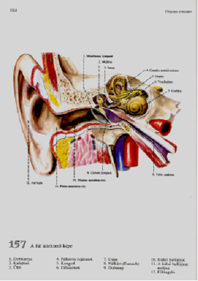
**Kép**: A fül anatómiája (Békésy alapján)

|         **Távközléstörténet**         |        **_-1-_**        |     **V2.26.3**      |
| :-----------------------------------: | :---------------------: | :------------------: |
|  |  **H45**  2026 |  |

---
# 2\. 🔊A fül

[Voice program download](https://www.audacityteam.org/download/)

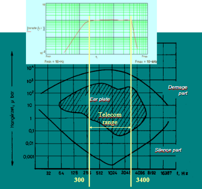

**Kép**: A fül hallásgörbéi

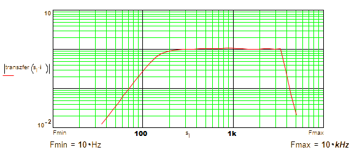

**Kép**: A távközlési frekvencia átviteli karakterisztika 

|         **Távközléstörténet**         |        **_-2-_**        |     **V2.26.3**      |
| :-----------------------------------: | :---------------------: | :------------------: |
|  |  **H45**  2026 |  |

---
# 3\. ☎Beszédtovábbítás alapja

## Távbeszélőtechnika

A távbeszélőtechnika a távközléstechnika egyik ága, amely az elektromos beszédátvitellel foglalkozik. Az elektromos beszédátvitel azt jelenti, hogy az emberi hangot az egyik végponton elektromos jellé alakítjuk, majd a másik végponton visszaalakítjuk az elektromos jelet hanggá. 

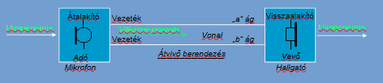

**Kép**: A hang elektromos továbbításának fizikai elve

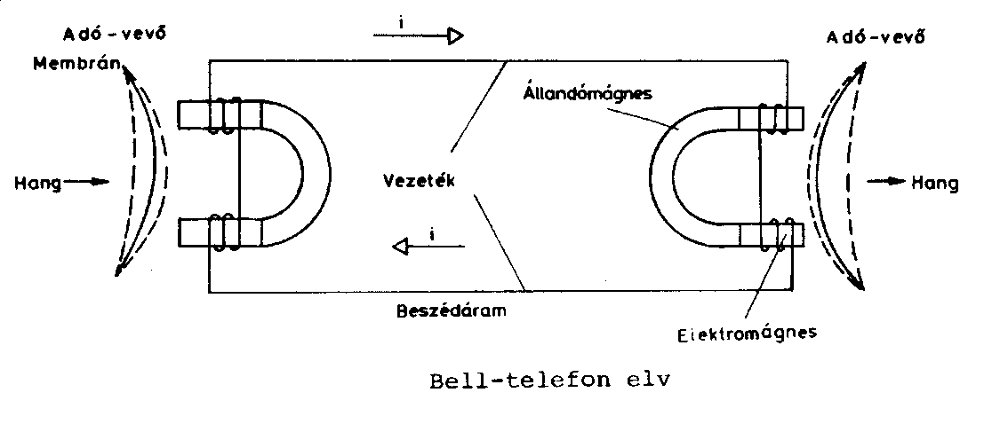

**Kép**: Bell telefonja, 1876 Philadelphiai 

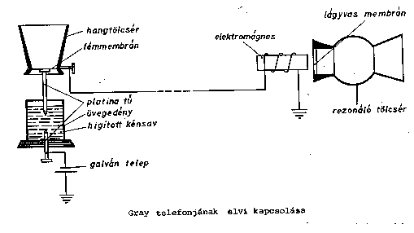

**Kép**: Gray telefonja, 1876

## Helyi telepes készülékek
[LB elv](https://hu.wikipedia.org/wiki/Telefonk%C3%A9sz%C3%BCl%C3%A9k#A%20k%C3%A9sz%C3%BCl%C3%A9k#Magyar%20k%C3%A9sz%C3%BCl%C3%A9kek#Helyi%20telepes%20k%C3%A9sz%C3%BCl%C3%A9kek)
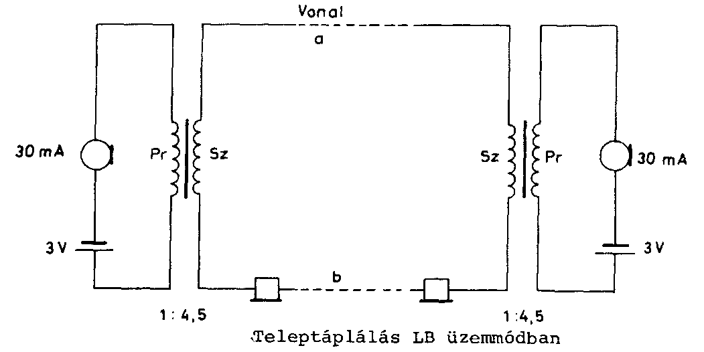
**Kép**: LB=Local Battery, azaz a telep az előfizető készülékében van.

**Kép**: [LB 37](https://www.telefonmuzeum.hu/index.php?/category/lb37)
## Központi telepes készülékek
[CB elv](https://hu.wikipedia.org/wiki/Telefonk%C3%A9sz%C3%BCl%C3%A9k#A%20k%C3%A9sz%C3%BCl%C3%A9k)

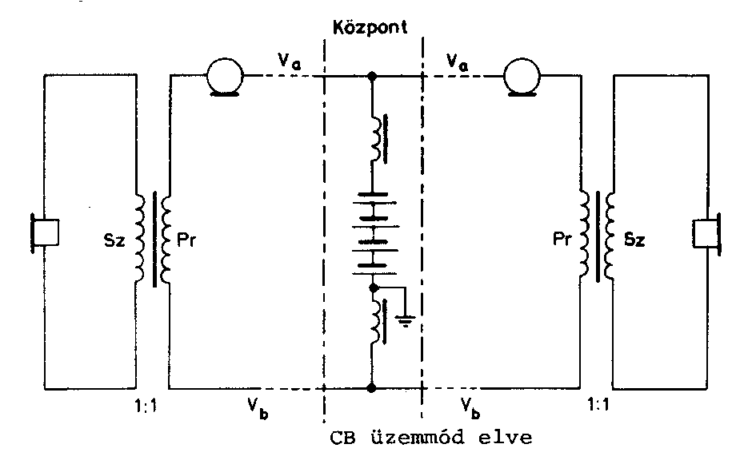

**Kép**: CB=Central Battery, azaz a telep a telefonközpontban van.

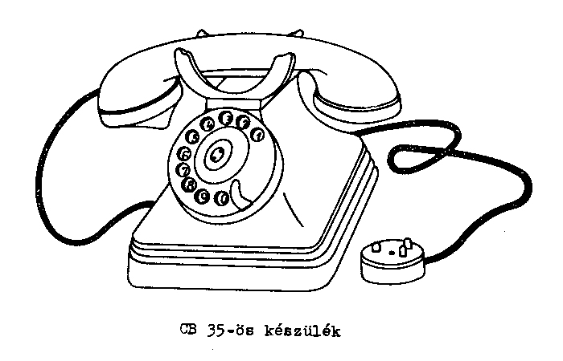
**Kép**: [CB 35](https://www.telefonmuzeum.hu/index.php?/category/cb-35)

|         **Távközléstörténet**         |        **_-3-_**        |     **V2.26.3**      |
| :-----------------------------------: | :---------------------: | :------------------: |
|  |  **H45**  2026 |  |

---
# 4\. 🏤Telefonközpontok

## A posta szerepe

A XIX. és XX. században a posta biztosította a hírközlési szolgáltatásokat:
- levélküldés
- csomagküldés
- távirat
- telefon
- telex
- műsorszórás (rádió, TV)
- FAX

Így természetes, hogy az első telefonközpontokat a postások üzemeltették akkor, amikor nem egyéb szolgáltatást végeztek.

## Kézikapcsolású telefonközpontok

Az első telefonközpontok Puskás Tivadar idejében kézi kapcsolásúak voltak.

![[LB10.jpg]]

**Kép**: LB10 kézi kapcsolású telefonközpont 

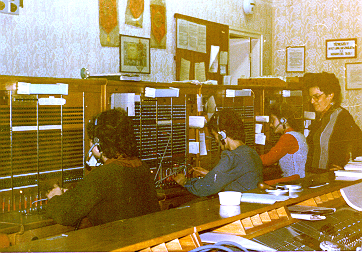

**Kép**: Kézi kapcsolású telefonközpont a XX. század első felében

A telefonhálózat oszlopokra feszített vezetékpárokból állt.

**Kép**: Korai japán távközlő vezeték hálózat (filmrészlet)

A helyközi kommunikációt (távolsági hívás) telefonközpontok közötti összeköttetésekkel oldották meg.

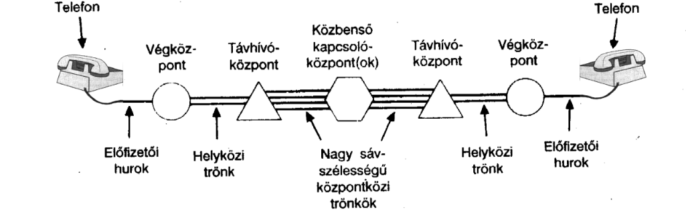
**Kép**: A távközlő hálózat (telefon, telex, FAX) felépítése

## A végközpont működése

A végközpont és a felhasználók, vagy előfizetők közötti réz érpárat "**előfizetői hurok**"-nak nevezzük. Három, időben jól elkülöníthető szakara bontható a működése.
- Hívás - calling
- Beszélgetés - talking
- Bontás - ending, booking

### Beszélgetés LB készülék esetén

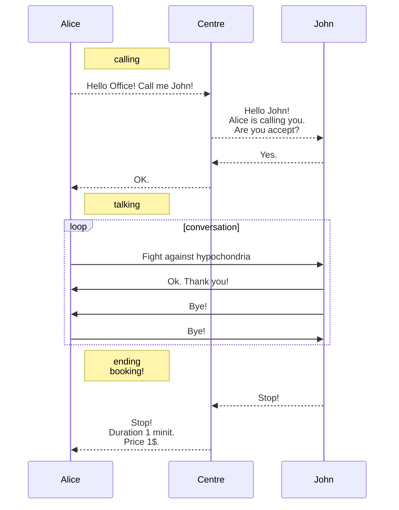

### Forgótárcsás automata központ

|                      CB 35                      |   Rotary-keresőgép    |            Rotary központ             |
| :---------------------------------------------: | :-------------------: | :-----------------------------------: |
|   a/b = pulse jelzés |  |  (2 számjegy) |

### Keresztrudas automata központ

|                      CB 35                      |             Keresztrudak              |   Crossbar központ    |
| :---------------------------------------------: | :-----------------------------------: | :-------------------: |
|   a/b = pulse jelzés |  crossbar elv |  |
### TPV központok elterjedése

Az előfizetők számának gyors növekedése szükségessé tette a posta épületeiben a bejövő vonalak bekötéseinek és rendezésének, valamint átkötéseinek biztosítására egy kábelrendező helység kialakítását. Kezdetben gyakran ebben a helységben helyezték el a központi akkumulátorokat is. 
A huzalozási nehézségek végül oda vezettek, hogy a központokban ki kellet alakítani relék segítségével egy adattárolót, ami vezérelte a központok működését. Létrejöttek a Tárolt Program Vezérlésű központok, az úgynevezett TPV központok.
A TPV központok már nem működtek szinkronban a végfelhasználói telefonkészülékekkel, hanem a bejövő hívások hívószámait eltárolták, és kis késleltetéssel a központ szabad időzítése szerint feldolgozták (kapcsoltak).
Ez tette lehetővé, hogy az előfizetői végkészülékek a jelzést ne a tápfeszültség szaggatásával küldjék be, hanem egy nyomógomb hatására megszólaló hang, az úgynevezett Tone segítségével jelezzék. A telefonközpontban frekvencia szűrők alkalmazásával döntötte el a központ (automatikusan), hogy az előfizető melyik számhoz tartozó nyomógombot nyomta meg.

|  | ![[Pasted image 20261027000754.png]] |
| :--------------------------: | :----------------------------------: |
|     Nyomógombos telefon      |      12, vagy 16 DTMF nyomógomb      |
Ld.: https://hu.wikipedia.org/wiki/Vezet%C3%A9kes_telefon
### DTMF billentyűzetfrekvenciák (hangklipekkel)

A távközlési beszédsáv 300Hz-3400Hz közötti tartománya lehetővé teszi nyolc frekvencia elkülönítését, és egymástól független átvitelét. Ha ezt a 8 frekvenciát két négyes csoportba soroljuk, és egy nyomógomb megnyomásakor egyszerre két frekvencia szólalhat meg akkor Dal-Tone Multi-Frequency (DTMF) jelzésről beszélünk.

![[DTMF_FREQUENCY.png]]

**Kép**: DTMF átviteli függvény Bode diagramja

[wikipedia](https://en.wikipedia.org/wiki/DTMF_signaling)

_A hangok lejátszásához Internet kapcsolatra van szükség._

|                                         Magas hangszín $\to$ $\downarrow$Mély hang                                          | [1209 Hz](https://upload.wikimedia.org/wikipedia/commons/transcoded/3/33/1209_Hz_Tone.ogg/1209_Hz_Tone.ogg.mp3 "Hang lejátszása") | [1336 Hz](https://upload.wikimedia.org/wikipedia/commons/transcoded/6/6b/1336_Hz_Tone.ogg/1336_Hz_Tone.ogg.mp3 "Hang lejátszása") | [1477 Hz](https://upload.wikimedia.org/wikipedia/commons/transcoded/6/6a/1477_Hz_Tone.ogg/1477_Hz_Tone.ogg.mp3 "Hang lejátszása") | [1633 Hz](https://upload.wikimedia.org/wikipedia/commons/transcoded/e/e8/1633_Hz_Tone.ogg/1633_Hz_Tone.ogg.mp3 "Hang lejátszása") |
| :----------------------------------------------------------------------------------------------------------------------------: | :-------------------------------------------------------------------------------------------------------------------------------: | :-------------------------------------------------------------------------------------------------------------------------------: | :-------------------------------------------------------------------------------------------------------------------------------: | :-------------------------------------------------------------------------------------------------------------------------------: |
| [697 Hz](https://upload.wikimedia.org/wikipedia/commons/transcoded/9/91/697_Hz_Tone.ogg/697_Hz_Tone.ogg.mp3 "Hang lejátszása") |         [**1**](https://upload.wikimedia.org/wikipedia/commons/transcoded/b/bf/Dtmf1.ogg/Dtmf1.ogg.mp3 "Hang lejátszása")         |         [**2**](https://upload.wikimedia.org/wikipedia/commons/transcoded/7/7d/Dtmf2.ogg/Dtmf2.ogg.mp3 "Hang lejátszása")         |         [**3**](https://upload.wikimedia.org/wikipedia/commons/transcoded/2/28/Dtmf3.ogg/Dtmf3.ogg.mp3 "Hang lejátszása")         |         [**A**](https://upload.wikimedia.org/wikipedia/commons/transcoded/d/d5/DtmfA.ogg/DtmfA.ogg.mp3 "Hang lejátszása")         |
| [770 Hz](https://upload.wikimedia.org/wikipedia/commons/transcoded/7/7f/770_Hz_Tone.ogg/770_Hz_Tone.ogg.mp3 "Hang lejátszása") |         [**4**](https://upload.wikimedia.org/wikipedia/commons/transcoded/9/9f/Dtmf4.ogg/Dtmf4.ogg.mp3 "Hang lejátszása")         |         [**5**](https://upload.wikimedia.org/wikipedia/commons/transcoded/1/1c/Dtmf5.ogg/Dtmf5.ogg.mp3 "Hang lejátszása")         |         [**6**](https://upload.wikimedia.org/wikipedia/commons/transcoded/7/7b/Dtmf6.ogg/Dtmf6.ogg.mp3 "Hang lejátszása")         |        [**B.**](https://upload.wikimedia.org/wikipedia/commons/transcoded/5/5a/DtmfB.ogg/DtmfB.ogg.mp3 "Hang lejátszása")         |
| [852 Hz](https://upload.wikimedia.org/wikipedia/commons/transcoded/4/4a/852_Hz_Tone.ogg/852_Hz_Tone.ogg.mp3 "Hang lejátszása") |         [**7**](https://upload.wikimedia.org/wikipedia/commons/transcoded/9/9f/Dtmf7.ogg/Dtmf7.ogg.mp3 "Hang lejátszása")         |         [**8**](https://upload.wikimedia.org/wikipedia/commons/transcoded/f/f7/Dtmf8.ogg/Dtmf8.ogg.mp3 "Hang lejátszása")         |         [**9**](https://upload.wikimedia.org/wikipedia/commons/transcoded/5/59/Dtmf9.ogg/Dtmf9.ogg.mp3 "Hang lejátszása")         |         [**C**](https://upload.wikimedia.org/wikipedia/commons/transcoded/9/96/DtmfC.ogg/DtmfC.ogg.mp3 "Hang lejátszása")         |
| [941 Hz](https://upload.wikimedia.org/wikipedia/commons/transcoded/9/96/941_Hz_Tone.ogg/941_Hz_Tone.ogg.mp3 "Hang lejátszása") |    [*****](https://upload.wikimedia.org/wikipedia/commons/transcoded/0/07/DtmfStar_1.ogg/DtmfStar_1.ogg.mp3 "Hang lejátszása")    |         [**0**](https://upload.wikimedia.org/wikipedia/commons/transcoded/2/2d/Dtmf0.ogg/Dtmf0.ogg.mp3 "Hang lejátszása")         |     [**#**](https://upload.wikimedia.org/wikipedia/commons/transcoded/4/4b/DtmfPound.ogg/DtmfPound.ogg.mp3 "Hang lejátszása")     |         [**D**](https://upload.wikimedia.org/wikipedia/commons/transcoded/9/99/DtmfD.ogg/DtmfD.ogg.mp3 "Hang lejátszása")         |

|         **Távközléstörténet**         |        **_-4-_**        |     **V2.26.3**      |
| :-----------------------------------: | :---------------------: | :------------------: |
|  |  **H45**  2026 |  |

---
# 5 \. ⌨Adatátvitel kezdete: Morze és Telex

## Morze kód továbbítás

Az elektromágneses hullámok felfedezésekor, még az erősítők megjelenése előtt felmerült az igény az információ fénysebességgel történő továbbítására. Kezdetben csak fémes vezetők azaz vezetékek segítségével (oszlopra szerelt villanydrótokkal) valósult meg, majd a tengeri és légi kommunikáció bekapcsolásával rádió hullámok segítségével.
Az első sikert Morze érte el. Egyszerű ASK kódolást valósított meg a morze-billentyű segítségével.
Ld.: https://hu.wikipedia.org/wiki/Samuel_Morse, vagy https://en.wikipedia.org/wiki/Samuel_Morse

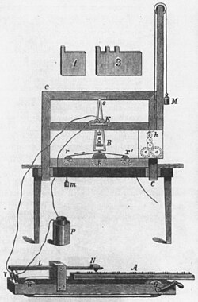

**Kép**: Eredeti Samuel Morse távíró

![[Morse_codes.png]]

**Kép**: Morze kódtábla

A kódolás hátránya, hogy a gyors továbbítás érdekében a legrövidebb kódokat választotta Morze, így viszont a betűk kódjának hossza változó, és abban az időben nem volt automatizálható. A vett jeleket egy toll papírcsíkra rajzolta, és a postásnak kellett értelmezni, elolvasni és szóban, vagy írásban továbbadni.

## Telex, Teletype

A változó kódhossz használatát küszöbölte ki a TELEX, amely az ASK billentyű-jeleket az akkoriban feltalált asztali írógéppel hozta létre, és a vett jeleket is az írógéphez hasonlóan papírra írta automatikusan. A papírcsíkot felváltotta a lyukszalag, amely lehetővé tette a gépelt szöveg későbbi, esetleg többszöri felhasználását.
Ld.: https://en.wikipedia.org/wiki/Telex

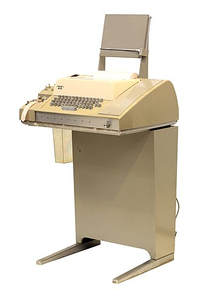
**Kép**: Teletype Model 33 ASR teleprinter
ami lyukszalag- olvasóval és lyukasztóval, számítógépes terminálként használható. https://en.wikipedia.org/wiki/Teletype_Model_33
Az 1930-as évektől használták.

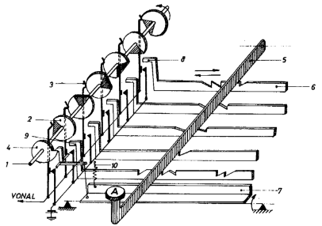

**Kép**: Telex (távgépíró) adó része

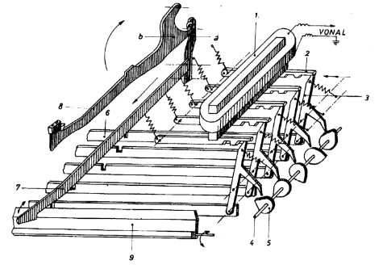

**Kép**: Telex (távgépíró) vevő része

### A TELEX átvitel kódolása

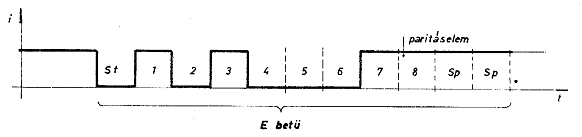

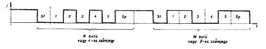
**Kép**: A Telex adatátvitele egyenáramú ASK kódolással történt

### A lyukszalag kódolása

Az angol ABC 26 betűje volt az alapja a gépelt szövegnek. A korábban felfedezett és szabadalmaztatott írógép volt az alapja az összeköttetésnek, így a cél az volt, hogy az egyik írógépen (Teletype-on) leírt szöveg a másikon íródjon papírra. Ezért a 26 betű mellé 5 írógép vezérlő kódot is át kellett vinni:
- **kocsiváltó** - kocsi (írófej) vissza a sor elejére (soremelés nélkül)
- **soremelő** - papír emelés egy sor magassággal (a kocsi helyzetétől függetlenül)
- **betűváltó** - kis betű/nagy betű
- **számváltó** - betű-/szám-, vagy írásjel váltó (Jel)
- **szóköz** - (Space) helykitöltő

Az 5+26=31 karakter 5 biten ábrázolható, megkülönböztethető.

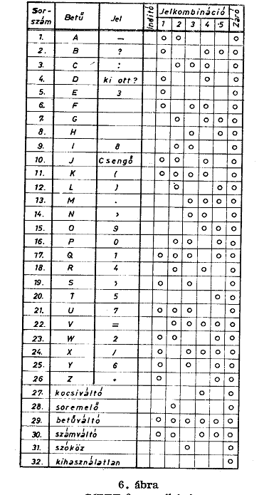
**Kép**: A Teletype lyukszalagjának kódolása

### A klaviatúra

Az **írógép** egy mechanikus vagy elektromechanikus gép karakterek begépelésére. Az első kereskedelmi írógépeket 1874-ben mutatták be, de az Egyesült Államok irodáiban csak az 1880-as évek közepe után váltak elterjedtté.
Ld.: https://en.wikipedia.org/wiki/Typewriter

![[Irogep1930.png]]
**Kép**: Írógép az 1930-as évekből

A Teletype és az írógép billentyűzete Amerikában megegyezett. Európában a "Z" és "Y" billentyűket felcserélték.

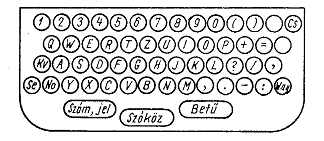
**Kép**: Teletype QWERTZ billentyűzete

A billentyűzet hasonlósága: Az 1870-es években írógépekhez kifejlesztett QWERTY továbbra is a de facto szabvány billentyűzetkiosztás az angol nyelvű számítógépes billentyűzetekhez .

### ASCII kódtábla
Az **ASCII** (**A**merican **S**tandard **C**ode for **I**nformation **I**nterchange ), egy karakterkódolás, _angol nyelvre fókuszált nyomtatható betűkből és 33 vezérlőkarakterből álló készletet_ összesen 128 kódot tartalmaz. Ld.: https://en.wikipedia.org/wiki/ASCII

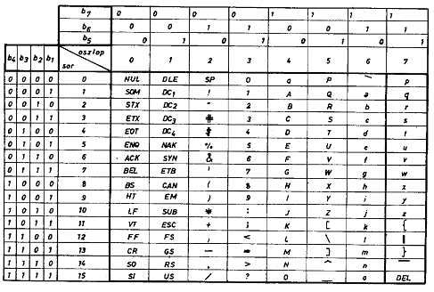
Az ASCII egy hétbites telexnyomtató kód szabványosítása, amelyet részben korábbi távírókódokból fejlesztettek ki .

Az ASCII szabvány kidolgozása 1961 májusában kezdődött, amikor Bob Bemer, az IBM mérnöke javaslatot nyújtott be az Amerikai Szabványügyi Szövetség (ASA), a mai Amerikai Nemzeti Szabványügyi Intézet (ANSI) X3.2 albizottságához . A szabvány első kiadása 1963-ban jelent meg,  a Teletype Model 33 bevezetésével egy időben . 

|         **Távközléstörténet**         |        **_-5-_**        |     **V2.26.3**      |
| :-----------------------------------: | :---------------------: | :------------------: |
|  |  **H45**  2026 |  |

---

# 6\. 🔜Digitális multiplexelés

**Időkapcsolás = TDM elv**
Az időosztásos multiplexálás,  Time Division Multiplexing,  TDM MPX  elve, hogy adott idő alatt érkező, csatornánként azonos mennyiségű adatot egyetlen csatornán kell továbbítani késleltetés nélkül.

**Kép**: A vonali kódolás folyamatábrája "T" időintervallumban

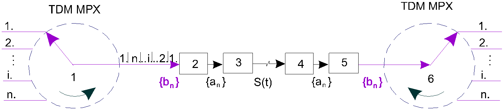

**Kép**: A központközi vonali kódolás digitális multiplexelésének folyamatábrája
![[Telephony_multiplexer_system.gif]]

**Kép**: Digitális multiplexelés elve (MPX)[^15]

|         **Távközléstörténet**         |        **_-6-_**        |     **V2.26.3**      |
| :-----------------------------------: | :---------------------: | :------------------: |
|  |  **H45**  2026 |  |

---
# 7\. ☎️Közös csatornás hálózati jelzés

A közöscsatornás jelzéstechnika alapgondolata, hogy a jelzések és a híranyagok továbbításának módja és esetenként útvonala is eltér egymástól. A jelzéseket külön, nagysebességű digitális jelzés-összeköttetéseken (jelzőcsatornán) továbbítják csomagkapcsolt üzenetekben.

**Kép**: A központok közötti nemzetközi jelzéshálózat

A jelzéshálózatot az X.25 protokoll alapján építették fel és a 7.generáció lett szabványos (SS7), míg a híranyagok digitálisan továbbítódnak szinkron digitális hálózatban (SDH).
## SS7 jelzésrendszer felépítése

**Kép**: Az Ensz ITU által javasolt **Numero 7** (Signalling System 7) nemzetközi szabvány

**Kép**: Az SS7, hét rétegű jelzésrendszer rétegei/szintjei

- Fizikai/elektronikai megvalósítás (MTP - M Telephony Protokol)
Az analóg beszédsáv 300Hz-3400Hz frekvenciatartományban 0dB csillapítással továbbítódik, míg azon kívül a 0Hz-4kHz tartományban -40dB a csillapítás. Az A/D átalakítás alapelve szerint, ha a legnagyobb frekvencia 4kHz, akkor a mintavételi frekvencia minimum 8kHz kell, hogy legyen. 8 bites kódolást használva a digitális sebesség 64kbit/sec . TDM multiplexálással 32 csatornát összefogva 2Mbit/sec SDH hálózat az alap jeltovábbítás központon belül, de további multiplexálással gigabit/sec sebességen optikai szálon továbbítódnak a jelek a helységek között.

- Távbeszélő felhasználói egység (TUP - Telephony User Part) /leépült/
- Adatátviteli felhasználói egység (DUP - Data User Part) /nem terjedt el/
- ISDN felhasználói egység (ISUP - ISDN User Part)

A TUP-nak és a DUP-nak csak történelmi jelentősége van, az ISUP terjedt el.
A szabványos összeköttetés-mentes felhasználói egységek az intelligens hálózati és mobil alkalmazásoknál játszanak szerepet.

**Ezek a következők:**
- Jelzésösszeköttetés-vezérlés (SCCP - Signalling Connection Control Part)
- Tranzakciós képességek (TCAP - Transaction Capabilities)
- Mobil alkalmazások (MAP - Mobile Application Part)
- Üzemviteli és fenntartási egység (OMAP - Operation and Maintenance Application Part)
- IN-alkalmazási egység (INAP - Intelligent Network Application Part) 

# 8\. 📠Digitális adatátvitel analóg beszédsávban

A számítástechnika fejlődésének kezdeti szakaszában (1940-1950 között) a tranzisztor előtti korszakban csak terminálok (teletype) csatlakoztak a központi számítógéphez. [^1]
Ld.: https://en.wikipedia.org/wiki/History_of_computing_hardware

Később a miniatürizálás hatására a központi egységek átalakultak adattárolókká és nagy sebességű műveletvégző egységgé, azaz szerverekké, a terminálok pedig egyre intelligensebb klienssé. Kialakult a **szerver-kliens** arhitektúra.

![[SorosPort.png]]
**Kép**: Közeli szerver-kliens kapcsolat

## Közeli digitális adatátvitel

Az '50-es évektől a '70-es évekig a szervereket klimatizált gépteremben helyezték el és rendszergazdák üzemeltették, míg a klienseket különböző terminál szobákban nem túl távol a gépteremtől. Az összeköttetést kábelek biztosították, nem túl bonyolult egyenáramú ASK kódolásos adatátvitellel. Két típusa alakult ki, a párhuzamos adatátvitel és a soros adatátvitel.

## Soros és párhuzamos portok

### Átvitel elve

![[Párhuzamos.png]]
**Kép**: Digitális párhuzamos és soros adatátvitel elve

Soros adatátvitellel (soros porton keresztül) csatlakoztatták a terminálokat (kliensseket), míg párhuzamos porton keresztül a nyomtatókat.

### DB9 - RS232 csatlakozó V.24 szabvány
A CCITT nemzetközi távközlési bizottság a V.24-es és V.28-as ajánlásaiban 1960-ban határozta meg a soros kommunikációs szabvány feladatait és elektromos jellemzőit.[^4]

![[RS-232.jpeg]]
**Kép**: RS232 szabvány kilenc pólusú DB9 csatlakozója

![|300][V24.png]
**Kép**: V.24 9 pólusú csatlakozó szabványos kábel összeköttetései

## Távoli digitális adatátvitel
A kezdeti számítógéphálózatot 1966-1975 között az ARPANET-et[^2], a nagy gépek (szerverek) összekapcsolása és a köréjük telepített közeli terminálszobák jellemezték. Ezek általában kormányzati hivatalokban, honvédelmi intézményekben és  egyetemeken lettek telepítve. A nyolcvanas években megjelent az igény a vidék és távoli helységek bekapcsolására az akkorra nemzetközivé vált Internet hálózatba. A "nagyfogyasztók" joga maradt a digitális bérelt vonalak használatának joga (pl.:TELEX) valamint a rádió-, TV-, műholdas- műsorsugárzás joga, lakossági felhasználásra kézenfekvő volt a nyilvános kapcsolt telefon hálózatot (**P**ublic **S**witched **T**elephone **N**etwork = **PSTN**) felhasználni. 

![[PPP.png]]
**Kép**: Távoli szerver-kliens kapcsolat

Digitális adatot analóg beszédsávban **modem**[^3] (**mo**dulátor-**dem**odulátor) segítségével vált lehetővé.
A modem szó a MOdulator-DEModulator szavak kezdeteinek összetételéből származik. Funkciója, hogy a számítógép által soros (vagy párhuzamos) porton kiadott digitális információt valamilyen modulációs eljárás segítségével kapcsolt telefonvonalon eljuttassa a távoli végen található (demodulátorral összekapcsolt) számítógéphez.

![[PSTN.png]]
**Kép**: PSTN hálózat használata számítógép belső modemmel adatátvitelre

Napjainkban az RS-232 [^4] lassan a háttérbe szorul, feladatait főleg az USB[^5] veszi át.
## Modem típusok

1984-ig kizárólag külső modemeket gyártottak, amelyek RS-232 porton csatlakoztak számítógéphez. 1981-ben jelent meg az első Personal Computer[^6](**IBM PC**), 1984-ben pedig az IBM AT. Ezzel eggyidőben megjelent az ITU-T V.22bis szabvány szerint működő belső modem is a piacon.

|  |  |   |  |   |
| :------------------------: | :------------------------: | :---------------------------------: | :----------------------------------: | :-----------------------------: |
|      V.22 külső modem      |      V.22 belső modem      |     V.34 külső modem (front)     |      V.34 külső modem (back)      |        V.34 belső modem         |
Az ezredfordulón jelent meg a csúcssebességű V.92 szabványnak megfelelő 56 kilobit/sec sebességű modem, majd ezután fokozatosan kiszorult a piacról. Átvette a helyét a kapcsolt vonali vezetékes kommunikációban a 64 kbit/sec sebességű ISDN, illetve a növekvő sebességű mobil telefon. A vezetékes bérelt vonali összeköttetések (nem kapcsolt) protokolja az ADSL lett.

## Modulációs eljárások
Ezeket a modemeket FAX-modemnek is hívták, mert alkalmasak voltak FAX készülékekkel is kommunikálni. [^13]
### Eljárások:

#### ASK [^8]

![[image_23.png]]
**Kép**: **A**mplitude **S**hift **K**eying (Amplitudó/billentyű moduláció) 

### FSK [^9]

![[FSK.png]]
**Kép**: **F**requency-**S**hift **K**eying
### PSK [^7]

![[image_24.png]]
**Kép**: **P**hase **S**hift **K**eying (Fázismoduláció)

### DPSK [^7]

![[DPSK.png]]
**Kép**: **D**ifferential **P**hase-**S**hift **K**eying

### QAM [^10]

| ![[image_25.png]] | ![[image_26.png]] |
|:-----------------:|:-----------------:|
| QAM 4 modulation  |                   |
**Kép**: **Q**uadrature **A**mplitude **M**odulation 4

![[Kommunikáció/H45/images/16-QAM_Demonstration_3.gif]]
**Kép**: **Q**uadrature **A**mplitude **M**odulation 16

### TCM [^11]

![[TCM.png]]

**Kép**: **T**rellis **C**oded **M**odulation

A **rácskódolt moduláció** (**TCM**) egy olyan modulációs séma, amely nagy hatékonysággal továbbítja az információkat a sávos csatornákon, például a telefonvonalakon keresztül. Az 1980-as évek végén a régi kapcsolt telefonszolgáltatáson (_POTS/PSTN_) keresztül működő modemek jellemzően 9,6 kbit/s sebességet értek el ezzel a modulációval.
### A betárcsázási sebességek evolúciója[^3]
Ezek az értékek maximális értékek, és a tényleges értékek bizonyos körülmények között (például zajos telefonvonalak) lassabbak lehetnek. A [baud](https://en.wikipedia.org/wiki/Baud "Baud") másodpercenként egy szimbólum; minden szimbólum kódolhat egy vagy több adatbitet.

| Átvitel sebessége, szabványa                                                                                                                                  | Moduláció | Bitsebesség kbit/s | Megjelenési év |
|:------------------------------------------------------------------------------------------------------------------------------------------------------------- |:---------:|:---------------------:| -------------- |
| 110 baud                                                                                                                                                      |  FSK-ban  |          0.1          | 1958           |
| 300 baud vagy [V.21](https://en.wikipedia.org/wiki/ITU-T_V.21 "ITU-T V.21")                                                                                   |  FSK-ban  |          0.3          | 1962           |
| 1,200/75 baud ([V.23](https://en.wikipedia.org/wiki/ITU-T_V.23 "ITU-T V.23"))                                                                                 |  FSK-ban  |       1,2/0,075       | 1964           |
| 1,200 bit/s (1200 baud) ([Bell 202](https://en.wikipedia.org/wiki/Bell_202 "Harang 202"))                                                                     |  FSK-ban  |          1.2          | 1976           |
| 1200 bit/s (600 baud) ([Bell 212A](https://en.wikipedia.org/wiki/Bell_212A "Harang 212A") vagy [V.22](https://en.wikipedia.org/wiki/ITU-T_V.22 "ITU-T V.22")) |   QPSK    |          1.2          | 1980           |
| 2,000 bit/s (1000 baud) (Bell 201A)                                                                                                                           |  PSK-ban  |          2.0          | 1962           |
| 2,400 bit/s (600 baud) ([V.22bis](https://en.wikipedia.org/wiki/ITU-T_V.22bis "ITU-T V.22bis"))                                                               |    QAM    |          2.4          | 1984           |
| 2,400 bit/s (1200 baud) ([V.26bis](https://en.wikipedia.org/wiki/ITU-T_V.26bis?action=edit&redlink=1 "ITU-T V.26bis (az oldal nem létezik)"))                 |  PSK-ban  |          2.4          |                |
| 4,800 bit/s (1600 baud) ([V.27ter](https://en.wikipedia.org/wiki/ITU-T_V.27ter "ITU-T V.27ter"))                                                              |  PSK-ban  |          4.8          | 1976           |
| 4,800 bit/s (1600 baud, Bell 208B)                                                                                                                            |   DPSK    |          4.8          |                |
| 9,600 bit/s (2400 baud) ([32. V](https://en.wikipedia.org/wiki/ITU-T_V.32 "ITU-T V.32").)                                                                     |    TCM    |          9.6          | 1984           |
| 14.4 kbit/s (2400 baud) ([V.32bis](https://en.wikipedia.org/wiki/ITU-T_V.32 "ITU-T V.32"))                                                                    |    TCM    |         14.4          | 1991           |
| 19.2 kbit/s (2400 baud) ([V.32terbo](https://en.wikipedia.org/wiki/V.32terbo "V.32terbo"))                                                                    |    TCM    |         19.2          | 1993           |
| 28.8 kbit/s (3200 baud) ([V.34](https://en.wikipedia.org/wiki/ITU-T_V.34 "ITU-T V.34"))                                                                       |    TCM    |         28.8          | 1994           |
| 33.6 kbit/s (3429 baud) ([V.34](https://en.wikipedia.org/wiki/ITU-T_V.34 "ITU-T V.34").)                                                                      |    TCM    |         33.6          | 1996           |
| 56 kbit/s (8000/3429 baud) ([V.90](https://en.wikipedia.org/wiki/ITU-T_V.90 "ITU-T V.90"))                                                                    | digitális |       56,0/33,6       | 1998           |
| 56  kbit/s (8000/8000 baud) ([V.92](https://en.wikipedia.org/wiki/ITU-T_V.92 "ITU-T V.92"))                                                                   | digitális |       56,0/48,0       | 2000           |
_Kovács János, Nagysebességű belső modem fejlesztése, disszertáció, "Doctor Universitas" 1997_

|         **Távközléstörténet**         |        **_-8-_**        |     **V2.26.3**      |
| :-----------------------------------: | :---------------------: | :------------------: |
|  |  **H45**  2026 |  |

---

# 9\. 🖥️Az ISDN
**Az Integrated Services Digital Network** (**ISDN**) egy kommunikációs szabványkészlet a hang-, videó-, adat- és egyéb hálózati szolgáltatások egyidejű digitális továbbítására a nyilvános kapcsolt telefonhálózat digitalizált áramkörein keresztül[^12]A szabványon 1980-ban kezdődött a Bell Labs-ban, és 1988-ban hivatalosan szabványosították a [CCITT](https://en.wikipedia.org/wiki/ITU-T "ITU-T") "Red Book" -ban.

![[Kommunikáció/H45/images/image53.png]]
**Kép**: **ISDN** logó

## A digitális nyilvános hálózat alapja a PCM-MPX

Az **impulzuskód-moduláció** (**PCM**) egy olyan módszer, amelyet az analóg jelek digitális ábrázolására használnak. Ez a digitális hang szabványos formája a számítógépekben, kompakt lemezekben, digitális telefonálásban és más digitális audio alkalmazásokban.[^14]

![[TDM-MPX.png]]
**Kép**: **I**mpulzuskód moduláció(PCM) az időosztásos multiplexelés (MPX) elve

![[PCM.png]]
**Kép**: Az Európai PCM30/32 digitális hálózat 2Mbit/s sebességű multikeretének szerkezete (ISDN30)
## ISDN előfizetői hálózatkialakítások

![[ISDN-NT.png]]
**Kép**: **ISDN** hálózatok

## Integrált szolgáltatások

- LAN-LAN összeköttetés
- G4 csoportú FAX
- Videokonferencia
- Állománytovábbítás (File Transfer)
- Internet csatlakozás
![[ISDN2.png]]
**Kép**: **ISDN2** magán célra

![[ISDN30.png]]
**Kép**: **ISDN30** vállalati célra

## Az So busz

**Az S 0 busz** egy interfész egy ISDN alapcsatlakozási telepítésen belül. Házon belüli vezetékezésre használják, és összekapcsolja az ISDN terminálokat az NTBA-val [^16]

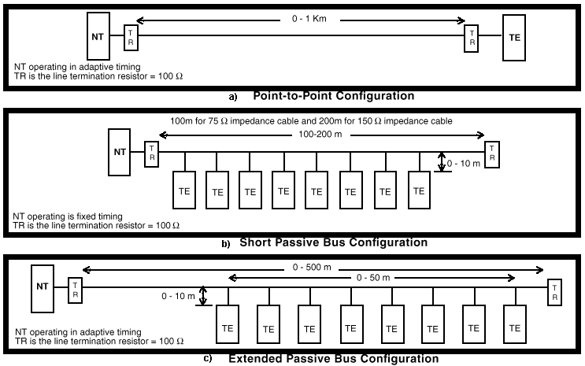
**Kép**: **ISDN2** So busz három szabványa
- Long busz
- Short busz
- Extended

TR: lezáró ellenállás mindenütt 2x100ohm
## EWSD

- Az újabb fejlesztések eredményeként (SIEMENS nyomán):
- Az új EWSD max. kapacitása
- 	 	  \>1 000 000 BHCA.[^18]
- A tranzit központ max. kapacitása
- 	 	  240 000 trönk. (1 trönk=2Mbit/sec)
- A max. forgalom 100 000 Erl.[^17]

**Kép**: Miskolci EWSD központ 2000-ben

|         **Távközléstörténet**         |        **_-9-_**        |     **V2.26.3**      |
| :-----------------------------------: | :---------------------: | :------------------: |
|  |  **H45**  2026 |  |
________
# 10\. 🏧Bérelt digitális vonali összeköttetések

## ATM szabvány
Az **aszinkron átviteli mód** (**ATM**=**Asynchronous Transfer Mode**) az American National Standards Institute ([ANSI](https://en.wikipedia.org/wiki/American_National_Standards_Institute "Amerikai Nemzeti Szabványügyi Intézet")) és az ENSZ Nemzetközi Távközlési Unió távközlési szabványügyi szektora([ITU-T](https://en.wikipedia.org/wiki/International_Telecommunication_Union_Telecommunication_Standardization_Sector "Nemzetközi Távközlési Unió Távközlési Szabványügyi Szegélyzet")) (ITU-T, korábban CCITT) által meghatározott távközlési szabvány[^19], amely többféle forgalom digitális átvitelére szolgál. Az ATM-et úgy fejlesztették ki, hogy megfeleljen a széles-sávú integrált szolgáltatások digitális hálózata([B-ISDN](https://en.wikipedia.org/wiki/Broadband_Integrated_Services_Digital_Network "Szélessávú integrált szolgáltatások digitális hálózata")) igényeinek, amelyet az 1980-as évek végén határoztak meg,[^20] és amelyet távközlési hálózatok integrálására terveztek.
Az ATM tervezésének idején a 155 Mbit/s [szinkron digitális hierarchiát](https://en.wikipedia.org/wiki/Synchronous_digital_hierarchy "Szinkron digitális hierarchia") 135 Mbit/s hasznos teherrel gyors optikai hálózati kapcsolatnak tekintették, és a digitális hálózatban számos plesiochronos digitális hierarchia [PDH](https://en.wikipedia.org/wiki/Plesiochronous_digital_hierarchy "Plesiochronos digitális hierarchia") kapcsolat jelentősen lassabb volt, az Egyesült Államokban 1,544 és 45 Mbit/s között, Európában pedig 2 és 34 Mbit/s között.

## ATM hálózat Magyarországon 2010-ben

![[ATM-2010.png]]
**Kép**: **MATÁV** optikai ATM gerinchálózata (155 Mbit/s)

## ATM protokol

![[ATM-Cell.png]]
**Kép**: **ATM** 53 bájtos cella

## LAN-Flex szolgáltatás az ezredfordulón

![[ATM-LAN.png]]

**Kép**: **LAN-Flex** „madártávlatból"

|         **Távközléstörténet**         |       **_-10-_**        |     **V2.26.3**      |
| :-----------------------------------: | :---------------------: | :------------------: |
|  |  **H45**  2026 |  |
______
# 11\. ▶️Beszédtovábbítás Interneten
**A Voice over Internet Protocol** (**VoIP**), más **néven** IP-telefonálás, olyan technológiák összessége, amelyeket elsősorban az Internet Protocol (IP) alapú hálózatokon keresztüli hangkommunikációs munkamenetekhez használnak[^21].
Az **internetes telefonálás**, a **szélessávú telefonos** **telefonszolgáltatás** és a **szélessávú telefonszolgáltatás** tágabb feltételei kifejezetten a hang- és egyéb kommunikációs szolgáltatások, például a fax, az SMS és a hangüzenetek interneten keresztüli továbbítására vonatkoznak, ellentétben a hagyományos nyilvános kapcsolt telefonhálózattal (PSTN), közismert nevén egyszerű régi telefonszolgáltatással (POTS).

![[Voip-typical.gif]]
**Kép**: **VoIP** példa a lakossági hálózatra[^21]

## A hangátvitel elve IP hálózaton

![[VoIP.png]]
**Kép**: **VoIP** hangtovábbítás

## VoIP hangtovábbítási szabványok

RFC 0760 DoD standard Internet Protocol. J. Postel. Jan-01-1980. 
RFC 0791 Internet Protocol. J. Postel. Sep-01-1981. 

![[VoIP_Speed.png]]
**Kép**: **VoIP** kommunikációs protokollok

![[VoIP_SS7.png]]
**Kép**: **VoIP** jelzés protokollok

|         **Távközléstörténet**         |       **_-11-_**        |     **V2.26.3**      |
| :-----------------------------------: | :---------------------: | :------------------: |
|  |  **H45**  2026 |  |

# 12\. 🚀󠄳󠅣󠅙󠄾󠄴󠅂󠅑Fix-SMS elve

A **Short Message Service** (**SMS**) a legtöbb telefon-, internet- és mobiltelefon-rendszer fizetett szöveges üzenetküldő szolgáltatása volt. Szabványosított kommunikációs protokollokat használt, amelyek lehetővé tették a telefonok számára, hogy rövid szöveges üzeneteket cseréljenek.

![[SM-SC.png]]
**Kép**: **PSTN** hívószám kijelzés kötelező SMS küldés és fogadás esetén.

Fontos szabvány előírás, hogy az SMS küldője nem tudta a hívószámkijelzését letiltani. Azaz nem lehetett titkos, név nélküli üzenetet küldeni. Ez tette lehetővé az alkalmazását riasztó készülékekben, banki szolgáltatásokban és MMS küldeményekben.

![[SMSC.png]]
**Kép**: **PSTN/ISDN** hálózat SMS szolgáltatása
Az ISDN hálózatban megvalósult az SMS küldési lehetőség, a PSTN hálózatban viszont a telefonok többsége nem volt alkalmas SMS küldésre. Ezekre a telefonokra érkező küldeményeket egy szerver automatikusan felolvasta.

## Mobil SMS küldés

![[MATÁV-SMSC.png]]

Indító oldalon a kiszolgáló MSC megkapja az SMS-t (1).
Ezután az MSC a VLR-hez fordul, ahonnan lekérdezi a küldő fél jogosultságát SMS küldéshez (2).
Ha a lekérdezés eredménye sikeres, az MSC elküldi az SMS-t a mobil SMS központba (SMSC) közvetlenül ha lehet, ha így nem megy, interworking MSC-n keresztül (4, 5). 
Az SMSC nyugtázza a vételt az MSC-nek közvetlenül vagy az interworking MSC-n keresztül (6, 7).
Az MSC nyugtázza az SMS küldést az előfizető felé (8).

Na de ez már egy másik lecke!

|         **Távközléstörténet**         |       **_-12-_**        |     **V2.26.3**      |
| :-----------------------------------: | :---------------------: | :------------------: |
|  |  **H45**  2026 |  |

# Zárszó

Köszönöm a figyelmet!

© fizikova@csindra.hu

[^1]: https://en.wikipedia.org/wiki/History_of_computing_hardware
[^2]: https://en.wikipedia.org/wiki/ARPANET
[^3]: https://en.wikipedia.org/wiki/Modem
[^4]: https://hu.wikipedia.org/wiki/RS-232
[^5]: https://en.wikipedia.org/wiki/USB
[^6]: https://en.wikipedia.org/wiki/IBM_Personal_Computer
[^7]: https://en.wikipedia.org/wiki/Phase-shift_keying
[^8]: https://en.wikipedia.org/wiki/Amplitude-shift_keying
[^9]: https://en.wikipedia.org/wiki/Frequency-shift_keying
[^10]: https://en.wikipedia.org/wiki/Quadrature_amplitude_modulation
[^11]: https://en.wikipedia.org/wiki/Trellis_coded_modulation
[^12]: Dr. rer. nat. Peter Bocker (1988). _ISDN The Integrated Services Digital Network: Concepts, Methods, Systems_. [Springer Berlin](https://en.wikipedia.org/wiki/Springer_Berlin "Springer Berlin") Heidelberg. [ISBN](https://en.wikipedia.org/wiki/ISBN_\(identifier\) "ISBN (identifier)") [978-3-662-08036-8](https://en.wikipedia.org/wiki/Special:BookSources/978-3-662-08036-8 "Special:BookSources/978-3-662-08036-8").
[^13]: https://en.wikipedia.org/wiki/Fax
[^14]: https://en.wikipedia.org/wiki/Pulse-code_modulation
[^15]: https://en.wikipedia.org/wiki/Multiplexer
[^16]: https://de.wikipedia.org/wiki/Network_Termination_for_ISDN_Basic_rate_Access 
[^17]: https://en.wikipedia.org/wiki/Erlang_(unit)
[^18]: https://en.wikipedia.org/wiki/Busy-hour_call_attempts
[^19]: https://en.wikipedia.org/wiki/Asynchronous_Transfer_Mode
[^20]: https://en.wikipedia.org/wiki/Asynchronous_Transfer_Mode#cite_note-bisdn-1
[^21]: https://en.wikipedia.org/wiki/Voice_over_IP
