# Wired telecommunications

| versio: V2.26.4<br>2026                             | http:\\web.csindra.hu  |
| --------------------------------------------------- |:----------------------:|
| <br>**Presenter:** Kovács János<br>fizikova©csindra.hu | 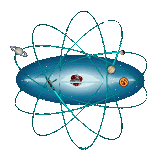 <br> Csindra Alapítvány|

|             **Outhors:**             | Debreceni Egyetem<br>Természettudományi és Technológiai Kar<br>Fizikai Intézet<br>Villamosmérnöki Tanszék |           <br><br>Debreceni Egyetem |
| :----------------------------------: | :-------------------------------------------------------------------------------------------------------: | :----------------------------------: |
| <br><br>Lajos Harasztosi|<br><br>Batistig Gábor  | <br><br>János Kovács |

# Table of Content
### 1 . 📙History of Hungarian telecom
### 2 . 🔊Ear
### 3. ☎ Fundamentals of Speech Transmission
### 4. 🏤 Telephone Exchanges
### 5. ⌨ The beginning of data transmission Morse Code and Telex
### 6. 🔜Digital Multiplexing
### 7. ☎️ Common-Channel Network Signaling
### 8. 📠 Digital Data Transmission in an Analog Voice Band
### 9. 🖥️ ISDN
### 10. 🏧 Digital Leased Line Connections
### 11. ▶️Voice Transmission over the Internet
### 12. 🚀󠄳󠅣󠅙󠄾󠄴󠅂󠅑The Principle of PSTN SMS

| History of Telecommunication |           ____________________            |             V2.26.4             |
| :--------------------------: | :---------------------------------------: | :-----------------------------: |
|  | <br>**Telecom History<br>2026<br>V2.26.4** |  |

---
# 1\. 📙History of Hungarian telecom

## Puskás Tivadar:
1877 Boston (first manual exchange)
1878 Paris
1881 Budapest ( 1 st  of May)
##  PKI=Post Research Institute:
1891 Budapest (Posta Kísérleti Állomás, Teréz exchange)
1914 New building in Zombori street
1991 MATÁV PKI-FI (bought by Deutsche Telekom)
2001 New building in Info-park
2007 Fusion with T-Mobile Hungary
## Békésy György (1899.Jún.03-1972)
1923  	 Doctor Univ. In Technical University of Budapest
1946-ig  	 PKI
1939-46  	 Professor in Experimental Physics Department of 
	 	 Pázmány Péter University
1946-47 	 Sweden (Karolinska Institute),
1947-66 	 USA (University Harvard)
1966- 	 Haway
Medical Nobel Prise in 1961

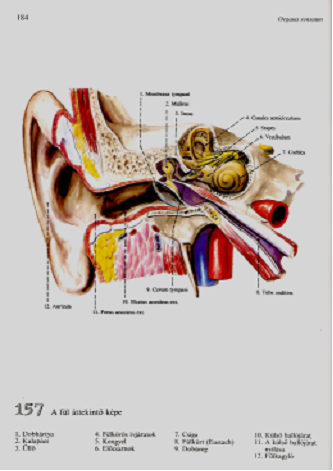
**Picture**: Anatomy of the ear (based on Békésy)

| History of Telecommunication |           _____ 1 ______            |             V2.26.4             |
| :--------------------------: | :---------------------------------------: | :-----------------------------: |
|  | <br>**Telecom History<br>2026<br>V2.26.4** |  |

---
# 2\. 🔊Ear

[Voice program download](https://www.audacityteam.org/download/)

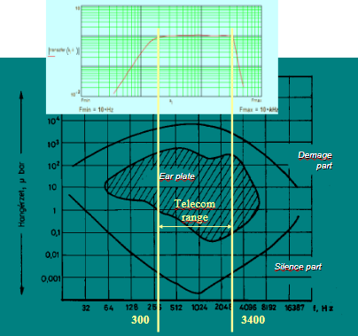

**Picture**: The ear's hearing curves

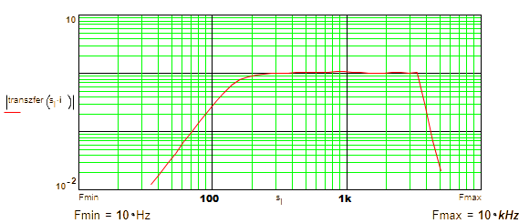


**Picture**: Telecommunication frequency transmission characteristic

| History of Telecommunication |           _____ 2 ______            |             V2.26.4             |
| :--------------------------: | :---------------------------------------: | :-----------------------------: |
|  | <br>**Telecom History<br>2026<br>V2.26.4** |  |


---
# 3. ☎ Fundamentals of Speech Transmission

## Telephony

Telephony is a branch of telecommunications technology concerned with the electrical transmission of speech. Electrical speech transmission involves converting human voice into an electrical signal at one end, and then converting that electrical signal back into sound at the other end.

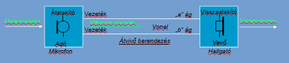

**Picture**: The physical principle of the electrical transmission of sound


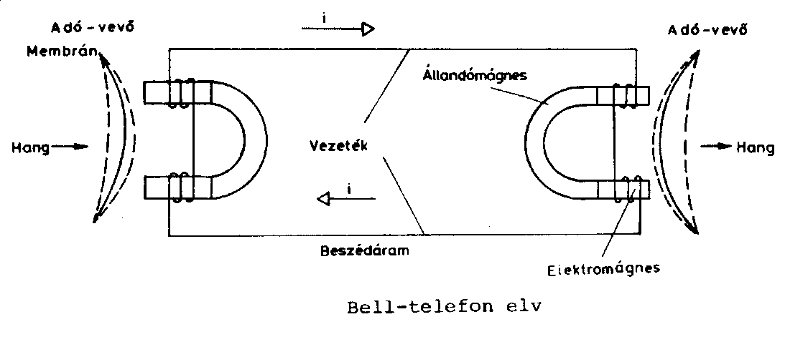
**Picture**: Bell’s telephone, Philadelphia, 1876


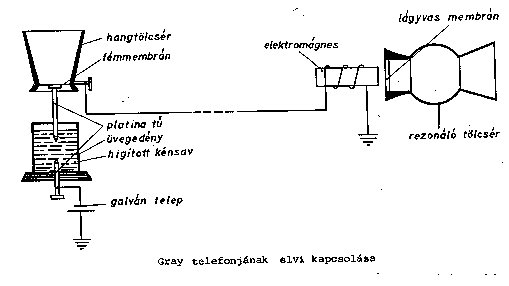

**Picture**: Gray’s telephone, 1876

## Local Battery Telephones

[LB principle](https://hu.wikipedia.org/wiki/Telefonk%C3%A9sz%C3%BCl%C3%A9k#A%20k%C3%A9sz%C3%BCl%C3%A9k#Magyar%20k%C3%A9sz%C3%BCl%C3%A9kek#Helyi%20telepes%20k%C3%A9sz%C3%BCl%C3%A9kek)

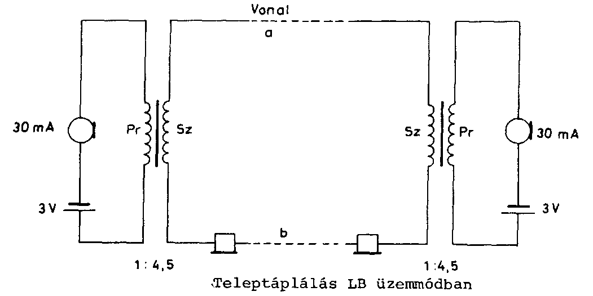
**Picture**: LB = Local Battery; the battery is located within the subscriber's telephone unit.


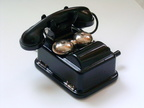

**Picture**: [LB 37](https://www.telefonmuzeum.hu/index.php?/category/lb37)

## Central Battery Telephones

[CB principle](https://hu.wikipedia.org/wiki/Telefonk%C3%A9sz%C3%BCl%C3%A9k#A%20k%C3%A9sz%C3%BCl%C3%A9k)


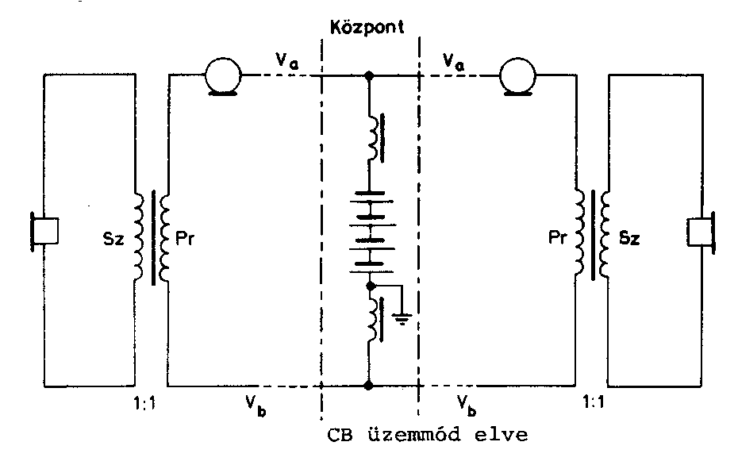

**Picture**: CB = Central Battery; the battery is located at the telephone exchange.

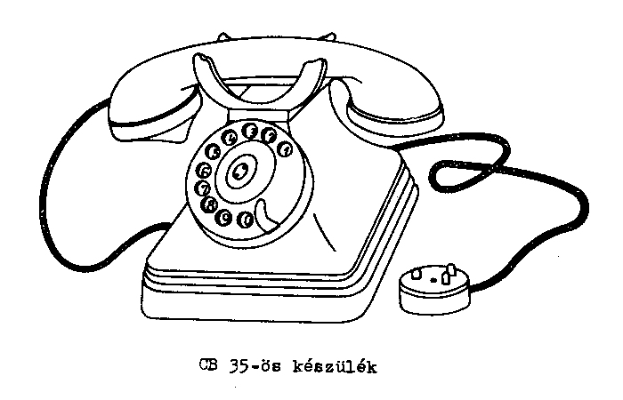

**Picture**: [CB 35](https://www.telefonmuzeum.hu/index.php?/category/cb-35)


| History of Telecommunication |           _____ 3 _______            |             V2.26.4             |
| :--------------------------: | :---------------------------------------: | :-----------------------------: |
|  | <br>**Telecom History<br>2026<br>V2.26.4** |  |


---

# 4. 🏤 Telephone Exchanges

## The Role of the Postal Service

In the 19th and 20th centuries, the postal service provided telecommunication services, including:
- mail delivery
- parcel delivery
- telegrams
- telephony
- telex
- broadcasting (radio, TV)
- fax

Consequently, it was natural for the first telephone exchanges to be operated by postal staff alongside their other duties.

## Manually Operated Telephone Exchanges

In the era of Tivadar Puskás, the first telephone exchanges were manually operated.

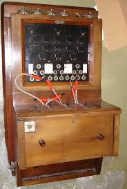

**Picture**: LB10 manually operated telephone exchange

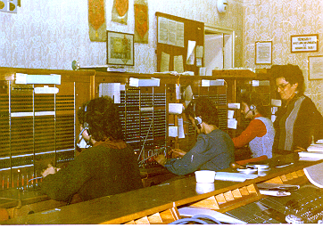

**Picture**: A manually operated telephone exchange from the first half of the 20th century

The telephone network consisted of pairs of wires strung on poles.


**Picture**: Early Japanese telecommunication line network (film excerpt)

Long-distance communication (long-distance calls) was facilitated through connections between telephone exchanges.

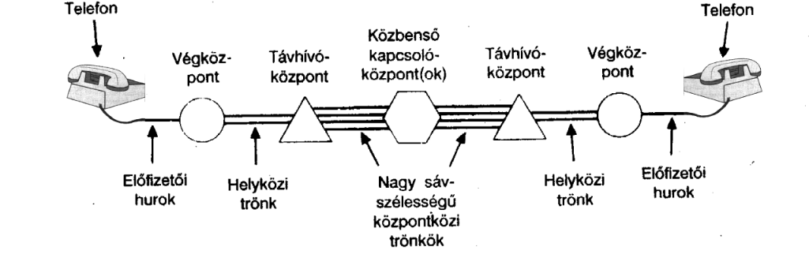
**Picture**: Structure of the telecommunication network (telephone, telex, FAX)

### Rotary-switch automatic exchange

| CB 35                      | Rotary selector    | Rotary exchange             |
| :---------------------------------------------: | :-------------------: | :-----------------------------------: |
| <br><br>a/b = pulse signaling | 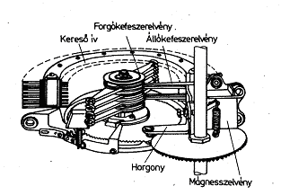 | 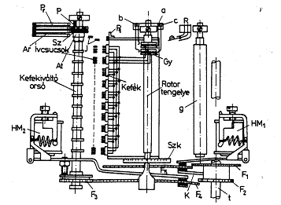<br>(2 digits) |

### Crossbar automatic exchange

|                           CB 35                           |                     Crossbars                      |      Crossbar exchange       |
| :-------------------------------------------------------: | :------------------------------------------------: | :--------------------------: |
| <br><br>a/b = pulse signaling | 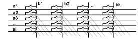<br>crossbar principle | 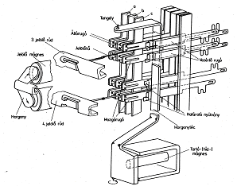 |

## Operation of the local exchange

The copper wire pair connecting the local exchange to the users—or subscribers—is called the "**subscriber loop**." Its operation can be divided into three distinct phases:

```
- Calling
- Talking
- Ending (clearing down)
```
### Conversation using an LB (local battery) telephone set

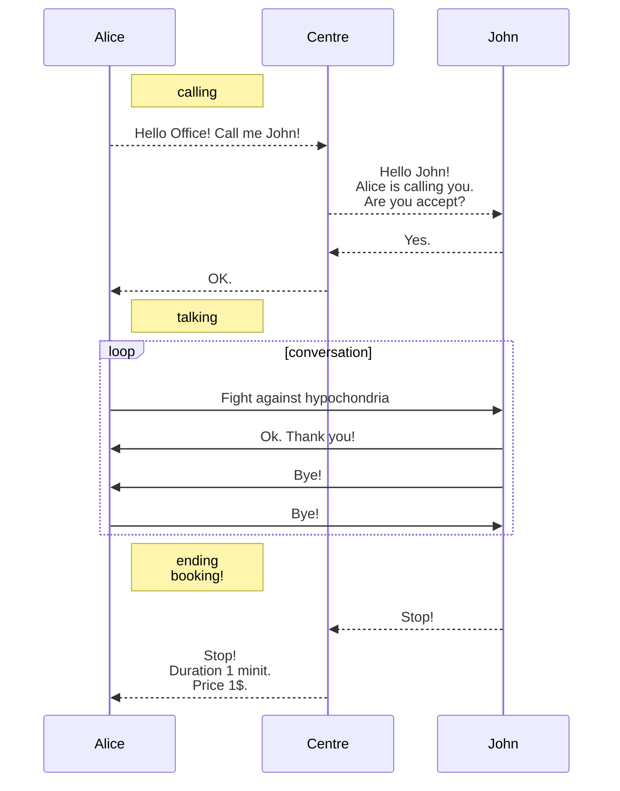

### Deployment of TPV exchanges

The rapid growth in the number of subscribers necessitated the creation of a dedicated cable distribution room within post office buildings to facilitate the termination, organization, and cross-connection of incoming lines. Initially, the central battery systems were also frequently housed in this area.
The complexities involved in the wiring eventually led to the development of a data storage mechanism within the exchanges—utilizing relays—to govern their operation. This gave rise to Stored Program Control (SPC) exchanges.
Unlike earlier systems, SPC exchanges did not operate in direct synchronization with the end-user telephone sets; instead, they captured the digits of incoming calls and processed (switched) them after a brief delay, according to the exchange's own internal timing.
This innovation allowed subscriber terminals to transmit signals not by interrupting the supply voltage, but by generating specific tones when a button was pressed. Within the telephone exchange, frequency filters were used to automatically determine which button—and thus which digit—the subscriber had pressed.

|  | 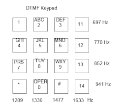 |
| :---------------------------------: | :----------------------------------: |
|        Push-button telephone        |      12 or 16 DTMF push-buttons      |
See: https://hu.wikipedia.org/wiki/Vezet%C3%A9kes_telefon
### DTMF Keypad Frequencies (with audio clips)

The telecommunication voice band—the range between 300 Hz and 3400 Hz—allows for the isolation and independent transmission of eight distinct frequencies. When these eight frequencies are organized into two groups of four, and pressing a single button triggers the simultaneous emission of two frequencies, this is known as Dual-Tone Multi-Frequency (DTMF) signaling.

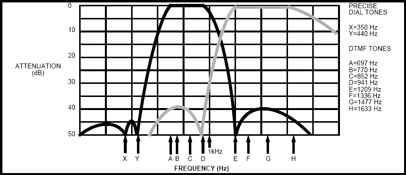

**Picture**: Bode plot of the DTMF transfer function

[wikipedia](https://en.wikipedia.org/wiki/DTMF_signaling)

_An Internet connection is required to play the sounds._

|                                           High pitch $\to$<br>$\downarrow$Low pitch                                            | [1209 Hz](https://upload.wikimedia.org/wikipedia/commons/transcoded/3/33/1209_Hz_Tone.ogg/1209_Hz_Tone.ogg.mp3 "Hang lejátszása") | [1336 Hz](https://upload.wikimedia.org/wikipedia/commons/transcoded/6/6b/1336_Hz_Tone.ogg/1336_Hz_Tone.ogg.mp3 "Hang lejátszása") | [1477 Hz](https://upload.wikimedia.org/wikipedia/commons/transcoded/6/6a/1477_Hz_Tone.ogg/1477_Hz_Tone.ogg.mp3 "Hang lejátszása") | [1633 Hz](https://upload.wikimedia.org/wikipedia/commons/transcoded/e/e8/1633_Hz_Tone.ogg/1633_Hz_Tone.ogg.mp3 "Hang lejátszása") |
| :----------------------------------------------------------------------------------------------------------------------------: | :-------------------------------------------------------------------------------------------------------------------------------: | :-------------------------------------------------------------------------------------------------------------------------------: | :-------------------------------------------------------------------------------------------------------------------------------: | :-------------------------------------------------------------------------------------------------------------------------------: |
| [697 Hz](https://upload.wikimedia.org/wikipedia/commons/transcoded/9/91/697_Hz_Tone.ogg/697_Hz_Tone.ogg.mp3 "Hang lejátszása") |         [**1**](https://upload.wikimedia.org/wikipedia/commons/transcoded/b/bf/Dtmf1.ogg/Dtmf1.ogg.mp3 "Hang lejátszása")         |         [**2**](https://upload.wikimedia.org/wikipedia/commons/transcoded/7/7d/Dtmf2.ogg/Dtmf2.ogg.mp3 "Hang lejátszása")         |         [**3**](https://upload.wikimedia.org/wikipedia/commons/transcoded/2/28/Dtmf3.ogg/Dtmf3.ogg.mp3 "Hang lejátszása")         |         [**A**](https://upload.wikimedia.org/wikipedia/commons/transcoded/d/d5/DtmfA.ogg/DtmfA.ogg.mp3 "Hang lejátszása")         |
| [770 Hz](https://upload.wikimedia.org/wikipedia/commons/transcoded/7/7f/770_Hz_Tone.ogg/770_Hz_Tone.ogg.mp3 "Hang lejátszása") |         [**4**](https://upload.wikimedia.org/wikipedia/commons/transcoded/9/9f/Dtmf4.ogg/Dtmf4.ogg.mp3 "Hang lejátszása")         |         [**5**](https://upload.wikimedia.org/wikipedia/commons/transcoded/1/1c/Dtmf5.ogg/Dtmf5.ogg.mp3 "Hang lejátszása")         |         [**6**](https://upload.wikimedia.org/wikipedia/commons/transcoded/7/7b/Dtmf6.ogg/Dtmf6.ogg.mp3 "Hang lejátszása")         |        [**B.**](https://upload.wikimedia.org/wikipedia/commons/transcoded/5/5a/DtmfB.ogg/DtmfB.ogg.mp3 "Hang lejátszása")         |
| [852 Hz](https://upload.wikimedia.org/wikipedia/commons/transcoded/4/4a/852_Hz_Tone.ogg/852_Hz_Tone.ogg.mp3 "Hang lejátszása") |         [**7**](https://upload.wikimedia.org/wikipedia/commons/transcoded/9/9f/Dtmf7.ogg/Dtmf7.ogg.mp3 "Hang lejátszása")         |         [**8**](https://upload.wikimedia.org/wikipedia/commons/transcoded/f/f7/Dtmf8.ogg/Dtmf8.ogg.mp3 "Hang lejátszása")         |         [**9**](https://upload.wikimedia.org/wikipedia/commons/transcoded/5/59/Dtmf9.ogg/Dtmf9.ogg.mp3 "Hang lejátszása")         |         [**C**](https://upload.wikimedia.org/wikipedia/commons/transcoded/9/96/DtmfC.ogg/DtmfC.ogg.mp3 "Hang lejátszása")         |
| [941 Hz](https://upload.wikimedia.org/wikipedia/commons/transcoded/9/96/941_Hz_Tone.ogg/941_Hz_Tone.ogg.mp3 "Hang lejátszása") |    [*****](https://upload.wikimedia.org/wikipedia/commons/transcoded/0/07/DtmfStar_1.ogg/DtmfStar_1.ogg.mp3 "Hang lejátszása")    |         [**0**](https://upload.wikimedia.org/wikipedia/commons/transcoded/2/2d/Dtmf0.ogg/Dtmf0.ogg.mp3 "Hang lejátszása")         |     [**#**](https://upload.wikimedia.org/wikipedia/commons/transcoded/4/4b/DtmfPound.ogg/DtmfPound.ogg.mp3 "Hang lejátszása")     |         [**D**](https://upload.wikimedia.org/wikipedia/commons/transcoded/9/99/DtmfD.ogg/DtmfD.ogg.mp3 "Hang lejátszása")         |

| History of Telecommunication |           _____ 4 _______            |             V2.26.4             |
| :--------------------------: | :---------------------------------------: | :-----------------------------: |
|  | <br>**Telecom History<br>2026<br>V2.26.4** |  |

---
# 5. ⌨ The beginning of data transmission: Morse Code and Telex

## Morse Code Transmission

Following the discovery of electromagnetic waves—and even before the advent of amplifiers—a need arose to transmit information at the speed of light. Initially, this was achieved solely through metallic conductors (i.e., wires strung on poles); later, with the inclusion of maritime and aerial communication, it was facilitated by radio waves.
Samuel Morse achieved the first breakthrough. He implemented a simple form of ASK (Amplitude-Shift Keying) using a telegraph key.
See: https://hu.wikipedia.org/wiki/Samuel_Morse, or https://en.wikipedia.org/wiki/Samuel_Morse

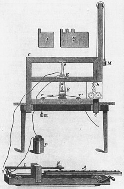

**Picture**: An original Samuel Morse telegraph

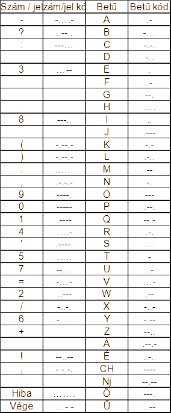

**Picture**: Morse code chart

A drawback of this encoding scheme is that, to ensure rapid transmission, Morse assigned the shortest codes to the most frequent characters. Consequently, the length of the codes varies for each letter—a system that could not be automated at the time. Received signals were recorded by a stylus onto a paper strip; a telegraph operator then had to interpret and read the sequence, subsequently relaying the message either verbally or in writing.
## Telex, Teletype

TELEX eliminated the use of variable-length codes; it generated signals using a keyboard—similar to the desktop typewriters invented around that time—and automatically recorded received signals onto paper, much like a typewriter. Paper strips were eventually replaced by punched tape, which allowed typed text to be reused later, potentially multiple times.
See: https://en.wikipedia.org/wiki/Telex


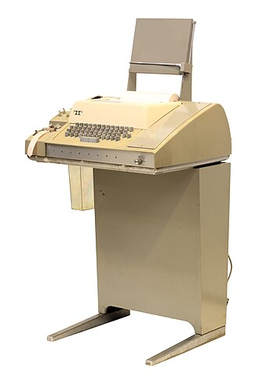
**Picture**: Teletype Model 33 ASR teleprinter
Equipped with a punched tape reader and punch, it could function as a computer terminal. https://en.wikipedia.org/wiki/Teletype_Model_33
In use since the 1930s.

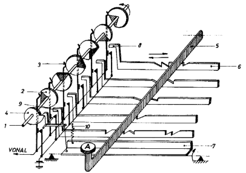

**Picture**: Transmitter component of a Telex (teleprinter)

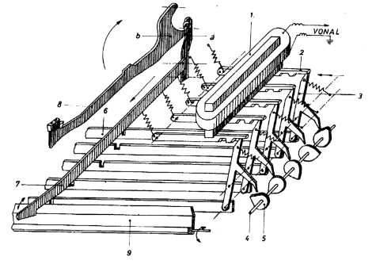

**Picture**: Receiver component of a Telex (teleprinter)

### Encoding for TELEX transmission

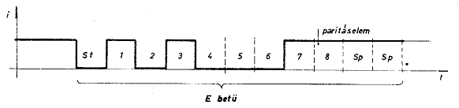

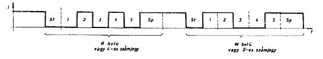
**Image**: Telex data transmission was performed using DC ASK (Amplitude Shift Keying) encoding.

### Encoding for Punched Tape

The 26 letters of the English alphabet formed the basis for the typed text. The system relied on the previously invented and patented typewriter; the objective was for text typed on one machine (a Teletype) to be reproduced on another. Consequently, in addition to the 26 letters, 5 control codes for the typewriter also had to be transmitted:
- **Carriage return** – moves the carriage (print head) back to the beginning of the line (without advancing the line).
- **Line feed** – advances the paper by one line (regardless of the carriage position).
- **Letter shift** – switches between lowercase and uppercase letters.
- **Figure shift** – switches from letters to numbers or punctuation marks.
- **Space** – a placeholder.

These 31 characters (5 control codes + 26 letters) can be represented and distinguished using 5 bits.

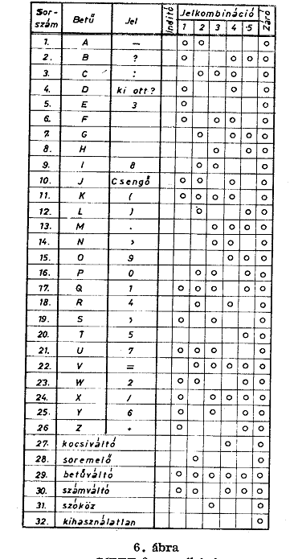
**Image**: Encoding for a Teletype punched tape

### The Keyboard

A **typewriter** is a mechanical or electromechanical machine used for typing characters. The first commercial typewriters were introduced in 1874, but they did not become widespread in offices in the United States until after the mid-1880s.
See: https://en.wikipedia.org/wiki/Typewriter

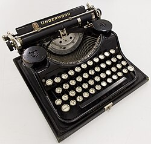
**Picture**: A typewriter from the 1930s

In America, the keyboard layout for the Teletype was the same as that of the typewriter. In Europe, the "Z" and "Y" keys were swapped.

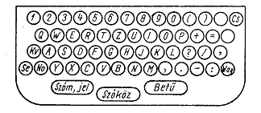
**Picture**: Teletype QWERTZ keyboard

Keyboard similarity: The QWERTY layout, developed for typewriters in the 1870s, remains the *de facto* standard keyboard layout for English-language computer keyboards.

### ASCII Code Table
**ASCII** (**A**merican **S**tandard **C**ode for **I**nformation **I**nterchange) is a character encoding system. It consists of a set of printable characters—focused on the English language—and 33 control characters, comprising a total of 128 codes. See: https://en.wikipedia.org/wiki/ASCII

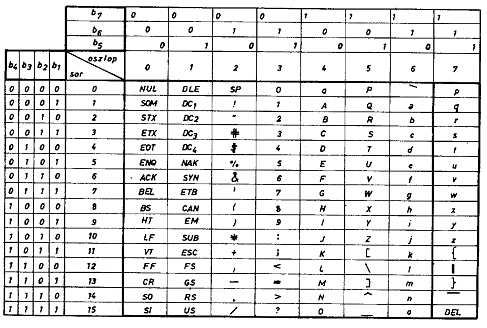
ASCII is a standardization of a seven-bit telex printer code, developed in part from earlier telegraph codes.

The development of the ASCII standard began in May 1961, when Bob Bemer, an engineer at IBM, submitted a proposal to the X3.2 subcommittee of the American Standards Association (ASA)—known today as the American National Standards Institute (ANSI). The first edition of the standard was published in 1963, coinciding with the introduction of the Teletype Model 33.

| History of Telecommunication |           ______ 5 ______            |             V2.26.4             |
| :--------------------------: | :---------------------------------------: | :-----------------------------: |
|  | <br>**Telecom History<br>2026<br>V2.26.4** |  |

---

# 6. 🔜Digital Multiplexing

**Time Switching = TDM Principle**
The principle of Time Division Multiplexing (TDM MPX) is that data arriving over various channels—with an equal amount of data per channel within a given timeframe—must be transmitted over a single channel without delay.

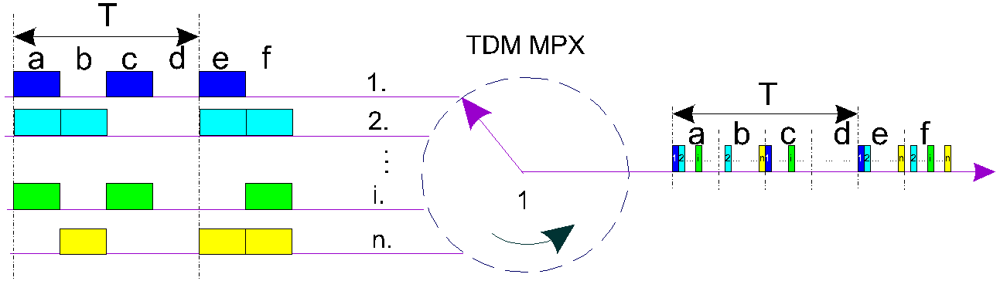
**Picture**: Flowchart of line coding within a time interval "T"

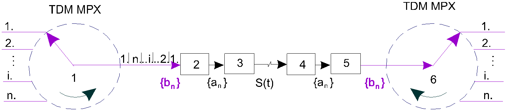

**Picture**: Flowchart of digital multiplexing for inter-exchange line coding
![[Telephony_multiplexer_system.gif]]

**Picture**: Principle of digital multiplexing (MPX)[^15]

| History of Telecommunication |           _____ 6 _______            |             V2.26.4             |
| :--------------------------: | :---------------------------------------: | :-----------------------------: |
|  | <br>**Telecom History<br>2026<br>V2.26.4** |  |

---
# 7. ☎️ Common-Channel Network Signaling

The fundamental concept of common-channel signaling is that the methods—and, in some cases, the paths—used for transmitting signaling information differ from those used for transmitting the actual payload (user traffic). Signaling information is transmitted separately via high-speed digital signaling links (signaling channels) in the form of packet-switched messages.


**Picture**: International signaling network between exchanges

The signaling network is built upon the X.25 protocol, with the 7th generation (SS7) becoming the standard, while user traffic is transmitted digitally via a Synchronous Digital Hierarchy (SDH) network.
## Architecture of the SS7 Signaling System
![[Pasted image 20261027004357.png]]
**Picture**: The international standard known as **Signalling System No. 7 (SS7)**, proposed by the ITU (International Telecommunication Union)


**Picture**: The layers of the signaling system seven-layer (SS7)

- Physical/electronic implementation (MTP – Message Transfer Part)
The analog voice band (300 Hz–3400 Hz) is transmitted with 0 dB attenuation, while outside this range—within the 0 Hz–4 kHz band—the attenuation is -40 dB. According to the principles of analog-to-digital (A/D) conversion, if the maximum frequency is 4 kHz, the sampling frequency must be at least 8 kHz. Using 8-bit encoding, the digital bit rate is 64 kbit/s. Through TDM multiplexing, 32 channels are combined to form a 2 Mbit/s stream—the standard for signal transmission within a central facility—while further multiplexing allows signals to be transmitted between locations over optical fiber at gigabit-per-second speeds.

Send feedback

- Telephony User Part (TUP) /obsolete/
- Data User Part (DUP) /did not gain widespread use/
- ISDN User Part (ISUP)

TUP and DUP are now only of historical significance; ISUP is the one that became widely adopted.
Standardized connectionless user parts play a role in intelligent network and mobile applications.

**These are as follows:**
- Signalling Connection Control Part (SCCP)
- Transaction Capabilities (TCAP)
- Mobile Application Part (MAP)
- Operation and Maintenance Application Part (OMAP)
- Intelligent Network Application Part (INAP)

| History of Telecommunication |           _____ 7 ________            |             V2.26.4             |
| :--------------------------: | :---------------------------------------: | :-----------------------------: |
|  | <br>**Telecom History<br>2026<br>V2.26.4** |  |

___
# 8. 📠 Digital Data Transmission in an Analog Voice Band

In the early stages of the development of computing (between 1940 and 1950)—the era before the transistor—only terminals (teletypes) were connected to the central computer. [^1]
See: https://en.wikipedia.org/wiki/History_of_computing_hardware

Later, driven by miniaturization, central units evolved into data storage and high-speed processing units—that is, servers—while terminals became increasingly intelligent clients. This gave rise to the **server-client** architecture.

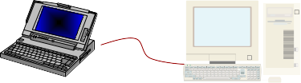
**Picture**: A close-range server-client connection

## Short-Range Digital Data Transmission

From the 1950s to the 1970s, servers were housed in air-conditioned machine rooms and managed by system administrators, while clients were located in various terminal rooms—not too far from the machine room. Connectivity was provided via cables, utilizing relatively simple DC-based ASK (Amplitude Shift Keying) encoding. Two types emerged: parallel data transmission and serial data transmission.

## Serial and Parallel Ports

### Principle of Transmission

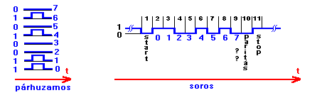
**Image**: Principle of digital parallel and serial data transmission

Terminals (clients) were connected via serial data transmission (using a serial port), while printers were connected via a parallel port.

### DB9 – RS-232 Connector and the V.24 Standard
In 1960, the CCITT (International Telegraph and Telephone Consultative Committee) defined the functions and electrical characteristics of the serial communication standard within its V.24 and V.28 recommendations.[^4]
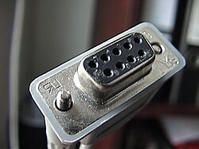
**Picture**: The 9-pin DB9 connector of the RS232 standard

![|300][V24.png]
**Picture**: Standard cable connections for a 9-pin V.24 connector

## Remote Digital Data Transmission

Early computer networking—specifically ARPANET[^2] between 1966 and 1975—was characterized by the interconnection of large machines (servers) and the terminal rooms established in their immediate vicinity. These were typically installed within government offices, defense institutions, and universities. By the 1980s, a need arose to connect rural and remote locations to what had by then become an international Internet. While the use of digital leased lines (e.g., TELEX) and infrastructure for radio, television, and satellite broadcasting remained the domain of "major users," the Public Switched Telephone Network (**PSTN**) proved the most logical choice for residential and general public use.


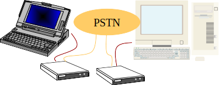
**Picture**: Remote server-client connection

The transmission of digital data over an analog voice-grade channel was made possible through the use of a **modem**[^3] (**mo**dulator-**dem**odulator).
The term "modem" is derived from the combination of the beginnings of the words "modulator" and "demodulator." Its function is to transmit digital information—output by a computer via a serial (or parallel) port—over a switched telephone line, using a modulation technique, to a computer located at the remote end (which is connected to a demodulator).
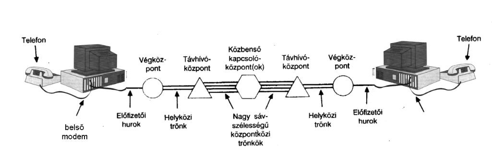
**Picture**: Using the PSTN network for data transmission via an internal computer modem

Nowadays, the RS-232 [^4] interface is gradually fading into the background, with its functions largely being taken over by USB[^5].
## Types of Modems

Until 1984, only external modems were manufactured; these connected to computers via an RS-232 port. The first Personal Computer[^6] (the **IBM PC**) appeared in 1981, followed by the IBM AT in 1984. Around the same time, internal modems operating according to the ITU-T V.22bis standard also entered the market.

| 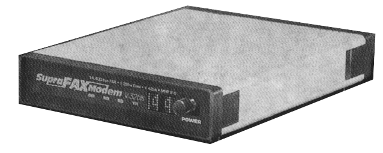 | 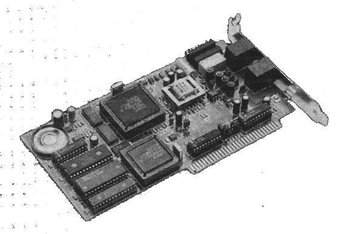 | 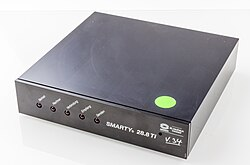<br> | 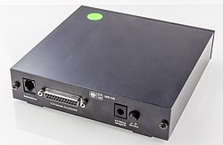 | 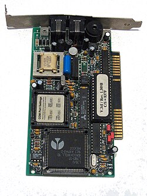<br> |
| :------------------------: | :------------------------: | :---------------------------------: | :----------------------------------: | :-----------------------------: |
|      V.22 external modem      |      V.22 internal modem      |     V.34 external modem<br>(front)     |      V.34 external modem<br>(back)      |        V.34 internal modem         |

At the turn of the millennium, the 56 kbit/s modem—compliant with the high-speed V.92 standard—emerged, only to be gradually phased out of the market. In the realm of switched-line wired communication, it was superseded by 64 kbit/s ISDN and increasingly fast mobile telephony. For wired leased-line (non-switched) connections, ADSL became the standard protocol.

## Modulation Techniques
These modems were also referred to as "fax modems," as they were capable of communicating with fax machines. [^13]
### Techniques:

#### ASK [^8]

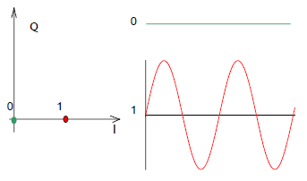
**Picture**: **A**mplitude **S**hift **K**eying 

### FSK [^9]

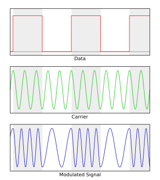
**Picture**: **F**requency-**S**hift **K**eying
### PSK [^7]

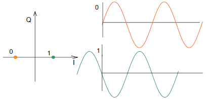
**Picture**: **P**hase **S**hift **K**eying 

### DPSK [^7]

![]images/DPSK.png)
**Picture**: **D**ifferential **P**hase-**S**hift **K**eying

### QAM [^10]


| 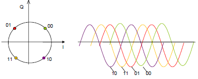 | 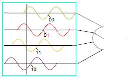 |
|:-----------------:|:-----------------:|
| QAM 4 modulation  |                   |
**Picture**: **Q**uadrature **A**mplitude **M**odulation 4

![[Kommunikáció/H45/images/16-QAM_Demonstration_3.gif]]
**Picture**: **Q**uadrature **A**mplitude **M**odulation 16

### TCM [^11]

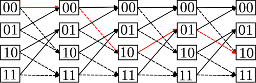

**Picture**: **T**rellis **C**oded **M**odulation

**Trellis-coded modulation** (**TCM**) is a modulation scheme that transmits information with high efficiency over band-limited channels, such as telephone lines. In the late 1980s, modems operating over the legacy public switched telephone network (_POTS/PSTN_) typically achieved speeds of 9.6 kbit/s using this modulation.
### The evolution of dial-up speeds[^3]
These figures represent maximum values; actual speeds may be lower under certain conditions (such as on noisy telephone lines). A [baud](https://en.wikipedia.org/wiki/Baud "Baud") corresponds to one symbol per second; each symbol can encode one or more data bits.

| Transmission speed, (standard)                                                                                                                              | Modulation | Bit rate<br>kbit/s | Year |
| :---------------------------------------------------------------------------------------------------------------------------------------------------------- | :--------: | :----------------: | ---- |
| 110 baud                                                                                                                                                    |  FSK-ban   |        0.1         | 1958 |
| 300 baud  ([V.21](https://en.wikipedia.org/wiki/ITU-T_V.21 "ITU-T V.21"))                                                                                   |  FSK-ban   |        0.3         | 1962 |
| 1,200/75 baud ([V.23](https://en.wikipedia.org/wiki/ITU-T_V.23 "ITU-T V.23"))                                                                               |  FSK-ban   |     1,2/0,075      | 1964 |
| 1,200 bit/s (1200 baud) ([Bell 202](https://en.wikipedia.org/wiki/Bell_202 "Harang 202"))                                                                   |  FSK-ban   |        1.2         | 1976 |
| 1200 bit/s (600 baud) ([Bell 212A](https://en.wikipedia.org/wiki/Bell_212A "Harang 212A") or [V.22](https://en.wikipedia.org/wiki/ITU-T_V.22 "ITU-T V.22")) |    QPSK    |        1.2         | 1980 |
| 2,000 bit/s (1000 baud) (Bell 201A)                                                                                                                         |  PSK-ban   |        2.0         | 1962 |
| 2,400 bit/s (600 baud) ([V.22bis](https://en.wikipedia.org/wiki/ITU-T_V.22bis "ITU-T V.22bis"))                                                             |    QAM     |        2.4         | 1984 |
| 2,400 bit/s (1200 baud) ([V.26bis](https://en.wikipedia.org/wiki/ITU-T_V.26bis?action=edit&redlink=1 "ITU-T V.26bis (az oldal nem létezik)"))               |  PSK-ban   |        2.4         |      |
| 4,800 bit/s (1600 baud) ([V.27ter](https://en.wikipedia.org/wiki/ITU-T_V.27ter "ITU-T V.27ter"))                                                            |  PSK-ban   |        4.8         | 1976 |
| 4,800 bit/s (1600 baud, Bell 208B)                                                                                                                          |    DPSK    |        4.8         |      |
| 9,600 bit/s (2400 baud) ([32. V](https://en.wikipedia.org/wiki/ITU-T_V.32 "ITU-T V.32").)                                                                   |    TCM     |        9.6         | 1984 |
| 14.4 kbit/s (2400 baud) ([V.32bis](https://en.wikipedia.org/wiki/ITU-T_V.32 "ITU-T V.32"))                                                                  |    TCM     |        14.4        | 1991 |
| 19.2 kbit/s (2400 baud) ([V.32terbo](https://en.wikipedia.org/wiki/V.32terbo "V.32terbo"))                                                                  |    TCM     |        19.2        | 1993 |
| 28.8 kbit/s (3200 baud) ([V.34](https://en.wikipedia.org/wiki/ITU-T_V.34 "ITU-T V.34"))                                                                     |    TCM     |        28.8        | 1994 |
| 33.6 kbit/s (3429 baud) ([V.34](https://en.wikipedia.org/wiki/ITU-T_V.34 "ITU-T V.34").)                                                                    |    TCM     |        33.6        | 1996 |
| 56 kbit/s (8000/3429 baud) ([V.90](https://en.wikipedia.org/wiki/ITU-T_V.90 "ITU-T V.90"))                                                                  | digitális  |     56,0/33,6      | 1998 |
| 56  kbit/s (8000/8000 baud) ([V.92](https://en.wikipedia.org/wiki/ITU-T_V.92 "ITU-T V.92"))                                                                 | digitális  |     56,0/48,0      | 2000 |
_János Kovács, Development of a High-Speed ​​Internal Modem, dissertation, "Doctor Universitas," 1997_

| History of Telecommunication |           _____ 8 ________            |             V2.26.4             |
| :--------------------------: | :---------------------------------------: | :-----------------------------: |
|  | <br>**Telecom History<br>2026<br>V2.26.4** |  |

---

# 9. 🖥️ ISDN
**Integrated Services Digital Network** (**ISDN**) is a set of communication standards for the simultaneous digital transmission of voice, video, data, and other network services over the digitized circuits of the public switched telephone network[^12]. Work on the standard began in 1980 at Bell Labs, and it was officially standardized in 1988 in the [CCITT](https://en.wikipedia.org/wiki/ITU-T "ITU-T") "Red Book."


**Image**: **ISDN** logo

## The foundation of the digital public network: PCM-MPX

**Pulse-code modulation** (**PCM**) is a method used to represent analog signals in digital form. It is the standard format for digital audio in computers, compact discs, digital telephony, and other digital audio applications.[^14]


**Image**: Pulse-code modulation (PCM) and the principle of time-division multiplexing (MPX)


**Image**: Structure of the European PCM30/32 digital network multiframe at a speed of 2 Mbit/s (ISDN30)
## ISDN subscriber network configurations


**Image**: **ISDN** networks

## Integrated Services

- LAN-to-LAN connection
- Group 4 (G4) FAX
- Videoconferencing
- File transfer
- Internet access

**Image**: **ISDN2** for private use


**Image**: **ISDN30** for corporate use

## The S0 Bus

**The S0 bus** is an interface within an ISDN basic access installation. It is used for internal (on-premises) wiring and connects ISDN terminals to the NTBA[^16].


**Image**: Three standards for the **ISDN2** S0 bus
- Long bus
- Short bus
- Extended

TR: Terminating resistor (2x100 ohms) at each end
## EWSD

- As a result of further developments (following SIEMENS):
- Maximum capacity of the new EWSD:
- 	 	  >1,000,000 BHCA  .
- Maximum capacity of the transit exchange:
- 	 	  240,000 trunks (1 trunk = 2 Mbit/sec).
- Maximum traffic: 100,000 Erl.[^17]


**Picture**: EWSD exchange in Miskolc in 2000

| History of Telecommunication |           _____ 9 _______            |             V2.26.4             |
| :--------------------------: | :---------------------------------------: | :-----------------------------: |
|  | <br>**Telecom History<br>2026<br>V2.26.4** |  |

________
# 10. 🏧 Digital Leased Line Connections

## The ATM Standard
**Asynchronous Transfer Mode** (**ATM**) is a telecommunications standard[^19]—defined by the American National Standards Institute ([ANSI](https://en.wikipedia.org/wiki/American_National_Standards_Institute)) and the Telecommunication Standardization Sector of the International Telecommunication Union ([ITU-T](https://en.wikipedia.org/wiki/International_Telecommunication_Union_Telecommunication_Standardization_Sector), formerly CCITT)—used for the digital transmission of various types of traffic. ATM was developed to meet the requirements of the **Broadband Integrated Services Digital Network** (**B-ISDN**), which was defined in the late 1980s[^20] and designed for the integration of telecommunications networks. At the time ATM was being designed, the 155 Mbit/s [Synchronous Digital Hierarchy](https://en.wikipedia.org/wiki/Synchronous_digital_hierarchy "Synchronous Digital Hierarchy")—with a payload of 135 Mbit/s—was considered a high-speed optical network connection; meanwhile, many [Plesiochronous Digital Hierarchy (PDH)](https://en.wikipedia.org/wiki/Plesiochronous_digital_hierarchy "Plesiochronous Digital Hierarchy") links within digital networks were significantly slower—ranging from 1.544 to 45 Mbit/s in the United States, and from 2 to 34 Mbit/s in Europe.

## ATM Network in Hungary in 2010

**Picture**: **MATÁV** optical ATM backbone network (155 Mbit/s)

## ATM protocol


**Image**: **ATM** 53-byte cell

## LAN-Flex service at the turn of the millennium


**Image**: **LAN-Flex** from a "bird's-eye view"

|         **Telecomhistory**         |       **_-10-_**        |     **V2.26.4**      |
| :-----------------------------------: | :---------------------: | :------------------: |
|  | <br>**H45**<br><br>2026 |  |
______
# 11\. ▶️Voice Transmission over the Internet

**Voice over Internet Protocol** (**VoIP**)—also known as IP telephony—is a set of technologies primarily used for voice communication sessions over Internet Protocol (IP)-based networks[^21].
Broader terms such as **Internet telephony**, **broadband telephony**, and **broadband phone service** specifically refer to the transmission of voice and other communication services—such as fax, SMS, and voicemail—over the Internet, as opposed to the traditional Public Switched Telephone Network (PSTN), commonly known as Plain Old Telephone Service (POTS).


**Image**: Example of **VoIP** in a residential network[^21]

## The Principle of Voice Transmission over an IP Network


**Image**: **VoIP** voice transmission

## VoIP Voice Transmission Standards

RFC 0760 DoD Standard Internet Protocol. J. Postel. Jan-01-1980.
RFC 0791 Internet Protocol. J. Postel. Sep-01-1981.


**Image**: **VoIP** communication protocols


**Image**: **VoIP** signaling protocols

| History of Telecommunication |           _____ 11 ______            |             V2.26.4             |
| :--------------------------: | :---------------------------------------: | :-----------------------------: |
|  | <br>**Telecom History<br>2026<br>V2.26.4** |  |


# 12\. 🚀󠄳󠅣󠅙󠄾󠄴󠅂󠅑The Principle of PSTN SMS

**Short Message Service** (**SMS**) was a paid text messaging service available on most telephone, internet, and mobile phone systems. It utilized standardized communication protocols that enabled telephones to exchange short text messages.


**Image**: **PSTN** caller ID is mandatory for sending and receiving SMS.

A key standard requirement was that the sender of an SMS could not disable caller identification. In other words, it was impossible to send a secret or anonymous message. This feature facilitated its use in alarm systems, banking services, and the delivery of MMS (Multimedia Messaging Service) notifications.


**Image**: SMS service in **PSTN/ISDN** networks.
While SMS transmission was implemented within ISDN networks, most telephones on the PSTN (Public Switched Telephone Network) were not capable of sending SMS. Messages arriving at such telephones were automatically read aloud by a server.

## Mobile SMS Transmission


At the originating end, the serving MSC receives the SMS (1).
The MSC then queries the VLR (Visitor Location Register) to verify the sender's authorization to send SMS (2).
If the query is successful, the MSC forwards the SMS to the mobile SMS Center (SMSC)—directly, if possible, or otherwise via an interworking MSC (4, 5). The SMSC acknowledges receipt to the MSC, either directly or via an interworking MSC (6, 7).
The MSC acknowledges the SMS transmission to the subscriber (8).

But that’s a lesson for another time!

| History of Telecommunication |           ______ 12 ____            |             V2.26.4             |
| :--------------------------: | :---------------------------------------: | :-----------------------------: |
|  | <br>**Telecom History<br>2026<br>V2.26.4** |  |


# Closing remarks

Thank you for your attention!

© fizikova@csindra.hu

[^1]: https://en.wikipedia.org/wiki/History_of_computing_hardware
[^2]: https://en.wikipedia.org/wiki/ARPANET
[^3]: https://en.wikipedia.org/wiki/Modem
[^4]: https://hu.wikipedia.org/wiki/RS-232
[^5]: https://en.wikipedia.org/wiki/USB
[^6]: https://en.wikipedia.org/wiki/IBM_Personal_Computer
[^7]: https://en.wikipedia.org/wiki/Phase-shift_keying
[^8]: https://en.wikipedia.org/wiki/Amplitude-shift_keying
[^9]: https://en.wikipedia.org/wiki/Frequency-shift_keying
[^10]: https://en.wikipedia.org/wiki/Quadrature_amplitude_modulation
[^11]: https://en.wikipedia.org/wiki/Trellis_coded_modulation
[^12]: Dr. rer. nat. Peter Bocker (1988). _ISDN The Integrated Services Digital Network: Concepts, Methods, Systems_. [Springer Berlin](https://en.wikipedia.org/wiki/Springer_Berlin "Springer Berlin") Heidelberg. [ISBN](https://en.wikipedia.org/wiki/ISBN_\(identifier\) "ISBN (identifier)") [978-3-662-08036-8](https://en.wikipedia.org/wiki/Special:BookSources/978-3-662-08036-8 "Special:BookSources/978-3-662-08036-8").
[^13]: https://en.wikipedia.org/wiki/Fax
[^14]: https://en.wikipedia.org/wiki/Pulse-code_modulation
[^15]: https://en.wikipedia.org/wiki/Multiplexer
[^16]: https://de.wikipedia.org/wiki/Network_Termination_for_ISDN_Basic_rate_Access 
[^17]: https://en.wikipedia.org/wiki/Erlang_(unit)

[^19]: https://en.wikipedia.org/wiki/Asynchronous_Transfer_Mode
[^20]: https://en.wikipedia.org/wiki/Asynchronous_Transfer_Mode#cite_note-bisdn-1
[^21]: https://en.wikipedia.org/wiki/Voice_over_IP
