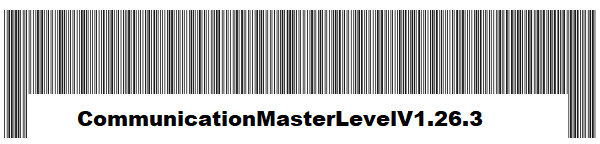

# 🛰️ Welcome!👉🏻 [(Magyarul)📜](https://github.com/Fizikova-Csindra/H45/blob/main/README.hu.md)

This repository hosts educational materials and research & development projects—at the master level—focused on **Communication (Telecommunications) [H]**, as part of the official open-source initiatives of the **Csindra Foundation**. Our goal is to advance communication:
- between humans,
- between humans and machines,
- and between machines.
Developments are best implemented when the background is understood. The Department of Electrical Engineering at the University of Debrecen and the Csindra Foundation have undertaken the task of creating comprehensive documentation on the history of telecommunications, covering technical progress over the last 150 years. The resulting documents are encyclopedic in nature and are intended for university students. They can be accessed via the links below.
---

  <a href="H45.wired.md" target="_blank">☎ Wired telecommunication</a>  
  <a href="H45.wired_DE-V2.26.4.pdf" download>Download (PDF)</a>

_____

  <a href="H45.mobile.md" target="_blank">📱 Mobile telecommunication</a>  
  <a href="H45.mobile_DE-V2.26.3.pdf" download>Download (PDF)</a>

___

## ✨ How Can You Contribute?

Our community is open to all developers, educators, and researchers. You can help in the following ways:
1. **Bug reports and ideas**: Open an "Issue" if you find a bug or have a new idea.
2. **Code and documentation**: Submit fixes or expand upon existing educational materials (via a Pull Request).
3. **Testing**: Test the code and procedures on actual hardware.
4. **Support**: Assist other members in resolving any issues they encounter.

We reward our most active contributors with public recognition, certificates, and medals aligned with the Foundation’s core values ​​(**BATKA, TALENTUM, KARÁT**)!

---

## 🔒 Safety and Ethics
Please ensure that you always adhere to the Foundation’s data protection policy and code of ethics while collaborating. Detailed licensing terms for each project can be found within the respective repositories.

  <a href="https://fizikova-csindra.github.io/ADATVEDELEM.en.html" target="_blank">Data Protection</a>

  <a href="https://fizikova-csindra.github.io/ETHICS.en.html" target="_blank">ETHICS</a>

  <a href="https://fizikova-csindra.github.io/LICENCE.en.html" target="_blank">LICENCE</a>

|  | **Csindra Alapítvány** V1.26.3   [web.csindra.hu](https://web.csindra.hu)   [GitHub: Csindra-H45](https://github.com/Fizikova-Csindra/H45) |  |
| :-----------------: | :-------------------------------------------------------------------------------------------------------------------------------------------------: | -------------------- |
