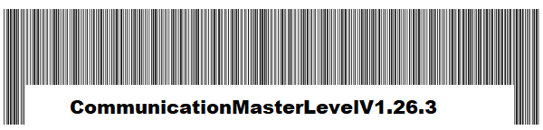

# 🛰️ Üdvözlünk !  👉🏻 [(English version)📜](https://github.com/Fizikova-Csindra/H45/blob/main/README.en.md)

Ez az adattár a **Csindra Alapítvány** hivatalos nyílt forráskódú projektjei közül a **Kommunikáció(Híradás)[H] mester szintű [H45]**, oktatási anyagainak és kutatási fejlesztéseinek ad otthont. Célunk a kommunikáció fejlesztése
  
- ember-ember  
- ember-gép  
- gép-gép  

között.

A fejlesztések úgy valósíthatóak meg jól, ha ismerjük az előzményeket. A Debreceni Egyetem Villamosmérnöki Tanszéke és a csindra Alapítvány arra vállalkozott, hogy egy átfogó távközléstörténeti dokumentációt készít az utóbbi 150 év technikai fejlődéséről. A kész dokumentumok lexikális jellegűek és egyetemi hallgatók számára készültek. A dokumentumok az alábbi linkeken nyílnak meg.

---

  <a href="H45.vezetekes.md" target="_blank">☎ Vezetékes távközlés</a>  
  <a href="H45.Vezetékes_DE_V2.26.3.pdf" download>A dokumentum letöltése (PDF)</a>

_____

  <a href="H45.mobil.md" target="_blank">📱 Mobil távközlés</a>  
  <a href="H45.mobil_DE-V2.26.3.pdf" download>A dokumentum letöltése (PDF)</a>

_______________
## ✨ Hogyan Járulhatsz Hozzá?

Közösségünk nyitott minden fejlesztő, oktató és kutató előtt. Az alábbi módokon segíthetsz:
1. **Hibajelentések és ötletek**: Nyiss egy „Issue”-t, ha hibát találsz vagy új ötleted van.
2. **Kód és dokumentáció**: Küldj be javításokat, egészítsd ki a meglévő tananyagokat (Pull Request).
3. **Tesztelés**: Teszteld a megírt kódokat és eljárásokat valós hardvereken.
4. **Támogatás**: Segíts más tagoknak a felmerülő problémák megoldásában.

A legaktívabb közreműködőket nyilvános elismerésben, oklevélben és az Alapítvány értékrendje szerinti érmekkel (**BATKA, TALENTUM, KARÁT**) jutalmazzuk!

---

## 🔒 Biztonság és Etika
Kérjük, hogy a közös munka során mindig tartsd be az Alapítvány adatvédelmi szabályzatát és etikai kódexét. A projektek részletes licencfeltételeit az adott repository-kban találod meg.

  <a href="https://fizikova-csindra.github.io/ADATVEDELEM.hu.html" target="_blank">ADATVÉDELEM</a>

  <a href="https://fizikova-csindra.github.io/ETIKA.hu.html" target="_blank">ETIKA</a>

  <a href="https://fizikova-csindra.github.io/LICENCE.hu.html" target="_blank">LICENSZ</a>

|           Távközléstörténet           |             ____________________             |       V2.26.3        |
| :-----------------------------------: | :------------------------------------------: | :------------------: |
|  |  **Távközléstörténet 2026 V2.26.3** |  |

